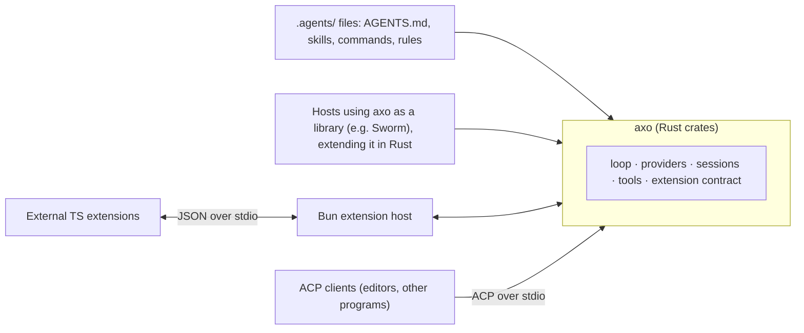

# axo design

This document records the decisions made so far, the intended architecture, and the questions still open. The background research is in [`research/`](research/README.md).

## Approach: a spiritual port of pi

axo's core follows pi rather than reinventing it. That covers the agent loop, the message and event data model, sessions and compaction, context assembly, and the built-in tools. Where pi already has a good answer, axo ports the idea into idiomatic Rust: the same concepts, not a line-by-line translation.

axo deliberately differs where pi keeps things minimal: extensions, subagents and agent-to-agent protocols. Those are designed later, on top of the ported core.

**The focus is embedding in Rust.** The binary is a convenience for other programs, kept as cheap as possible. axo is unlikely to have outside users for a long time, so effort goes into the library.

## Goals

1. **Own the core.** Keep the agent loop, sessions and tool contracts small enough to understand completely. Use libraries for the plumbing, not for the core.
2. **Stay headless and host-agnostic.** axo is a Rust library first; that is where the effort goes. A small binary speaks ACP for everything else. No terminal UI, and no knowledge of any particular host.
3. **Make extending it as easy as in pi.** A third-party developer can write a TypeScript extension, drop it in a directory, and have it work.
4. **Stay light.** Many sessions run in one process. Memory per session matters.
5. **Be more capable than pi's core** in the places every feature depends on:
   - child sessions, which make subagents cheap;
   - resolution of `scheme://` URLs, so tools such as `read` and `grep` work on more than plain files.

## Non-goals

- **No approval system.** axo never asks the user for permission. See [No approvals](#no-approvals).
- **No terminal UI** in the core.
- **No compatibility with other harnesses' session files** for now. axo reads and writes only its own format.

## Architecture



### Core responsibilities

| Area | What the core owns |
|---|---|
| Agent loop | Send messages, stream the response, run tool calls, repeat. Supports steering and follow-up messages, abort, and per-turn events. |
| Providers | Streaming, thinking/reasoning, prompt caching, usage and cost, behind a provider trait. Extensions can register providers. |
| Sessions | Storage behind a trait. The default is a JSONL entry tree with stable ids, parent ids, timestamps, model and usage per message. Supports branching, forking and compaction. |
| Child sessions | One session can start another in the same process and receive its result. This is the foundation for subagents and roles. |
| Tools | The tool trait and the built-in tools: `read`, `edit` (exact replace with a stale-file guard), `write`, `bash`, `grep`, `find`. |
| URL resolution | A scheme registry that `read`, `grep` and other tools consult, so extensions can add schemes (`pr://`, `agent://`, …) without changing any tool. |
| Extension events | Points in sessions, turns, the context, the system prompt and tool calls where extensions and Rust hosts can react or intervene. There are no standalone hook scripts; extensions are the one way to customize behavior. |
| Events | One typed event stream per session, consumed by library hosts, the ACP adapter and the extension host alike. |

Everything else is an extension: roles, plan mode, `orchestrate`, GitHub, the browser, memory, eval, and so on.

### Crates

The core follows pi's layers: `axo-ai`, `axo-agent`, `axo` (the library hosts use) and `axo-acp` (the binary). See [`core.md`](core.md#layers). The extension host gets its own crate when the extension contract is designed.

### The headless binary speaks ACP

The binary uses the [Agent Client Protocol](https://agentclientprotocol.com) and nothing else; axo invents no RPC protocol of its own.

- **Why:** a custom protocol would mean wiring every axo feature to the wire anyway. ACP is a standard that existing clients already speak. And real integrations embed the Rust library instead.
- **Gaps:** axo features that ACP cannot express are added as `_axo/*` extension methods, and only when something actually needs them.

## Ways to extend axo

There are three layers. All of them register into the same extension contract.

### 1. Declarative files: the `.agents/` convention

axo follows the `.agents/` convention that other harnesses already read, so the same files work across tools. omp, for example, loads:
- `AGENTS.md`, plus `.agents/AGENTS.md`;
- `.agents/skills/`;
- `.agents/commands/*.md`;
- `.agents/rules/*.{md,mdc}`.

It reads both the project (walking up to the repository root) and the user's `~/.agents/`. Role and agent definitions should also live here as data, not code.

The exact set axo supports is decided when the loader is built. The rule is to adopt existing conventions, not invent new ones.

### 2. Rust, as a library

A host embeds axo and registers its own tools, event handlers, providers and URL schemes directly in Rust. This is how Sworm extends axo. First-party features such as subagents and roles can ship this way too.

### 3. External TypeScript extensions, run in a Bun extension host

Third-party extensions are written in TypeScript against a typed SDK. They should be as simple to write as pi extensions:

```ts
import { defineExtension } from "@axo/sdk";

export default defineExtension((axo) => {
  axo.registerTool({
    name: "hello",
    description: "Say hello",
    parameters: { name: "string" },
    run: async ({ name }) => `hello ${name}`,
  });

  axo.on("tool_call", async (call) => {
    if (call.name === "bash" && call.args.command.includes("rm -rf /")) {
      return { block: true, reason: "refused" };
    }
  });
});
```

**How it runs:**
- **One process.** When at least one extension is present, axo starts a single Bun process and loads every extension into it, the way VS Code runs one extension host. With no extensions, no process starts.
- **A bridge, not a shared runtime.** axo and the host exchange JSON messages over stdio, with calls in both directions: axo calls extension event handlers and tools, and extensions call back into axo (run commands, read the session, start a child session). The SDK hides the bridge, the way Tauri's typed `invoke` hides its IPC.
- **Generated types.** The SDK's TypeScript types are generated from the Rust contract (with `ts-rs` or `specta`), so the two sides cannot drift apart.

**Why Bun over an embedded engine** (V8 through `deno_core`, or QuickJS):
- **Capable extensions.** They get the full Bun/npm runtime: `fetch`, a filesystem, processes, crypto and local HTTP servers. OAuth provider extensions need all of these.
- **Less for us to build.** An embedded engine would require building and maintaining every API that extensions need.
- **Crash isolation.** A crashing extension kills the host process, not axo; axo restarts it.
- **No cost when unused.** The axo binary stays small, and nothing extra runs when there are no extensions.

**What we give up:** users who want extensions must install Bun, and Bun has no permission sandbox.

**A way back.** Extensions only see the SDK, so axo could move to an embedded engine later without changing any extension.

**Not supported:** loading native dynamic libraries (`.so`) as plugins. Rust has no stable ABI, a panic cannot safely cross the boundary, and a buggy plugin takes the whole process down.

### MCP

MCP servers plug in as an adapter that provides tools. MCP carries tools, resources and prompts. It has no hooks, commands or session state, so it complements the extension system rather than replacing it.

## Providers and OAuth

- **Built-in providers.** The core ships the API formats that matter (Anthropic Messages, OpenAI Chat Completions and Responses), including OpenAI-compatible local servers such as llama.cpp and Qwen.
- **One built-in login: OpenAI Codex** (ChatGPT subscription). Every other provider uses an API key. Further subscription logins come later, built in or from extensions.
- **Extensions can register providers**, including providers with unofficial OAuth logins (pi already supports this with `pi.registerProvider()`).
- **The split for extension OAuth providers:**
  - The extension owns authentication: login, the browser redirect, the local callback server, token refresh, and which headers and base URL to use.
  - The Rust core owns streaming for any API format it already speaks, so tokens never travel through the bridge.
  - Only a provider with an entirely custom API format streams through the extension.
- **Provider layer: a port of pi-ai.** axo's message model is pi's, so porting pi-ai's adapters avoids a conversion layer between our types and a library's. [genai](https://github.com/jeremychone/rust-genai) was considered and not adopted. Details: [`core.md`](core.md#providers-axo-ai).

## No approvals

axo never prompts for permission, just like pi. Approval systems are a long tail of edge cases and UX, and none of that belongs in the core.

What the core does keep is an ordinary `tool_call` event whose handler may return `{ block, reason }`. That is general extension machinery, not an approval system. It lets a host or extension enforce a rule, and anyone who wants approvals can build them on top. axo itself never asks.

## Reuse from omp

omp is MIT-licensed. Its Rust crates (`pi-shell`, `pi-walker`, `pi-diff`, `pi-vcs`) are references, and possible dependencies where one clearly saves work. None is on crates.io, so each would be a git dependency or copied in. Its hashline editor (`pi-edit`) was evaluated and not adopted; see [`research/pi-edit.md`](research/pi-edit.md).

omp's TypeScript features (subagents and roles, plan mode, URL schemes, GitHub, the browser, memory, eval) serve as references to rewrite as axo extensions, keeping their license notices. [`research/`](research/README.md#porting-omp-features-onto-pi) has size estimates for each.

## Open questions

1. **Extension contract.** Exactly what an extension can register (tools, event handlers, commands, providers, URL schemes, session entries, child sessions), which events exist, and their order and semantics. This is the main design work and needs its own discussion.
2. **Extension directories.** Proposed: `~/.axo/extensions/` for your own, and `<project>/.axo/extensions/` for a repository's. Not `.agents/`, because the format is axo-specific. Project extensions run code from the repository, so they are what the project trust gate will guard.
3. **Name of the TypeScript SDK package.**

## Build order

The core is built in milestones M1–M6, as real code meant to be kept: clean types, clear seams, no shortcuts. It can still be reworked when the design learns something. See [`core.md`](core.md#build-order).
