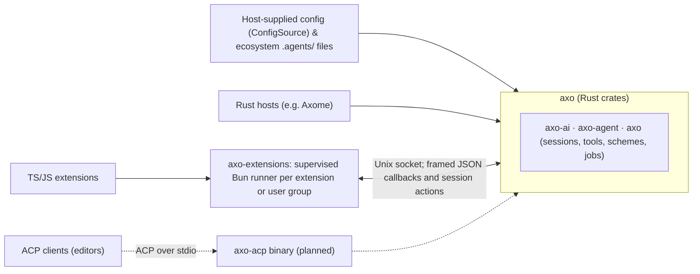

# axo design: goals & architecture

This document holds axo's goals, non-goals, architecture, and settled core decisions. It changes only when goals or core decisions change.

- **Implemented reference:** [`crates/axo/docs/README.md`](../crates/axo/docs/README.md) documents the live APIs, configuration, prompt assembly, session format, schemes, supervision, and compaction rules as built.
- **Active planning:** [`plan.md`](plan.md) holds unbuilt work, design discussions in flight (codemode, MCP and `ast_edit`, ACP), and open questions.
- **Background studies:** [`pi/`](pi/README.md) (source notes on pi v1.3.0) and [`research/`](research/README.md) (comparative studies and measurements).

## Approach: a spiritual port of pi

axo's core follows pi v1.3.0 rather than reinventing it: the agent loop, the message and event data model, sessions and compaction, context assembly, and the built-in tools. Where pi already has a good answer, axo ports the idea into idiomatic Rust: the same concepts, not a line-by-line translation.

axo deliberately goes beyond pi where an embedded, always-on Rust library needs more:
- **Durability from the start** (crash recovery, run markers, replay policies, single-writer locks, and `attach` catch-up).
- **Scoped project access** (`ignore`, `read`, `trust`) instead of all-or-nothing project trust.
- **First-class Nix and direnv dev-shell capture** behind an `ExecEnv` seam.
- **Per-session URL schemes** (`artifact://`, `skill://`, `local://`, `axo://`, `proc://`, `agent://`, `tool://`, and host schemes) resolved by file tools and bash.
- **In-process subagents and teams** (`spawn`, `yield`, `send`, `kill`, `agent://`), built on child sessions that are job-registry rows, plus deferred tools (`call`, `tool://`) and cache-safe root session modes.
- **TS/JS extensions** for providers and session capabilities through supervised Bun (`axo-extensions`); sandboxed model-written scripts (codemode) are planned in [`plan.md`](plan.md).

**The focus is embedding in Rust.** Effort goes into the library; an optional ACP binary for external programs is deferred pending Track 6 (`plan.md`).

## Goals

1. **Own the core.** Keep the agent loop, sessions and tool contracts small enough to understand completely. Use libraries for plumbing, not for the core.
2. **Stay headless and host-agnostic.** axo is a Rust library first (an ACP binary for external programs is deferred; see Track 6 in [`plan.md`](plan.md)). No terminal UI, and no knowledge of any particular host (Axome is one host using axo as a library).
3. **Stay light.** Many sessions run in one process. Memory per session matters: the target is for three sessions in one process to stay well under three `pi --mode rpc` processes (160–209 MiB PSS; measured at ~92 MiB in [`research/README.md`](research/README.md#memory-measurements)).
4. **Survive restarts.** A host restart or crash mid-turn or mid-tool must not corrupt the session or silently drop a run.
5. **Make extending easy at every layer.** Declarative `.agents/` files, Rust traits for library hosts, an embedded JS sandbox for model-written scripts (codemode), and a Bun extension host for third-party TypeScript extensions.
6. **Be more capable than pi's core** in the places every feature depends on:
   - in-process child sessions, which make subagents cheap;
   - tools calling other tools through the normal hook pipeline;
   - resolution of `scheme://` URLs, so tools work on more than plain files.

## Non-goals

- **No approval system in the core.** axo never prompts for permission to run a tool. See [No approvals](#no-approvals).
- **No terminal UI** in the core.
- **No compatibility with other harnesses' session files.** axo reads and writes its own format (version 1).
- **Not ported from pi or omp:**
  - **Interface:** TUI, themes, HTML export, user `!` shell commands.
  - **Packaging and extras:** pi packages, telemetry, cache warming, image generation.
  - **Models:** virtual/classifier models, the provider zoo beyond the core wire families (subscription providers live outside axo), and pi's file migrations.
  - **omp's shell & edit machinery:** embedded brush shell and in-process coreutils, persistent shell state between calls, the command interceptor, PTY mode, and the `pi-edit` hashline editor.

## Architecture

### Layers and crates

| Crate | Ports | Owns |
|---|---|---|
| `axo-ai` | pi `packages/ai` | Message model, streaming events, `Accumulator`, the provider `Api` trait, Anthropic / Chat Completions / Responses / Gemini adapters, model registry and owned provider layers, auth, error classification, fixed transport retries, overflow detection, cost |
| `axo-agent` | pi `packages/agent` | The agent loop, `Tool` trait with `Replay`, `ToolHooks` host policy, `LoopHooks` driver contract, immutable `AgentEvent`s delivered only through `Persist`, steering and follow-up queues, cancellation with reasons |
| `axo-macros` | none | `#[expose]` proc macro for JSON dispatch and type metadata, used by `axo` and `axo-extensions` |
| `axo` | pi `coding-agent/src/core` | `Axo` and `Session`, JSONL session storage and projection, recovery and `attach`, compaction and `/shake`, context assembly, built-in tools, `ExecEnv`, command supervision, background jobs, URL schemes, config |
| `axo-extensions` | none | Static manifest discovery, ordered provider and session composition, session actions and journal events, placement lifecycle and the embedded TypeScript runner |

`axo-acp` (the optional binary speaking ACP over stdio) remains a planned separate crate, deferred pending a rethink of whether axo itself should ship it or leave it to a host (Track 6 in [`plan.md`](plan.md)).

Each existing crate depends only on the ones above it. Why three core crates with separate integration crates:
- **Enforced dependency direction.** `axo-agent` cannot see session files; `axo-ai` cannot see the loop. The loop stays testable with `ScriptedApi` and no disk; `axo-ai` stays usable alone for one-off model calls (titles, commit messages) without opening a session.
- **The binary stays out of the library.** Hosts that embed `axo` never compile ACP code.

`axo-ai` and `axo-agent` derive `specta::Type` unconditionally because `axo`'s extension surface registers their types; gate it behind a feature only if either crate gains a consumer that does not depend on `axo`.

Tools, context and config stay modules inside `axo`; the planned codemode script sandbox will too (see [Track 1](plan.md#track-1-codemode-and-script-extensions)). `axo-extensions` uses the public APIs of `axo`, `axo-agent`, `axo-ai` and `axo-macros`. Its runner source is embedded in the crate, and the type-only author SDK (`packages/axo-extension-sdk`, `@axo/extension-sdk`) lives in the same repository so shared API and binding changes land together.

Internal ownership follows those boundaries:
- `axo-ai/src/models/mod.rs` is the facade; `registry.rs` owns base/scoped overlays and provider resolution, `feeds.rs` owns refresh and discovery, `build.rs` constructs the loaded catalog, and `stream.rs` dispatches model streams. Credential provenance belongs to `auth`.
- `axo/src/session/mod.rs` keeps the session handle, shared state, and journal-facing core. `events.rs`, `registrations.rs`, `run.rs`, `start.rs`, and `fork.rs` own their respective lifecycles; `selection.rs` owns live model, thinking, and tier selection.
- `axo-extensions` exposes root `Extensions` and `ExtensionScope` handles over one `ExtensionSet` API. `reconcile.rs` owns composition transitions, `deps.rs` owns authored dependency installation, and the session registry holds attachments while placements use a weak dispatch handle.

## Settled core decisions

Full operational details live in [`crates/axo/docs/`](../crates/axo/docs/README.md); this section records the architectural rules and why they were chosen.

### Host contract (`axo`)

- **Embedder-first.** If the model can see it, the host can read it typed; if the model can do it, the host can do it through a typed method; if the UI shows it live, the session file can rebuild it.
- **One ordered event stream per session.** A single broadcast delivers events in total order. `Session::attach` takes its snapshot and subscription under the journal publication, live, mode, job-registry and tree-usage locks, so every event falls before or after the snapshot. State-valued events (`Job`, `Context`, `AutoPaused`, `TreeUsage`) may repeat what the snapshot already holds but are never missed; hosts resync with `attach` if their receiver lags.
- **Durable means reconstructable.** The session file records the facts needed to rebuild host-visible durable state, not just model-facing descriptions of it. Jobs and usage are derived views over entries, usable on closed sessions; live-only facts such as residency, progress, executing child tools and unread mail counts are absent there, and an unfinished command reads as running until reconciliation records otherwise. Whole-tree usage sums each session's own journal (`Entry::usage()`, maintenance included) with every descendant's, rather than trusting run rollups.
- **Deliberate boundaries.** Model-facing text stays rendered text over typed state, not a replacement for it. Streaming deltas are live-only; the durable completed messages reconstruct the transcript, not every transient frame. No unjournaled transcript injection: hosts use durable `Session::post` messages or transcript-recorded section changes rather than a host `prepare_request` hook. A registered provider's `RequestRewrite` is a provider-wire seam: it reshapes the request the adapter built from the journaled transcript, is installed by the host that owns it, and is not recorded.
- **Explicit observation boundaries.** `Activity` events and attach snapshots expose run/maintenance/navigation ownership, but idle never reserves the session. Selected and effective modes are separate. Prompt inspection distinguishes the latest local build from recorded projected sections, not a provider-wire receipt; context-file inventories and ledger hashes do no disk refresh. Typed edited acceptance validates the pending schema and preserves original and accepted values. Coordination actions share typed receipts and routed-submission provenance; retained command output keeps raw merged bytes plus stdout/stderr sidecars in capture order.

### Data model and providers (`axo-ai`)

- **The system prompt and tool set live in the transcript as `SystemMessage`s.** The first system message carries named sections; later ones patch sections or tools. Replaying the transcript reconstructs the exact prompt and tool set at any point, keeping resume, branching, and compaction consistent and the prompt prefix cache-stable.
- **Typed `ReasoningReplay` and byte-stable tool arguments.** Rather than overloading a single string field as pi does, provider-specific reasoning replay data (`AnthropicSignature`, `AnthropicRedacted`, `OpenAiReasoningItem`, `ReasoningField`, `ReasoningDetails`) is a typed enum ([`research/message-models.md`](research/message-models.md)). `serde_json` uses `preserve_order` so tool-call arguments replay byte-for-byte without breaking prompt caches.
- **Delta-only streaming events.** Only `Start` and terminal `Done`/`Error` carry a full `AssistantMessage`; mid-stream events carry `{ content_index, delta }`, and a shared `Accumulator` rebuilds the partial message. That avoids a full-message clone per token in Rust. Streams never fail with `Err`; failures end with `AssistantEvent::Error` preserving partial content.
- **Ported adapters over `reqwest` + SSE.** Anthropic Messages, OpenAI Chat Completions (including llama.cpp/Qwen), OpenAI Responses, and Google Gemini `generateContent`. Subscription providers (ChatGPT Codex, Claude subscription) live outside axo and reach these adapters through `ProviderTransport`, `ProviderModels` and `compat.toolNamePrefix`, and report account limits through `ProviderUsage` (fetched on demand at most every five minutes, plus limits read off every response's headers). `ProviderLogin` supplies a `Credential` on login or refresh; axo resolves `ModelAuth { api_key, headers, base_url }` for the adapter.
- **Catalog and price-tier windows.** Model metadata is data, not code: it comes from the `models.dev` v2 feed and from runtime providers' own lists (`ProviderModels`, both cached under the `ModelsOptions::cache_dir` the host chooses; `None` runs without the catalog), overridden by the host's `ModelsConfig`. axo maps feed fields to `Model` and keeps no per-model-ID rules (only a short denylist of SDK packages whose entries are not the wire they name, or need auth axo lacks); a wrong value is fixed by a host override or upstream. `Models` refreshes both on a timer and on `Models::refresh`, keeping the last good data on failure, and open sessions adopt a changed registry definition at their next request, so only a new wire protocol, transport or auth flow needs an axo release. Standard context windows stop below higher-priced extended-context tiers unless the host sets `ModelsOptions::extended_context` or an explicit window is configured.
- **Service tiers separate choice from billing.** The session records the chosen tier; requests use it only when the model supports it, and assistant messages record the served tier for pricing. Carrying a tier across models or into children is opt-in. See [Model selectors](../crates/axo/docs/configuration.md#model-selectors).
- **Cross-model replay (`transform_messages`).** Pure function that drops foreign-model thinking from outgoing requests (keeping it in the session file), omits failed/aborted assistant turns, normalizes tool-call IDs, and synthesizes `"No result provided"` for orphaned calls.

### Agent loop (`axo-agent`)

- **Parallel execution, sequential preparation.** Tool calls prepare and run `ToolHooks::before_tool_call` sequentially in source order; an `ExecutionMode::Sequential` call is a barrier (earlier calls finish first, later calls wait for it) and consecutive parallel calls between barriers run concurrently, so a batched `read` then `edit` of one file runs in the order the model issued them; only tools control execution mode. `ToolExecutionEnd` emits in completion order and reports failure through `result.is_error`; tool-result messages append in call order.
- **Tools run on their own tasks.** Each prepared call is spawned; the loop awaits only their completion, so a tool waiting on state `Persist` holds can never stall the loop. Stop and shutdown cancel calls cooperatively and abort only calls still running after a 3 s grace; a batch starts executing only after all its calls are prepared.
- **Truncated responses never execute tools.** When an assistant message stops with `StopReason::Length`, every tool call in it receives a synthetic error result without running.
- **Nested calls are agent-owned, outside the batch.** Tools can call other tools through `ToolContext::calls` with the same routing, validation, and hooks. Each root call owns a one-level call family with a separate cancellation token and execution gate. Nested calls emit execution events, not transcript messages, and can outlive the root's return.
- **One agent sink; session-owned live delivery.** `Persist::persist(&AgentEvent)` is the agent's only awaited event sink and cannot rewrite events. The loop delivers events in order; nested calls can deliver concurrently, keeping their own start, update, and end order. `Session` saves each message on `MessageEnd` before the next request, owns live run state, and relays events over its bounded broadcast channel. Hosts, UIs, and ACP resync through `session.attach` if they lag, so a slow client never stalls the loop. `LiveSnapshot` exposes `running`, `streaming`, `pending_tool_calls`, and `queued` (steers and follow-ups with their submission ids) directly; the agent exposes queue ids through `Agent::queued_ids()`, not a second snapshot or broadcast API, and hosts track the queue from `submission`, `message`, and `submission_withdrawn` entries.
- **Cancellation reasons.** `CancelReason::User` keeps the partial assistant message and writes synthetic aborted results for unanswered calls. `CancelReason::Shutdown` (`Session::shutdown` or drop) writes nothing as aborted; the run stays open in the log and recovers on reopen.
- **Per-call tool context and message provenance.** `Tool::execute` receives a `ToolContext` (call, cancellation, updates, a `SteerSignal` that is pending while steering input is queued and not yet drained, and a `ToolInvocationId`). Queues hold `QueuedMessage`s with their submission ids, and `AgentEvent::MessageEnd` carries a `MessageOrigin` (`Run`, `Input(id)`, or `Tool(invocation)`), so persistence binds results and submissions by identity instead of message equality. The loop stays generic: it knows nothing about jobs.
- **Separate host policy from the loop driver.** Hosts supply an ordered `SessionOptions::host.tool_policies` list of `ToolPolicy` implementations inherited by forks and children. Each receives a `ToolScope` containing session identity, depth, persona or child spec, the effective mode, the effective `BashAccess`, and the effective write scope. The child's turn budget and mode gate run before host policies; the first before-call block or error stops execution, while after-call overrides fold in order and errors are logged and skipped. `ToolHooks` remains the generic agent-layer contract; `Session` implements `LoopHooks` for request preparation, message lowering, turn completion, and queued delivery, not as a session-pluggable policy seam.
- **Single-owner selection and rollback.** `Agent::set_selection` changes model, thinking and tier together. Queue withdrawal returns an opaque `RemovedQueued` token retaining its source queue and restoration position; callers do not reconstruct queue identity.

### Durable sessions, compaction, and retry (`axo`)

- **The session tree is the source of truth.** Append-only JSONL (`FORMAT_VERSION = 1`) with an OS file lock (`File::try_lock`) enforcing one writer per session ([`research/durable.md`](research/durable.md)). `project(entries, leaf)` resolves `context_edit`s across the full root-to-leaf path before applying the latest compaction checkpoint, borrowing from the log.
- **One journal task owns the session file.** Every append goes through it as an ordered batch whose ids and parents it assigns; readers take immutable snapshots that never wait on a write. Live run state, the model selection and session ownership live outside it in locks never held across an await, so no loop poll path can queue behind disk I/O. Durability order lives in the data: a job's `job_start` is written in the same batch as the tool result that admits it, and its `job_end` follows the admission decision. Maintenance prepares from a snapshot and commits only at the revision it read.
- **One submission sender and one revival path.** `Entry::Submission` records sender identity only in typed `provenance`. Parked-child lookup and reconciliation both pass through the session table's per-child revival gate; a failed revival leaves its seed available for another attempt.
- **Crash recovery and `Replay`.** `run_start` and `run_end` bracket every run; prompts, steers, and follow-ups are persisted as `submission` entries (with optional `request_id` deduplication) before queuing. On reopen, unfinished tool calls with `Replay::Safe` (`read`, `grep`, `find`, `ask`, `wait`, `spawn`, child `yield`, `enter_mode`, reviewed mode `yield`, and `write` to a plain path or `local://`) re-run under `RecoveryPolicy::Resume`; `Replay::Never` (`bash`, `edit`, `kill`, `send`, unreviewed mode `yield`, `write` to a scheme whose `write_replay` is `Never`, and host tools keeping the default `Tool::replay`) get an interrupted error result pointing to any spooled output. Recovery routes `call` envelopes before choosing replay policy; interrupted results, spooled-output lookup, and admission of already-started children use the resolved inner identity. After 5 consecutive resumes with no progress, the run parks as `Interrupted`.
- **Compaction and `/shake`.** Recoverable clearing writes elided tool outputs, images, and thinking blocks to `<session>/artifacts/<n>.shake.*` files, referenced as `artifact://<n>`, and replaces them via `Entry::ContextEdit` ([`research/compaction.md`](research/compaction.md), [`research/compaction-methods.md`](research/compaction-methods.md)). Elision, recoverable clearing and `/shake` preserve mode and tool-catalog notices. Automatic maintenance picks one action per pass (recoverable clearing when it reaches headroom, otherwise a live or separate model summary checkpoint), carries over recent whole user messages, and protects active skills. Clearing has its own threshold at 75% of the window, below the summary trigger: between the two it runs alone and never escalates to a summary. It also runs below that threshold when an Anthropic prompt cache is already cold, the prompt is at least 150k tokens and at least 20k tokens can go. Its protect window and headroom derive from the trigger, and it also stubs the large string arguments of aged `edit`/`write` calls and images in aged tool results.
- **Prompt-cache policy is axo's default, not host code.** Anthropic requests carry one cache lifetime on every breakpoint (`cacheTtl`: roots default to 1h on unpriced first-party routes and 5m otherwise, children to 5m). A 5m cache is kept warm through pauses by a zero-token request behind a price gate (`cacheWarming`), journaled as `usage` entries with kind `cache_warm` and never a turn. One-shot summary requests carry no breakpoint. OpenAI Responses rows that accept mid-conversation system messages send the prompt as a leading `developer` item, so prompt updates append instead of rewriting the prefix.
- **File tools prove freshness the cheapest way.** `edit` needs no earlier read: every `oldText` must match the current file exactly once. `write` over an existing file keeps the ledger check. `bash` is never blocked by default; the public `classify_bash` backs the opt-in `bash.blockToolViews` setting and attaches nested context files for the files a bash command views.
- **Bounded retry and one-shot overflow recovery.** Overflow is classified before transient errors. Overflow hides the failed turn and runs recoverable clearing followed by a separate-request compaction pass. Transient provider errors hide the failed turn and retry under axo's `Settings.retry` policy, shared with summary requests: defaults are 3 retries with exponential backoff (2/4/8 s or a server delay hint ≤ 60 s), and zero retries disables them. Hints above `retry.maxDelayMs` or unrepresentable backoffs stop retries. axo-ai owns classification and a separate fixed 2-retry pre-body transport layer; a server hint above its 60 s transport limit is returned for turn-level policy, not reclassified. A context-overflow signal on a silent stop keeps the response and runs automatic compaction instead of retrying. Submissions store typed prompt parts (`PromptInput`, `PromptPart`) so hosts can redraw chips and forks can return them as `Fork::editable` for resubmission.

### Configuration ownership (`axo`)

- **axo owns configuration formats and semantics; hosts own names, locations and acquisition through `ConfigSource`; axo has no configuration directory.** axo defines the settings schema, prompt-override names (`PROMPT_NAMES`), validation, merge, trust filtering and value resolution in one evaluator (`EffectiveConfig::resolve`). The host implements `ConfigSource` (`user()` returning `UserConfig`: a `ConfigLayer` plus context files; `project(cwd)` returning a `ConfigLayer`) and decides whether layers come from files, a database, or code. Skill roots belong to each layer: allowed project roots precede user roots, after implicit project `.agents/skills`. Project skill roots require `Read` or `Trust` and the user's skills gate; acquiring the project layer also requires its config gate. `Axo::builder(models, store)` performs no configuration I/O; models, credentials and the session store are host-constructed values.
- **Sampling and trust.** Each [configuration lookup](../crates/axo/docs/configuration.md#lifecycle) samples the user layer once and computes project access from that same sample. `project(cwd)` is called only at `read` or `trust`; one-off model completions use only the user layer, and a fork inherits its parent's resolved config. Hosts are trusted integration code; project layers are untrusted data, validated before filtering, with user-only keys stripped. After merging, `EffectiveConfig::resolve` forces `bash.devShell` off below `trust`, warning once with the winning origin even for a user setting. Config values expand environment variables only; leading `!` values are rejected, never executed or cached. I/O a host performs before handing axo a layer is outside axo's guarantee.
- **Host-selected caches.** Catalog and Nix dev-shell caches and the materialized `axo://` docs live wherever the host points `ModelsOptions::cache_dir` / `AxoBuilder::cache_dir`. Without `AxoBuilder::cache_dir`, there is no `docs` section or `axo://` scheme, and `bash.devShell: "nix"` falls back to the host environment with a warning.
- **axo bundles no agent and no role names (decided 2026-11-07; see [`research/subagents.md`](research/subagents.md)).** Every running agent, root session or child, is an agent definition a host, user or project supplied: one markdown format (`AgentSpec`) for both, loaded from host-supplied `agent_roots` or passed in code, never from a directory axo chooses. Settings are the defaults for every agent; a definition states one agent's deviations. The model alias table (`modelRoles`) is empty until a host fills it; axo resolves names and defines no meaning for any.

### Agents and child sessions (`axo`)

- **Children are continuable sessions in the job registry.** Each child gets one persistent `agent_N` row in the parent's `JobRegistry` across all its runs (`child_start`, multi-message `job_end`), with async-only spawn (`Session::spawn`, `Session::spawn_team`, and the model's `spawn` tool). A child session runs with its own transcript and file; the registry row is the delivery and observation contract, not the child's lifetime.
- **Narrow inline specs; one format for root and children.** Agent definitions (`AgentSpec`: YAML frontmatter + prompt body) come from host-supplied `agent_roots` or code; axo bundles no personas. The root session is an agent the host designates. Inline specs in `spawn` supply a prompt and optional output schema and can only restrict tools and model; depth, concurrency, environment, and host hooks are inherited.
- **Persona versus mode.** A persona is the root session's agent definition: chosen at chat start, persisted with the session, and switchable through `Session::set_agent`. A mode is a separate, cache-safe instruction overlay with journal-derived selection and call-time limits; see [Session modes](#session-modes-axo).
- **Explicit agent placement.** Agent frontmatter declares `runAs: root | subagent | any`, default `any`. Root selection rejects subagent-only definitions; spawning and team membership reject root-only definitions.
- **Personas persist by name.** Reopening re-resolves the recorded persona name in the current catalog, so edits to the definition apply. A missing or now subagent-only persona produces a diagnostic and runs with no persona. `Session::set_agent` applies the new persona's model selector when it declares one; otherwise it keeps the current model.
- **Persona switches are cache-heavy.** Arbitrary mid-session tool changes preserve the prefix only when `Model::tool_support()` reports `TranscriptToolSupport::Changes`; `Additions` permits promotion but not arbitrary replacement, and `None` does not preserve tool-list changes. System-message support also varies by provider. `set_agent` may run mid-run and takes effect at the next model request; a host wanting an idle-only switch waits for idle itself. Frequently toggled instructions belong in `Session::post` messages or modes, not persona changes.
- **`SpawnHook` policy surface.** axo has no approval prompts; creation decisions pass through `SpawnHook` (`Allow`, `Block`, `Replace`), inherited by children, with requester and team identity in `SpawnContext`.
- **User-only budgets.** Governed by `subagents`: `maxDepth` (default 1), `maxConcurrent` (default 8 FIFO run slots shared across root descendants and live forks), and `maxTurns` (default 50 requests per child run before wrap-up blocking). No wall-clock timeout. Idle children park; `Axo::session(id)` revives them.
- **Children open through their root.** `Axo::open_session` rejects a child file with `Error::ChildSession { root }`; hosts open and keep that root (dropping it detaches its children), then reach the child with `Axo::session(id)`. Read-only inspection uses `open_session_read` and `project`. There is no combined child handle, because it would contend with the root's single-writer lock.
- **Schema-validated `yield`.** Children with an `output` schema receive a `yield` tool; non-object schemas wrap as `{result}`. Three rejected validations or answering without yielding after a nudge fails the run. Result extraction matches the successful result by call id and decodes either direct `yield` arguments or the inner arguments of `call {tool: "yield", args}`.
- **Team-scoped messaging and mail.** `send` messages a child by `agent_N`, a teammate by roster name, or `parent`; only the caller's children can be steered. Sibling messaging is permitted only within a team roster (durable mail in the receiver's journal, read at turn boundaries or `wait`). Mutual waits among waiting members without pending work fail with an explanatory error, so deadlock is never a lasting state. Team state has no type of its own: hosts group child rows by `TeamRef::id` and read live executing tools and `unread_mail` from each row. `agent://` is read-only.
- **Per-host identity.** Defaults to `axo`; `AxoBuilder::name` configures the docs scheme, section text, and bundled prompt self-references.

### Session modes (`axo`)

- **Root-only definitions, no bundled modes.** Hosts supply markdown roots or programmatic `ModeSpec` definitions; `ModeSpec::parse` turns host-bundled markdown into the latter, so user and project files of the same name override it. Names are `:`-namespaced and, without frontmatter `name`, derived from the path below the root (`plan/roadmap.md` is `plan:roadmap`). The body holds instructions; frontmatter supplies description, `argument-hint`, `disable-model-invocation`, optional model selection, tool allow/deny limits, `bash` access, optional result schema/review/continuation, and extra host-policy metadata. Children cannot select modes.
- **Journal-derived selection.** `Session::set_mode` records `Entry::ModeChange`; `Projection::mode` at the current leaf is authoritative. Navigate restores the branch's mode; forks and reopen derive it from entries and resolve its name against the current catalog. A missing definition produces a diagnostic and runs without it. Persona, model, thinking, and tier selections instead follow the live selection on navigate, except that crossing into or out of a mode switches the model as entering or leaving it would.
- **One request boundary for effectiveness.** Selection is recorded immediately and exposed by `Session::mode`, `SessionEvent::Mode`, and `LiveSnapshot::mode`; instructions, tool limits and tool installation become effective together at the next run start or turn boundary. Policy scopes and the model's `spawn` report the effective mode, not a pending selection; host spawns apply the selected mode.
- **Reconciled notices, not queued reminders.** Before each provider request, the session compares the projected announcements with the effective mode and deferred catalog, appending only missing durable custom messages. Catalog state folds `details.added` and `details.removed` from every surviving `tool_catalog` notice in transcript order, rather than treating the latest delta as a snapshot. Entry, exit, compaction, navigation and reopen share this path; reminders are not repeated every request. Comparison is by name, so edited instructions reappear on the next entry or after compaction. Mode instructions and limits do not rewrite the system prompt or declared tool list.
- **Call-time limits and descendant ceilings.** A mode's allowlist, when present, and denylist gate the resolved tool identity before host policy; `yield` is exempt from the mode gate. A child spawned under a mode persists its limits as `SpawnLink::limits`, a ceiling every descendant inherits; it filters the child's shaped tools after the persona allowlist and also removes `kill` and `send`, so leaving the parent's mode never relaxes them. The parent's effective bash access and write scope persist the same way as `SpawnLink::bash` and `SpawnLink::writes`. Children inherit limits, not the mode or its instructions.
- **Undo only the mode's own model change.** Entering may select a model, thinking level, and service tier, journaling the previous selection for restoration. Leaving or switching modes uses that base; an explicit model or thinking change clears restoration so exit preserves the user's choice. This optional model swap is the accepted cache break.
- **Commands are host-selected entry points.** Mode and registered commands use the [session command catalog and parser](#context-prompt-policy-and-project-access-axo). Running a mode command selects the mode and steers the supplied prompt; selection without a prompt does not start a run. A registered command runs its host `CommandHandler` alongside a turn.
- **Deferred model entry and completion.** Root sessions offer deferred `enter_mode` for invocable definitions, subject to persona tool selection and call-time policy; `disable-model-invocation` excludes a definition from model entry, not host commands. A mode with a result supplies deferred, schema-validated `yield`; non-object schemas wrap as `{result}`. Execution requires that yield's mode to be both selected and effective. Valid results end that mode unless host review is requested; invalid arguments leave it active. Mode completion has no child-output nudge or rejection-count failure.
- **Typed result review.** `SessionEvent::ModeResult` reports the value and `awaiting_review`; `LiveSnapshot::pending_results` contains `PendingResult` values awaiting review. `Session::accept_result` resolves the waiting yield, which ends its mode only if that same mode is still selected; completion cannot clear a replacement selection. `Session::revise_result` keeps it active with nonblank feedback; `Session::dismiss` aborts the run. A changed mode selection supersedes pending review, and `SessionEvent::ModeResultResolved` clears the pending item with a typed `ResultResolution`. The persisted `yield` result carries `details` `{mode, outcome, result}`, dismissed and superseded error results included, so the outcome survives reopen. Questions and mode reviews share registry machinery, not response contracts.
- **Continuation and recovery.** An acceptance message overrides `ModeResult::then`; without either, successful `yield` terminates the run. Reviewed mode yields use `Replay::Safe` and can ask again after interruption; unreviewed mode yields use `Replay::Never`. Selection changes immediately, while the instruction/limit/tool transition still waits for the next boundary.
- **Reserved completion identity.** In a root session with any mode definitions, host tools named `yield` (direct or deferred) are ignored with a diagnostic, even outside a mode. Mode `yield` is promoted only on models supporting full tool changes, not addition-only models, because its schema and availability change with the mode.

### Context, prompt policy, and project access (`axo`)

- **Cache-stable prompt sections.** Ordered general-to-specific and stable-to-changing: `delegation` (children only), `system`, `agent` (the persona or child spec body; `system` always holds the `SYSTEM` override or bundled prompt), `docs`, `tools`, `schemes`, `work`, `prose`, `project_context`, `skills`, `team` (team members only), `cwd`, `dev_shell`, `date`, then host sections. Subsequent updates emit diff `SystemMessage`s containing only changed or removed sections.
- **Hard-coded text policy.** Model-facing text that cannot be overridden through host-supplied prompt overrides (`SYSTEM`, `WORK`, `PROSE`, and the summary prompts) must be a needed runtime fact or an indispensable positive instruction. Behavioral opinions live in the bundled prompt files; tool guidance belongs to each tool's `prompt_guidelines()`.
- **Context files and skills.** `contextFiles` is an ordered map of relative paths walked from the git root to `cwd`, plus on-demand nested context attached to `read`/`write`/`edit` results and `bash` views when subdirectories are first touched. Children default to `contextFiles: "nested"`: no startup files, and only files below the project root attach. Skills follow the Agent Skills standard (`SKILL.md` in `.agents/skills` and each layer's `ConfigLayer::skill_roots`, plus `~/.agents/skills` and `~/.agents/AGENTS.md` when the user enables `homeAgentsDir`); like modes, skill names are `:`-namespaced and default to the `SKILL.md` directory below its root (`plan/roadmap/SKILL.md` is `/plan:roadmap`). User context files come from `UserConfig::context_files`. There is no separate `commands/` directory.
- **One command catalog for the host.** `Session::commands()` lists the six built-ins (`/compact`, `/shake`, `/model`, `/thinking`, `/tier`, `/navigate`), then modes, registered commands and unhidden skills. Built-ins have JSON Schema arguments and a fixed mid-run policy each. The catalog is an offer, not a UI contract; app-only commands (Axome's `/new-chat`, `/settings`) stay in the app ([`research/agents-dir.md`](research/agents-dir.md)). `Session::parse_command` matches built-ins, modes and registered commands in that order; `run_command` executes them. Skills expand separately on `/name args` prompt submission, even when hidden by a catalog collision, and are also available to the model. Prompt text does not run commands.
- **Keywords are typed prose, not commands.** Root sessions load `KeywordSpec` definitions from host `keyword_roots` (project roots only at `trust`) and `Definitions::keywords`. An active keyword fires when its exact name is a standalone prose word in text the user typed (`prompt`, `steer`, `follow_up`), never in host posts, mail, or child input, so agent-written text cannot fire one. Its body joins that user message inline as a `<keyword>` block, like a skill expansion, so steering and compaction never separate it from its message; its optional `model` applies a persistent selection exactly as `/model` would. `Session::keyword_matches` exposes the same matcher so composers highlight what will fire; `keywords.enabled` and `keywords.disabled` switch them off.
- **Command guidance and visibility.** A command that asks the model for something takes optional free-text guidance as its last argument (`focus` on `/compact` and summarizing `/navigate`), marked `"format": "text"` so the text form takes the rest of the line verbatim and hosts give it a wide input. Guidance is an instruction placed after the summary template, never inside the data tags. The entry a command commits records every input that shaped it (`Entry::Compaction` carries `reason` and `focus`, `Entry::BranchSummary` carries `focus`), so the session file shows what ran and why.
- **Project access (`ignore`, `read`, `trust`).** Controlled by the user-only `project` settings block in the host's user layer (`project.paths` globs and `project.access`, default `read`), or per session by `SessionOptions::project_access`. `ignore` loads nothing from the repo and never requests the project layer; `read` loads markdown context, skills, prompt overrides, and settings. Only `bash.devShell` runs project code: it resolves to `off` below `trust`, regardless of its source; `trust` permits it. Leading `!` config values are unsupported at every access level.

### Built-in tools and execution environment (`axo`)

- **Built-in surface:** `read`, `write`, `edit`, `bash`, `grep`, `find`, `wait`, `spawn` (below `subagents.maxDepth`), and `ask` (when `SessionOptions::ask_enabled`); output children also get `yield`. `kill` is installed when `bash` or `spawn` is available; `send` when `spawn` or peers are available. Persona/child allowlists do not directly remove those implied action tools; an inherited mode ceiling (`SpawnLink::limits`) does. `call` is installed when deferred tools or root mode definitions exist, also outside persona allowlists. The name `call` is always reserved: direct or deferred host tools with that name are ignored with a diagnostic, even when no dispatcher is installed. Mode limits and host policy apply to the resolved operation.
- **Schemes are nouns; tools are verbs.** `read` observes a resource; `write` and `edit` store content readable back at that URL. Actions are tools, not special write endpoints: `kill` stops a background job or child run, and `send` delivers agent messages. The old action-write routes are removed, not aliases.
- **Deferred tools and one identity.** Host tools declare direct or deferred exposure. Deferred tools are documented at read-only `tool://` and invoked through `call {tool, args}`, without adding every schema to the declared tool list. Only the model's `read` of a tool's documentation requests promotion at the next boundary, when the model's `TranscriptToolSupport` permits it; host inspection through `Session::schemes` and `Session::tools` is side-effect free. The agent routes `call` to the inner tool before preparation: validation, hooks, policy, mode limits, replay, execution mode, execution events and the tool-result name use the inner name and arguments. Only the assistant's call block retains the envelope; hosts correlate by call id. For Chat Completions with `requiresToolResultName`, the wire result name instead matches that assistant call's name, falling back to the stored result name when no matching call exists.
- **Host tool replacement.** `Session::set_tools` replaces the direct and deferred host tool lists while retaining the existing persona, prompt context, and section configuration. It still reshapes the tools and rebuilds the prompt; it is not a no-read operation. Direct tools determine the tools prompt section. Deferred-only changes leave that section stable when the dispatcher is already present and no native promotion changes the declared list. Host tool policies, spawn hooks, schemes, sections and registered commands are live the same way (`set_tool_policies`, `set_spawn_hooks`, `set_schemes`, `set_sections`, `set_commands`): the session's current values, not its start options, seed forks, and children too except for commands, which children never have. A hook pass or spawn resolution uses the list current when it started.
- **Two registration owners.** A session keeps `SessionOptions::host` and `SessionOptions::layer`, both `Registrations`, apart; `Session::set_layer` replaces the layer whole. For the six registration lists, layer entries apply after host entries. For [definitions](../crates/axo/docs/extending.md#live-definitions), layer entries take precedence over host entries. Each owner replaces only its own part, so a composer such as the extension bridge never snapshots or overwrites host registrations and the host setters stay usable beside it. A layer is validated before anything changes (invalid section or scheme names reject it whole). Forks keep the split; children receive the joined lists as their own. Effective bash and write restrictions are installed before any host tool factory sees `SessionTools`.
- **`edit` and the stale-file guard.** Exact replace with fuzzy fallback (whitespace, quotes, dashes), plus per-session content-hash tracking and a process-wide per-file lock ([`research/edit-formats.md`](research/edit-formats.md)). `write` on an existing file requires that the session last saw its current contents and rejects external modifications since; `edit` needs no earlier read because every `oldText` must match the current file exactly once.
- **File changes are typed records over content-addressed snapshots.** A tool result's `details.files` lists its file reads and writes; each record has a ledger entry and, for a write that changed bytes, a `FileChange`. Built-in and host tools use the same guarded file helpers. Raw before/after bytes are stored as read-only blobs named by `FileLedger::hash` under `<session>/snapshots/`. Binary content is stored; only files over 4 MiB or failed blob writes are recorded by hash alone. Diffs are over BOM-stripped, LF-normalized text with a 64 KiB inline patch cap. Blobs are never pruned by compaction or `/shake`, and forks link only those their path references. Squashing a range lives in axo (pure `squash` plus a re-diff from blobs), so hosts get net per-file changes for any turns, branches, closed sessions, or children without git. `bash` and virtual-scheme writes record nothing; there is no revert.
- **`bash` and `ExecEnv`.** Always runs real `bash` from `PATH`, never fish ([`research/shell-tool.md`](research/shell-tool.md)). Output strips ANSI escapes, caps lines at 768 B, keeps 20 KB head + 30 KB tail inline, and spools raw output to `<session>/artifacts/<n>.bash.<escaped-call-id>.log`, referenced as `artifact://<n>`. `DevShellEnv` captures a Nix flake dev shell (cached with a GC root under `<cache_dir>/devshell/`, the host's `AxoBuilder::cache_dir`, watching `.nix` files for invalidation) or an allowed direnv `.envrc` once ([`research/nix-shell.md`](research/nix-shell.md)). Environment resolution stays in the foreground.
- **Host-selected command supervision.** Every local command (bash and dev-shell capture) runs through `ProcessSupervisor` in its own container, chosen by the host with `AxoBuilder::supervision(Supervision)`. `Supervision::ProcessGroup` (default) needs no helper executable or privileges: commands lead their own process group, guarded best-effort by an `sh` watcher that kills the group if axo dies. `Supervision::Cgroup` runs each command in its own cgroup v2 job directory watched by a guardian process; the host routes arguments in `main` to `axo::exec::supervisor::run` and runs in a delegated cgroup subtree (`Delegate=yes`). Supervision fails closed with no downgrade. See [`configuration.md`](../crates/axo/docs/configuration.md#command-supervision-axosupervision) for failure messages and routing details.
- **Read-only bash is a kernel filesystem ceiling.** Mode and agent frontmatter `bash: readOnly` (`BashAccess`) makes the session's built-in `bash` run every command with an `ExecSpec::sandbox`: a Linux Landlock ruleset applied on a short-lived spawn thread, so the command tree may read and execute anywhere but write only to temp, `/dev/null`, and the session's `local://` directory, while the harness stays unrestricted. It fails closed without Landlock ABI 3 (Linux 6.2+), and descendants inherit it through `SpawnLink::bash`. It bounds filesystem writes only (not network, signals, or services), and it is unrelated to the planned codemode script sandbox.
- **Write scope is a file-tool check, independent of bash.** Mode and agent frontmatter `writes` scopes `write`, `edit`, and host file tools (through `SessionTools::check_write`). The persona or child spec, mode, and inherited spawn ceiling keep separate layers. At write time a target must be under an entry in every layer; no layers means unrestricted, and an empty layer denies all writes. File-backed URL entries and directories compare by real path; virtual targets match only URL prefixes. `local://` stays symbolic so each child gets its own local directory. `SpawnLink::writes` persists the inherited scope as [typed roots grouped by layer](../crates/axo/docs/sessions-and-compaction.md#jsonl-format-format_version--1). It deliberately does not sandbox `bash`; definitions pair it with `bash: readOnly`, and a later Landlock writable set could derive from `write_scope`.
- **Background jobs and `wait`.** Bash is promoted to a background job `bg_N` on `async: true`, after 60 s of foreground waiting, or when the user steers; a job's `JobStart` rides the tool-result batch that admits it (or, for retained helpers, its foreground result), its `JobEnd` follows both the command's end and its admission, and admission and delivery receipts ride on the `Entry::Message` carrying the result, ensuring exactly-once delivery across navigation, crashes, and reopen. A Stop (latched when pressed) or a failed run (latched when it settles) holds queued input and automatic wakes until user input or `Session::resume_wakes`. See [`sessions-and-compaction.md`](../crates/axo/docs/sessions-and-compaction.md#background-job-durability).
- **URL schemes (`axo`).** Per-session URL scheme registry (`Schemes`) resolving `Target::File { path, writable }` (file tools run normally; bash rewrites matching word/flag/redirect URLs) or `Target::Virtual` (scheme handles reads and content writes). Built-ins: `artifact://`, `skill://`, `local://`, `axo://`, and in-session `proc://`, `agent://`, and `tool://`; the last three are read-only. Reserved names: `artifact`, `file`, and `tool`. `write_replay` defaults to `Replay::Never`. Hosts inject schemes via `SessionOptions::host.schemes`, and schemes define model prompt guidance via `Scheme::prompt_doc`.
- **`ask`.** Takes one document, an ordered list of Markdown and typed question blocks (`AskBlock`), emits `SessionEvent::QuestionPending` and waits for `session.answer(call_id, answers)` or `dismiss(call_id)` (cancels the run), with no UI trait (`Replay::Safe`). Axo never parses the Markdown; it validates the call and the host's submission against the document (an invalid submission stays pending) and returns one answer object keyed by question id. A queued steer settles it, like a reviewed mode `yield`, with a non-error "sent a message instead" result rather than waiting behind it.

### Extension parity and authority

The [generated reference](../crates/axo/docs/extension-api.md) covers the four callable objects (`session`, `tools`, `host`, `models`). [`extending.md`](../crates/axo/docs/extending.md#4-bun-extensions-axo-extensions) describes the shipped bridge, including packaging and install.

- **TypeScript binds the public Rust API by default.** Withhold a method only for ownership (host registrations, lifecycle, host singletons), authority (credential secrets), or transport (use a wire method for live handles). `#[expose]` requires an exposure marker or a skip with a reason on each public method. Its bare form validates withheld-only impls without registering a block. Explicitly listed dispatch blocks drive Rust dispatch, generated bindings and the reference; the [surface guard](../crates/axo/tests/ext_surface.rs) checks decisions on methods and free functions. Rust implements the operation; the runner forwards it.
- **Explicit dispatch owners.** `Axo::invoke(method, args, caller)` dispatches host methods only; `Axo::invoke_models(models, method, args, caller)` targets the supplied base or scoped registry. There is no callable `types` object. Wire `runCommand` means session commands; supervised bash is `tools.runBash`.
- **Manifests stay static.** Extensions declare contributions in `extension.json` instead of replacing the host's registrations. Reading them without running code preserves lazy start, visible failures and collision diagnostics before activation. Registration in code and generating manifests from code were considered and set aside; revisit if writing real extensions shows that manifests are a burden.
- **No SDK or wire stability during development.** The SDK stays at `0.0.0` without bumps for breaking changes. Versioning becomes meaningful when Toph declares axo out of development.
- **Extensions are trusted.** There is no sandbox or per-call authority check. Commands receive a session handle; a tool receives its call's `tools` handle and session ID. Its file methods share the built-ins' guards and ledger, and its command method uses the live call's supervised execution path. Only attached sessions feed the manifest entry handler; an extension can subscribe to a child by ID without attaching it.
- **The host owns session lifecycle.** Extensions request create/open/fork/close through an optional host hook. The host retains the session and updates its UI; the bridge attaches returned sessions and detaches them after close. Without a hook these requests fail, not the rest of the host API.
- **One completion, two views.** `models.complete` returns the final assistant message. `models.stream` delivers assistant events over the same subscribe/stream protocol as session events.
- **Users control named overrides.** The user's enabled-extension order determines collisions, with provenance showing winners and hidden contributions; no priority syntax. Required composition changes belong in the shared Rust API. Core identities remain reserved: `call`, the applicable `yield`, and schemes `artifact`, `file`, `tool`. User-authorized overrides do not mean replacing startup singletons or taking over host lifecycle.
- **Bun is host-supplied, not bundled by axo.** The host passes a binary path and chooses resource locations and acquisition. Missing Bun produces extension-unavailability diagnostics without disabling unrelated core functionality. The bridge and SDK are part of the axo repository, but that does not bundle a runtime or prescribe an application directory or UI.
- **One supervised process per extension by default.** Users may group extensions to save memory, knowingly sharing a failure domain; no Workers, author placement hints or automatic migration. A runner is not multiplied per session and is started lazily by the first operation that needs a TS callback. Bidirectional framed JSON runs over a private Unix-domain socket bound before spawn, so the supervisor's stdin/cgroup bootstrap and output pipes stay unchanged in both process-group and cgroup modes; the bridge is Unix-only. Placement evidence and limitations live in [the Bun study](research/bun-topology.md).
- **Socket-owned wire identity.** The private socket and nonce bind a runner generation; frames carry neither a generation nor a protocol version. Accept and hello share one handshake deadline. Runner errors carry codes whose phrases Rust owns, manifest journal delivery uses a separate `entry` method, and the runner trusts parent arguments while validating author replies.
- **Validated extension setup and serialized resets.** `Extensions::new` is fallible and rejects relative paths, including Bun, without I/O; absolute unusable Bun remains a runtime diagnostic. Authored dependency failure resets serialize with installation and clear remembered and published failures together, fencing replaced admissions.
- **Visible failure and bounded recovery.** Restart a stuck or crashed runner; three failures in five minutes disable it with a host-visible event. Load-time failure disables that extension. Interrupted calls fail visibly, and uncertain side effects are never blindly replayed. Only explicit removal from the enabled list of a live manager lets retained tool policies and spawn hooks allow. Unavailability while enabled fails closed, as does shutdown or loss of the manager. A dead or hung grouped runner cannot identify the member at fault, so it counts one failure for the whole placement; a clean import/activation rejection disables only that member. No memory cap by default; report process/group memory with the metric and attribution scope explicit, not as exact per-extension allocation. Optional limits wait for a concrete need.
- **Providers and logins are first, through level 2.** Rust stores credentials and owns locked refresh. Credentials follow the provider origin slot (loaded provider, registered owner, or layer owner), not the winning provider ID, so an override cannot use another principal's stored credential. Typed login interaction lets hosts render URL/device-code/prompt/select/progress/cancel flows. Level 2 lets the provider rewrite the standard adapter's URL, headers and body before Rust sends and parses it. Provider models are a **static catalog** read from each enabled package's manifest without running code, plus an optional runtime list (`listModels`) that axo drives and caches per credential slot, so priority and model lookup never start Bun; a known claim whose runner cannot serve (Bun unusable, restarting or disabled) stays registered as unavailable and fails by extension identity with a nonretryable error, never silently falling back or sending an unrewritten request. **The failure boundary is the callback, not the stream:** losing the runner before a login, refresh or rewrite reply fails that operation without replay; once Rust has sent the rewritten request, the HTTP response and stream belong to Rust and finish independently of the runner, unless the provider declares `transport`, whose HTTP exchange runs in Bun while Rust still encodes, retries and decodes. Subscription integrations live outside axo (Axo-Extras). Extension-emitted normalized events and custom wire streams are not scheduled.
- **Registered commands reuse the session's [command catalog](#context-prompt-policy-and-project-access-axo).** Hosts do not merge or dispatch a separate extension catalog.
- **TypeScript is the workflow language.** Extensions compose typed operations rather than chaining slash text or adding a declarative workflow engine.
- **Extension settings stay in extension-owned files.** Extensions register no settings keys. The host supplies each extension a data-directory path as a convention, not an enforced filesystem boundary; the author chooses filenames and formats. Only core enable/group management belongs in user-only harness configuration. Cleanup of that directory is a host action, not automatic permission to delete arbitrary extension files.
- **Preserve session contracts.** Request boundaries, per-session factories and deliberately shared state, child/fork inheritance, journal durability, re-registration on reopen, error handling and replay retain their existing meanings. Project-discovered executable code requires trust; explicit user installation is a different authorization path. Neither mode implies OS sandboxing.
- **Keep the adjacent work separate.** Typed login interaction and the session lifecycle hook work without a general UI channel. Remaining UI, provider, MCP and `ast_edit` work is deferred in [Track 5](plan.md#track-5-extensions-bun-host-mcp--ast_edit). Model-written codemode remains a separate, planned embedded-engine capability; evaluating Boa there does not reopen the Bun decision.

## Ways to extend axo

1. **Host-supplied configuration and ecosystem files:** settings layers, prompt overrides, skill roots, agent roots, mode roots, keyword roots, and context files the host hands axo through `ConfigSource` (plus `SessionOptions::definitions` for registrations supplied in code); models and credentials the host loads into `Models`; and the ecosystem `.agents/` conventions (`AGENTS.md`, `.agents/skills/*/SKILL.md`). Agent, mode, and keyword definitions are host-rooted only; axo reads no `.agents/agents/`, `.agents/modes/`, or `.agents/keywords/`.
2. **Rust traits (for hosts like Axome):** `ConfigSource`, `Tool`, `ToolPolicy`, `CommandHandler`, `ExecEnv`, `SessionStore`, `Streamer`, `CredentialStore`, `ProviderLogin`, `LoginInteraction`, `RequestRewrite`, `Scheme`, and `SpawnHook`. Hosts supply `Streamer` through `AxoBuilder::streamer` for tests and custom transports; `ScriptedApi` implements `Streamer`. `Api` is the adapter contract that `Models` dispatches to. `ToolHooks` is the generic agent-layer policy contract; `LoopHooks` is the loop-driver contract implemented by `Session`.
3. **Embedded script sandbox (`codemode`) (planned; see [`plan.md`](plan.md)):** stateless JavaScript scripts running in an embedded engine (such as QuickJS) whose only powers are calling tools.
4. **TypeScript/JavaScript extensions on Bun (`axo-extensions`):** the host passes its Bun binary, package roots, managed store, data and runtime directories and the user's enabled list to `axo_extensions::Extensions`. Enabled packages contribute providers and session registrations; trusted handlers call the shared Rust APIs under the [parity rules](#extension-parity-and-authority). Authored packages (plain IDs, under the roots) install their own npm dependencies; installed packages (`publisher/name`, in the store) arrive through one install call with update, rollback and uninstall. Acquisition stays with the host. One supervised process per extension by default; user grouping is optional.
5. **MCP servers (planned; see [`plan.md`](plan.md)):** external tool servers from the ecosystem project files `.mcp.json` / `mcp.json` plus host-supplied server configuration, plugged into the tool registry.

## No approvals

axo never prompts for permission to run a tool. Approval systems are a long tail of policy edge cases and UX that do not belong in the core.

What the core provides is `ToolPolicy::before_tool_call` (supplied through `SessionOptions::tool_policies`) and `SpawnHook` (supplied through `SessionOptions::spawn_hooks`), which may return blocks, plus declarative mode tool limits and read-only `bash` ceilings. That is general machinery: a host, an extension, or a subagent spec can enforce rules on top of it, while axo itself never asks. Optional host review of a mode result is a shipped completion decision, not tool approval.

## Milestones completed

| # | Milestone | Status |
|---|---|---|
| M1 | `axo-ai`: types, events, `Accumulator`, Anthropic / Chat Completions / Responses adapters (Codex since moved to Axo-Extras), auth, `models.dev` catalog, `ScriptedApi` | Done |
| M2 | `axo-agent`: loop, `Tool` trait with `Replay`, `ToolHooks` policy, `LoopHooks` driver contract, queues, cancellation reasons, `continue_run`, `recover_response`, immutable `Persist` sink | Done |
| M3 | `axo` tools & context: `read`, `write`, `edit`, `bash`, `grep`, `find`, `wait`, `ask`, `ExecEnv` + `DevShellEnv`, sectioned prompt, context files, skills, config | Done |
| M4 | `axo` sessions: `JsonlStore`, `Projection`, resume, `navigate`, `fork`, run markers, submissions, crash recovery, file lock, `attach`, PSS memory benchmark | Done |
| M5 | Compaction with clearing and summaries, `/shake`, atomic branch summaries, bounded auto-retry, one-shot overflow recovery, crash reconstruction | Done |
| Track 3 | Command supervision (process group & cgroup v2), background jobs, `proc://`, `wait` | Done |
| Track 4 | Per-session URL scheme registry (`artifact://`, `skill://`, `local://`, `axo://`, `proc://`), host schemes, bash rewriting | Done |
| Track 2 | Agents: `AgentSpec` definitions and root agent, async `spawn` of in-process child sessions, teams and messaging, budgets, `yield`, `agent://` | Done |
| Post-M5 | User command catalog, typed `Command` parsing, `PromptInput` / `PromptPart` structured submissions | Done |
| Post-M5 | Embeddable configuration: host `ConfigSource`, one `EffectiveConfig` evaluator, no axo configuration directory | Done |
| Tool surface & modes A–H | Public tool-change capability, deferred routing and catalog, `kill`/`send`, mode definitions, `ToolPolicy`, journal-derived root modes with boundary notices, limits, model restoration, commands, deferred `enter_mode`, schema-validated mode `yield` and typed host result review | Done |
| Pre-adoption batch (Axome T10) | `agent` prompt section, namespaced modes/skills, public definition parsers, keywords, side-effect-free tool inspection, read-only Landlock `bash`, typed review outcomes and `kill`/`send` details, `resume_wakes`, live child tools and mail on rows, whole-tree usage | Done |
| Host capability handoff | Layer-scoped skill roots; activity and effective-mode observation; edited result acceptance; built/recorded prompt, context-file and ledger inspection; rich retry events; typed coordination receipts and routed host sends with provenance; durable stream-tagged command output | Done |
| File-change snapshots | Typed `FileChange` records on `write`/`edit`, content-addressed `snapshots/` blobs, host blob reads and range squashing, fork blob carry-over | Done |
| Keyword replay and write scopes | Recover queued input using recorded keyword names rather than matching again; enforce layered file write scopes and persist child ceilings | Done |
| Queue control | Stop and failed-run wake latches, resume and withdrawal of queued input, typed queue snapshots, steering of pending questions and mode reviews | Done |
| Track 5 phases 1–3 and parity plans A and B | Rust provider/login seam, supervised Bun providers and session contributions, generated bindings and typed subscriptions, guarded file and command operations, host lifecycle hook, and one-off and streamed model completions | Implemented; real-Bun and cgroup acceptance are opt-in checks |
| Track 5 phase 4 | Authored dependency installs, the managed store with install/rollback/uninstall, the manifest `sdk` check and per-runner memory | Implemented; real-Bun acceptance is opt-in |
| Track 8 | Token and context efficiency: `read`/`grep`/`edit` contract, bash classifier, prompt-cache lifetime and warming, 75% clearing threshold with cold-clear and argument stubs, nested-only child context, hidden agents | Done |
