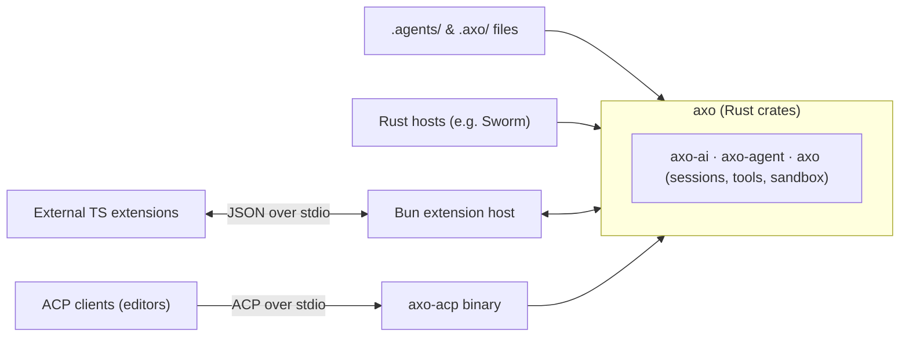

# axo design: goals & architecture

This document holds axo's goals, non-goals, architecture, and settled core decisions. It changes only when goals or core decisions change.

- **Implemented reference:** [`crates/axo/docs/README.md`](../crates/axo/docs/README.md) documents the live APIs, configuration, prompt assembly, session format, and compaction rules as built in M1–M5.
- **Active planning:** [`plan.md`](plan.md) holds unbuilt work, design discussions in flight (codemode, subagents, background jobs, schemes, extensions, ACP), and open questions.
- **Background studies:** [`pi/`](pi/README.md) (source notes on pi v1.3.0) and [`research/`](research/README.md) (comparative studies and measurements).

## Approach: a spiritual port of pi

axo's core follows pi v1.3.0 rather than reinventing it: the agent loop, the message and event data model, sessions and compaction, context assembly, and the built-in tools. Where pi already has a good answer, axo ports the idea into idiomatic Rust: the same concepts, not a line-by-line translation.

axo deliberately goes beyond pi where an embedded, always-on Rust library needs more:
- **Durability from the start** (crash recovery, run markers, replay policies, single-writer locks, and `attach` catch-up).
- **Scoped project access** (`ignore`, `read`, `trust`) instead of all-or-nothing project trust.
- **First-class Nix and direnv dev-shell capture** behind an `ExecEnv` seam.
- **Sandboxed script execution (codemode), subagents, URL schemes, and extensions** (planned in [`plan.md`](plan.md)).

**The focus is embedding in Rust.** The ACP binary is a convenience for external programs, kept as thin as possible. Effort goes into the library.

## Goals

1. **Own the core.** Keep the agent loop, sessions and tool contracts small enough to understand completely. Use libraries for plumbing, not for the core.
2. **Stay headless and host-agnostic.** axo is a Rust library first. A small binary speaks ACP for everything else. No terminal UI, and no knowledge of any particular host (Sworm is one host using axo as a library).
3. **Stay light.** Many sessions run in one process. Memory per session matters: the target is for three sessions in one process to stay well under three `pi --mode rpc` processes (160–209 MiB PSS; measured at ~92 MiB in [`research/README.md`](research/README.md#memory-measurements)).
4. **Survive restarts.** A host restart or crash mid-turn or mid-tool must not corrupt the session or silently drop a run.
5. **Make extending easy at every layer.** Declarative `.agents/` files, Rust traits for library hosts, an embedded JS sandbox for model-written scripts (codemode), and a Bun extension host for third-party TypeScript extensions.
6. **Be more capable than pi's core** in the places every feature depends on:
   - in-process child sessions, which make subagents cheap;
   - tools calling other tools through the normal hook pipeline;
   - resolution of `scheme://` URLs, so tools work on more than plain files.

## Non-goals

- **No approval system in the core.** axo never prompts for permission to run a tool. See [No approvals](#no-approvals).
- **No terminal UI** in the core.
- **No compatibility with other harnesses' session files.** axo reads and writes its own format (version 1).
- **Not ported from pi or omp:**
  - **Interface:** TUI, themes, HTML export, user `!` shell commands.
  - **Packaging and extras:** pi packages, telemetry, cache warming, image generation.
  - **Models:** virtual/classifier models, the provider zoo beyond the three core wire families, and pi's file migrations.
  - **omp's shell & edit machinery:** embedded brush shell and in-process coreutils, persistent shell state between calls, the command interceptor, PTY mode, and the `pi-edit` hashline editor.

## Architecture

### Layers and crates

| Crate | Ports | Owns |
|---|---|---|
| `axo-ai` | pi `packages/ai` | Message model, streaming events, `Accumulator`, the provider `Api` trait, Anthropic / Chat Completions / Responses & Codex adapters, model registry, auth, retry, overflow detection, cost |
| `axo-agent` | pi `packages/agent` | The agent loop, `Tool` trait with `Replay`, `AgentEvent`, `LoopHooks`, steering and follow-up queues, cancellation with reasons |
| `axo` | pi `coding-agent/src/core` | `Axo` and `Session`, JSONL session storage and projection, recovery and `attach`, compaction and `/shake`, context assembly, built-in tools, `ExecEnv`, config |
| `axo-acp` | — | The `axo` binary: ACP over stdio, mapped onto `Session` |

Each crate depends only on the ones above it. Why four crates:
- **Enforced dependency direction.** `axo-agent` cannot see session files; `axo-ai` cannot see the loop. The loop stays testable with `ScriptedApi` and no disk; `axo-ai` stays usable alone for one-off model calls (titles, commit messages) without opening a session.
- **The binary stays out of the library.** Hosts that embed `axo` never compile ACP code.
- **Incremental builds.** `axo-ai` carries the HTTP stack and changes least once written.

Tools, context, config, and the script sandbox stay modules inside `axo`. The Bun extension host gets a crate only when its contract is built.

## Settled core decisions

Full operational details live in [`crates/axo/docs/`](../crates/axo/docs/README.md); this section records the architectural rules and why they were chosen.

### Data model and providers (`axo-ai`)

- **The system prompt and tool set live in the transcript as `SystemMessage`s.** The first system message carries named sections; later ones patch sections or tools. Replaying the transcript reconstructs the exact prompt and tool set at any point, keeping resume, branching, and compaction consistent and the prompt prefix cache-stable.
- **Typed `ReasoningReplay` and byte-stable tool arguments.** Rather than overloading a single string field as pi does, provider-specific reasoning replay data (`AnthropicSignature`, `AnthropicRedacted`, `OpenAiReasoningItem`, `ReasoningField`, `ReasoningDetails`) is a typed enum ([`research/message-models.md`](research/message-models.md)). `serde_json` uses `preserve_order` so tool-call arguments replay byte-for-byte without breaking prompt caches.
- **Delta-only streaming events.** Only `Start` and terminal `Done`/`Error` carry a full `AssistantMessage`; mid-stream events carry `{ content_index, delta }`, and a shared `Accumulator` rebuilds the partial message. That avoids a full-message clone per token in Rust. Streams never fail with `Err`; failures end with `AssistantEvent::Error` preserving partial content.
- **Ported adapters over `reqwest` + SSE.** Anthropic Messages, OpenAI Chat Completions (including llama.cpp/Qwen), and OpenAI Responses (including ChatGPT Codex OAuth). Every auth path resolves to `ModelAuth { api_key, headers, base_url }`, which is the only type an auth provider hands the core.
- **Catalog and price-tier windows.** Model metadata comes from `models.dev` (cached in `<AXO_DIR>/cache/models.json`) merged with built-in baselines and overridden by `models.jsonc`. Standard context windows stop below higher-priced extended-context tiers unless `extendedContext: true` is set in user settings or an explicit window is configured in `models.jsonc`.
- **Cross-model replay (`transform_messages`).** Pure function that drops foreign-model thinking from outgoing requests (keeping it in the session file), omits failed/aborted assistant turns, normalizes tool-call IDs, and synthesizes `"No result provided"` for orphaned calls.

### Agent loop (`axo-agent`)

- **Parallel execution, sequential preparation.** Tool calls prepare and run `before_tool_call` sequentially in source order; execution runs in parallel unless the loop or any tool in the batch is `ExecutionMode::Sequential`; `ToolExecutionEnd` emits in completion order; tool-result messages append in call order.
- **Truncated responses never execute tools.** When an assistant message stops with `StopReason::Length`, every tool call in it receives a synthetic error result without running.
- **Split event delivery.** Persistence is one ordered, awaited subscriber that saves each message on `MessageEnd` before the next request. All other observers (hosts, UIs, ACP) receive events over a bounded broadcast channel and resync via `session.attach` if they lag, so a slow client never stalls the loop.
- **Cancellation reasons.** `CancelReason::User` keeps the partial assistant message and writes synthetic aborted results for unanswered calls. `CancelReason::Shutdown` (`Session::shutdown` or drop) writes nothing as aborted; the run stays open in the log and recovers on reopen.

### Durable sessions, compaction, and retry (`axo`)

- **The session tree is the source of truth.** Append-only JSONL (`FORMAT_VERSION = 1`) with an OS file lock (`File::try_lock`) enforcing one writer per session ([`research/durable.md`](research/durable.md)). `project(entries, leaf)` resolves `context_edit`s across the full root-to-leaf path before applying the latest compaction checkpoint, borrowing from the log.
- **Crash recovery and `Replay`.** `run_start` and `run_end` bracket every run; prompts, steers, and follow-ups are persisted as `submission` entries (with optional `request_id` deduplication) before queuing. On reopen, unfinished tool calls with `Replay::Safe` (`read`, `grep`, `find`, `ask`) re-run under `RecoveryPolicy::Resume`; `Replay::Never` (`bash`, `write`, `edit`, and later `codemode`) get an interrupted error result pointing to any spooled output. After 5 consecutive resumes with no progress, the run parks as `Interrupted`.
- **Compaction and `/shake`.** Recoverable clearing writes elided tool outputs, images, and thinking blocks to `<session>/context/` artifacts and replaces them via `Entry::ContextEdit` ([`research/compaction.md`](research/compaction.md), [`research/compaction-methods.md`](research/compaction-methods.md)). Automatic maintenance picks one action per pass (recoverable clearing when it reaches headroom, otherwise a live or separate model summary checkpoint), carries over recent whole user messages, and protects active skills.
- **Bounded retry and one-shot overflow recovery.** Overflow is classified before transient errors. Overflow hides the failed turn and runs a separate-request compaction pass once per progress step. Transient provider errors and silent stops hide the failed turn and retry up to 3 times with exponential backoff (2/4/8 s or `Retry-After` ≤ 60 s). Retry and overflow state is reconstructed from log entries on reopen without a separate retry log.

### Context, prompt policy, and project access (`axo`)

- **Cache-stable prompt sections.** Ordered general-to-specific and stable-to-changing: `system`, `docs`, `tools`, `work`, `prose`, `project_context`, `skills`, `cwd`, `dev_shell`, `date`, then host sections. Subsequent updates emit diff `SystemMessage`s containing only changed or removed sections.
- **Hard-coded text policy.** Model-facing text that cannot be overridden through `prompts/` (`SYSTEM.md`, `WORK.md`, `PROSE.md`, and the summary prompts) must be a needed runtime fact or an indispensable positive instruction. Behavioral opinions live in the bundled prompt files; tool guidance belongs to each tool's `prompt_guidelines()`.
- **Context files and skills.** `contextFiles` is an ordered map of relative paths walked from the git root to `cwd`, plus on-demand nested context attached to `read`/`write`/`edit` results when subdirectories are first touched. Skills follow the Agent Skills standard (`SKILL.md` in `.agents/skills` and `~/.axo/skills`, invoked by the model or via `/name args`). There is no separate `commands/` directory; user-only commands belong to extensions ([`research/agents-dir.md`](research/agents-dir.md)).
- **Project access (`ignore`, `read`, `trust`).** Controlled by the user-only `project` settings block (`project.paths` globs and `project.access`, default `read`). `ignore` loads nothing from the repo; `read` loads markdown context, skills, prompt overrides, and safe settings while stripping code-running settings (`bash.devShell`, `!command` `defaultModel`); `trust` permits code-running project contributions.

### Built-in tools and execution environment (`axo`)

- **Default built-in set:** `read`, `write`, `edit`, `bash`, `grep`, `find`, and `ask` (when the host can answer questions).
- **`edit` and the stale-file guard.** Exact replace with fuzzy fallback (whitespace, quotes, dashes), plus per-session content-hash tracking and a process-wide per-file lock ([`research/edit-formats.md`](research/edit-formats.md)). `edit` and `write` on an existing file require a prior read in the session and reject external modifications since that read.
- **`bash` and `ExecEnv`.** Always runs real `bash` from `PATH`, never fish ([`research/shell-tool.md`](research/shell-tool.md)). Runs in a dedicated process group with a pipe-backed guard child that `SIGKILL`s the group if axo dies; stopping sends `SIGTERM`, waits 1 s, then `SIGKILL`s. Output strips ANSI escapes, caps lines at 768 B, keeps 20 KB head + 30 KB tail inline, and spools raw output to `<session>/bash/<call_id>.log`. `DevShellEnv` captures a Nix flake dev shell or allowed direnv once, caches it with a GC root under `<AXO_DIR>/cache/devshell/`, and watches `.nix` files for invalidation ([`research/nix-shell.md`](research/nix-shell.md)).
- **`ask`.** Emits `SessionEvent::QuestionPending` and waits for `session.answer(call_id, answers)` or `dismiss()`, with no UI trait (`Replay::Safe`).

## Ways to extend axo

1. **Declarative files (`.agents/` and `.axo/`):** `AGENTS.md`, `SKILL.md`, prompt overrides, `models.jsonc`, and later agent role files (`.agents/agents/*.md`).
2. **Rust traits (for hosts like Sworm):** `Tool`, `LoopHooks`, `ExecEnv`, `SessionStore`, `Api`, `Streamer`, and `CredentialStore`.
3. **Embedded script sandbox (`codemode`):** stateless JavaScript scripts running in an embedded engine (such as QuickJS) whose only powers are calling tools. Later, scripts may also define session tools and configure the harness of spawned subagents; see [`plan.md`](plan.md).
4. **External TypeScript extensions (Bun host):** when third-party extensions need full runtime access (`fetch`, filesystem, processes, npm, OAuth callback servers), axo runs one shared Bun process over stdio against a typed `@axo/sdk`.
5. **MCP servers:** external tool servers configured in `.mcp.json` / `mcp.json` / `~/.axo/mcp.json`, plugged into the tool registry.

## No approvals

axo never prompts for permission to run a tool. Approval systems are a long tail of policy edge cases and UX that do not belong in the core.

What the core provides is `LoopHooks::before_tool_call`, which may return `ToolCallDecision::Block { reason }`. That is general machinery: a host, an extension, or a subagent spec can enforce rules on top of it, while axo itself never asks.

## Milestones completed

| # | Milestone | Status |
|---|---|---|
| M1 | `axo-ai`: types, events, `Accumulator`, Anthropic / Chat Completions / Responses & Codex adapters, auth, `models.dev` catalog, `ScriptedApi` | Done |
| M2 | `axo-agent`: loop, `Tool` trait with `Replay`, `LoopHooks`, queues, cancellation reasons, `continue_run`, `recover_response`, split event delivery | Done |
| M3 | `axo` tools & context: `read`, `write`, `edit`, `bash`, `grep`, `find`, `ask`, `ExecEnv` + `DevShellEnv`, sectioned prompt, context files, skills, config | Done |
| M4 | `axo` sessions: `JsonlStore`, `Projection`, resume, `navigate`, `fork`, run markers, submissions, crash recovery, file lock, `attach`, PSS memory benchmark | Done |
| M5 | Compaction with clearing and summaries, `/shake`, atomic branch summaries, bounded auto-retry, one-shot overflow recovery, crash reconstruction | Done |
