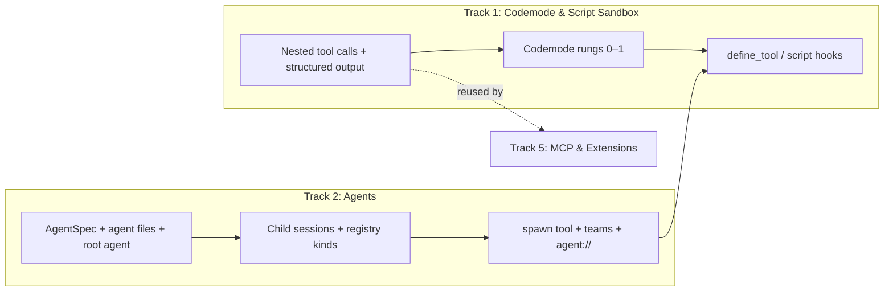
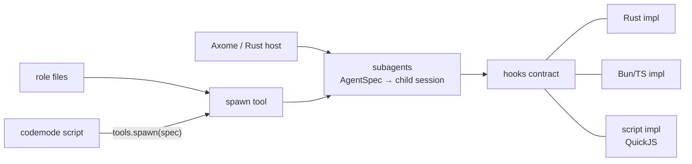

# axo plan: active work & open discussions

This is the live planning document for unbuilt work and active design discussions. It changes freely as we work.

- **Goals & settled architecture:** [`design.md`](design.md)
- **Implemented reference:** [`crates/axo/docs/README.md`](../crates/axo/docs/README.md)
- **Background studies:** [`pi/`](pi/README.md) and [`research/`](research/README.md)

## Overview of tracks

M1–M5 plus Tracks 3 and 4 are complete. The remaining work splits into independent tracks (`axo-acp` is deferred):



| Track | Scope | Status |
|---|---|---|
| **1. Codemode, script extensions & agent specs** | Embedded JS sandbox (`rquickjs`), nested tool calls, structured tool output, `codemode` tool (rungs 0–1), then `define_tool` and child script hooks (rungs 2–5) | **Active focus.** Rungs 0–1 decided; rungs 2+ in discussion |
| **2. Agents: `AgentSpec`, root agent, subagents (`task`) & teams** | One agent-definition format for the root session and children; in-process child sessions as job-registry rows; async `task`, parent↔child messaging, teams; model aliases; budgets; `yield`; `agent://` | **Designed, unbuilt.** Discussion complete (below); build order set |
| **5. Extensions (Bun host), MCP & `ast_edit`** | Extension contract, Bun stdio host & `@axo/sdk`, `.mcp.json` / host-supplied MCP tool adapter, optional `ast_edit` | Planned |
| **6. ACP binary (`axo-acp`, M6)** | Stdio JSON-RPC binary mapping ACP onto `Session` | Deferred: rethink whether axo itself should ship ACP or leave it to a host |

---

## Track 1: Codemode, script extensions and agent specs

Notes from the design discussion of 2026-10-22. Only items marked **Decided** are settled; items marked **Direction** remain open for discussion.

### Where we landed

- **Decided:** axo builds a codemode tool in pi's shape (rungs 0–1 below): a stateless, sandboxed JavaScript script per call whose only powers are tool calls. It is built in, behind a Cargo feature, on an embedded engine. It does not wait for the Bun extension host.
- **Direction:** state lives in resources that tools own, not in the script; everything addressable is reachable from scripts; and scripts may configure the harness of the subagents they spawn, but not change the session the user talks to.
- **Shape:** three separate systems, each useful alone. Codemode composes them but owns none of them:
  1. subagents, specified by an `AgentSpec`;
  2. the script sandbox;
  3. the hooks contract, with a script implementation among others.

### omp `eval` vs pi `codemode`

Both let the model write code that calls tools, built for different jobs. Sources: pi 1.3.0 (`packages/coding-agent/docs/codemode.md`, `packages/codemode/README.md`, `extensions/codemode/`), omp 18.12.2 (`docs/tools/eval.md`, `src/prompts/tools/eval.md`).

| | omp `eval` | pi `codemode` |
|---|---|---|
| Unit | One cell per call, notebook-style | One script per call |
| State | Kernel stays alive between calls; lost on restart ("Kernel-loss notice means reload setup") | Fresh VM per script; small JSON values via `store`/`load`, saved as session entries per branch |
| Runtime | Bun worker (`Bun`, `fs`, `fetch`, `process`, `require`) and a Python subprocess | QuickJS compiled to WebAssembly: no files, network, timers or modules |
| Packages | `%bun add`, `%pip install`, `%load ./script.py` | None |
| Reach | Anything bash can, plus `tool.<name>()` | Only `tools.<name>()` and `models.*` |
| Host helpers | `agent()`, `workpool()`, `wait()`, `judge()`/`judgeBatch()`, `completion()`, `@tool` for subagents, extension preludes such as `browser` | `searchTools`, `describeTool`, `describeNamespace`, `models.classify`/`generateImages` |
| Output | Printed text, images, tables, DataFrame views, figures | `text()`, `image()`, `return`, `console`; capped by an output-token budget |
| Safety | `approval="exec"`, bash's trust level | Sandbox: 256 MB heap, interrupt handler, at most two workers per process |
| Long runs | Optional auto-backgrounding into an async job | Hard `timeout_ms` |
| Portability | Tied to omp | No pi dependencies; also runs on Cloudflare Workers |

#### Intent

- **omp: an agent workbench and orchestration language.** The doc opens with "Do not shell out to `python -c`, `bun -e`, or `node -e` through `bash`." Eval is the better home for code the agent was already running through bash:
  - state across calls for notebook-style exploration (DataFrame views, figure capture, `%pip`);
  - orchestration, through `agent()`, `workpool()`, `wait()` and `judge()`, so the agent runs other agents from code;
  - a home for extensions: preludes add globals such as `browser`.

  It is bash with better ergonomics, so it gets bash's trust level.
- **pi: composing tool calls and saving context.** "Only the script's output reaches the model, so a script can run calls in parallel and filter large results before the model sees them."
  - tool results are structured values, and only the script's output reaches the model;
  - MCP tools default to script-only exposure, so large servers stay out of the prompt and are found with `searchTools()`;
  - every effect is a tool call, so hooks, blocking and validation apply;
  - no hidden state, which suits durability.

  [INFERENCE: the name and framing match Cloudflare's "Code Mode"; pi's docs do not cite it.]

#### What pi's codemode cannot do

Impossible in pi's codemode as shipped:

1. **Keep a large working set across calls.** Example: load every session JSONL file once, then answer follow-up questions. `store` holds at most 256 KiB per value and 1 MiB in total.
2. **Take in a large file in one go.** `tools.read` returns the same 2000-line / 50 KB slice the model sees (`read.ts:216` builds the script value from the truncated content); `tools.bash` returns at most 1 MiB.
3. **Call an LLM or run agents from code.** Chat models "cannot be run from scripts"; only non-LLM classifiers and image models. pi has no subagent tool in core.
4. **Hold a live connection across calls.** A logged-in browser tab, a DB connection, a websocket. Inside a script there are no sockets at all.
5. **Keep working after its call returns.** For example, a 20-minute benchmark sweep while the conversation continues.
6. **Define tools that subagents call back into** (omp's `@tool`).

Possible only by going through `bash`, at the cost of a process per step, text in and out, and often a second language:

| Task | omp eval | pi codemode |
|---|---|---|
| Collect dependency versions from 30 `Cargo.toml` files | A TOML parser via `%bun add`, or `tomllib` | Regex by hand, or `cargo metadata` through bash |
| Fetch 50 PRs from the GitHub API | `fetch` in a loop | `curl` through bash per request |
| Plot cost per day | pandas and matplotlib | Write a `.py` file, run it with bash, `tools.read` the PNG, then `image()` |
| Poll CI every 30 s | A sleep loop | No timers; `bash sleep 30` between checks |
| Fuzzy-dedupe 50k strings | V8 or Python speed | QuickJS interprets with a 256 MB heap; slow, or bash a real runtime |
| Hash files, diff text, resize images | Standard library or packages | `sha256sum`, `diff`, `magick` through bash |

Codemode plus bash covers everything eval does except state between calls and orchestration. Items 3 and 6 are not sandbox limits: `agent()` or `completion()` is another host function or tool call. What a sandbox cannot give on its own is state or a handle that outlives the script.

### Embedded, not the Bun host

**Decided.** Earlier notes linked eval to the Bun extension host as a reuse shortcut ("the Bun host is already a JS runtime"). The two have opposite requirements:

| Need | Extensions (why Bun) | Codemode scripts |
|---|---|---|
| Access | Full runtime: `fetch`, fs, processes, npm, OAuth servers | Only tool calls, so `before_tool_call` cannot be bypassed |
| Sandbox | Given up on purpose | The point |
| Lifetime | One long-lived process | One short script per call |
| Isolation | One process for all extensions | A runaway script must not take extensions down |
| Cost when unused | Bun must be installed | Nothing to install |

- **pi does the same.** Its extensions run in Node/Bun, yet codemode runs in a separate QuickJS-wasm VM in a worker with a 256 MiB cap (`execute.ts`, `config.ts:491`).
- **Fewer hops.** In the Bun host, every nested tool call would cross the stdio bridge twice: script → Bun → axo's tool pipeline → Bun → script. Embedded, a nested call is an in-process call into the tool pipeline.
- **The VM has no power of its own.** QuickJS starts with nothing. Every capability is a Rust host function that axo injects. Rust decides what is possible; JS lets the agent express runtime logic (loops, conditions, filtering).
- **Engine candidates** (to verify in a short spike before coding):

  | Engine | Notes |
  |---|---|
  | QuickJS (`rquickjs`) | Small; memory and interrupt limits; can await Rust futures. The default |
  | `boa` | Pure Rust, slower. The fallback |
  | V8 (`deno_core`) | Fast, but tens of MB in the binary; against the memory goal |

### The model: a ladder of power

#### Three ideas

- **A. Data lives in a tool or resource, not in the script.** The script stays stateless. Anything that lasts has an owner and a name; scripts refer to it by name. Each resource has its own crash behavior, unlike an eval kernel where everything dies together:

  | Resource | Owner | Name |
  |---|---|---|
  | A dataset | A query tool, e.g. SQLite in the session directory | `table://sessions` |
  | A browser tab | The browser tool | `browser://tab/3` |
  | A long command | The job registry | `proc://bg_2` |
  | A subagent | Child sessions | `agent://reviewer-4` |

- **B. Everything addressable is callable.** URL schemes supply the nouns, tools the verbs, subagents the workers. A script sees all of them as one object model, and every call passes through the tool pipeline.
- **C. Scripts extend axo.** Once scripts can call everything, the next step is letting them add things.

#### The ladder

| Rung | The script can… | Example |
|---|---|---|
| 0 | call tools | pi's codemode |
| 1 | call named resources (A, B) | query `sessions`, wait on `agent://…` |
| 2 | define functions that later scripts reuse | a `parseCargoLock()` helper for this session |
| 3 | register tools the model or subagents can call | a `pr_status` tool wrapping `gh` |
| 4 | register hooks | after each edit to a `.rs` file, run `cargo check` and attach errors |
| 5 | change the prompt or tool set | add a section; hide tools for a focused task |

**Decided:** rungs 0–1 are the immediate build target. Rungs 2 and up need the design below.

- **Rungs 2 and 3 merge.** A saved function is a defined tool that only scripts can call.
- **Tools and hooks differ in kind.** A tool runs only when called; the call and its result are visible, and a bad tool is one the model can stop using. A hook runs on every matching event without being called, and can block, rewrite or redirect other calls or decide whether the loop continues. A tool adds a new verb; a hook changes how the existing ones behave.
- **Skills can carry scripts.** A markdown skill can come with a script that sets up the hooks and tools its task needs. The agent can also write such a script mid-task and save it as a skill afterward.
- **Seams, not internals.** Scripts only plug into published seams: before/after tool call, prepare request, finish turn, the steer and follow-up queues, context edits, prompt sections, tool registration.

#### Parent and children

**Direction:**

> A script may **add** to the parent: functions and script-callable tools (rungs 2–3). It may **change behavior** (hooks, prompt sections, tool set, loop control; rungs 4–5) only in children it spawns.

The session the user talks to is changed only by the user. Children are disposable agents a script builds for one job; their hooks die with them.

- **The invariant.** Children inherit the parent's policy: user settings, user and project extensions, project trust, the exec environment. Script hooks run **before** that inherited policy, so the policy always sees the final arguments that will run. A script can tighten a child's rules, never loosen them past the user's.
- **What it fixes:**
  - persistent prompt injection cannot take over the parent;
  - silent interference, and hooks outliving their reason, are confined to a child with one task;
  - the parent's tool set, and so its prompt cache, never changes;
  - provenance comes naturally ("child `reviewer-3`, built by the script at entry #N, with hooks X and Y");
  - durability is mostly free: child sessions are linked to the call that spawned them, and the child's harness setup is system messages in its own transcript.
- **What it costs:**
  - delegation overhead: a child needs a briefing and its own context, so it uses more tokens and takes longer;
  - children should return small schema-shaped results, not transcripts;
  - changes to the parent session move to user-level config.

### Three systems, one job each



1. **Subagents (Rust core).** An `AgentSpec` is plain data: role, model, tools, prompt sections, hooks, output schema, inherited policy. Spawning it returns a handle (`agent://<id>`) to wait on. It knows nothing about JS.
2. **The script sandbox.** Runs JS with injected host functions under limits. Codemode is a thin tool on top of it; `define_tool` sources and script hooks reuse the same sandbox.
3. **Hooks.** One Rust contract with several implementations: Rust (Axome, first-party features), TypeScript (Bun extensions), and a script implementation that runs stored JS in the sandbox when the hook fires.

#### Which tool grants each rung

| Rung | Tool | Applies to |
|---|---|---|
| 2–3 | `define_tool` (name TBD) | The current session, as an addition |
| 4 | `task`, through the spec's `hooks` field | Only the spawned child |
| 5 | `task`, through the spec's `prompt` and `tools` fields | Only the spawned child |

`define_tool`:

```json
{
  "name": "cargo_errors",
  "description": "Run cargo check on one crate; return only error lines",
  "parameters": { "type": "object", "properties": { "crate": { "type": "string" } }, "required": ["crate"] },
  "source": "const r = await tools.bash({ command: `cargo check -p ${args.crate} --message-format short` }); return r.output.split('\\n').filter(l => l.startsWith('error'));"
}
```

- `source` runs in the sandbox, so the tool can only call other tools.
- Saved as a session entry: replayed on resume, scoped to its branch, kept through compaction.
- Script-only exposure by default, so the parent's declared tool set does not change. Children can be given it by name.

`task` with a child harness:

```json
{
  "role": "worker",
  "input": "Refactor compaction/summary.rs to …",
  "tools": ["read", "edit", "bash", "cargo_errors"],
  "hooks": [{
    "on": "after_tool_call",
    "tools": ["edit", "write"],
    "source": "if (call.args.path.endsWith('.rs')) result.append(await tools.cargo_errors({ crate: 'axo' }));"
  }],
  "output": { "type": "object", "properties": { "summary": { "type": "string" } } }
}
```

**Codemode is only as powerful as the tools it can call.** Two caveats:
- the ceiling is the most powerful callable tool (`bash`); the sandbox guarantees that effects pass through the tool pipeline and its hooks, not that they are restricted;
- scale is new: a script can make 500 calls where the model would make 5, so call-count limits and timeouts belong on codemode itself.

### Scenarios and risks

| User says | What gets set up | Uses | Under the parent/child rule |
|---|---|---|---|
| "Refactor the compaction module, keep it compiling" | After each edit to `crates/axo/**/*.rs`, run `cargo check -p axo` and attach the first errors | after-tool hook | ✅ Runs in a child; the parent orchestrates |
| "Don't touch generated files, never run `cargo update`" | Block edits under `**/generated/**` and bash matching `cargo update` | before-tool hook | ❌ for the parent (user settings/policy); ✅ imposed on children |
| "Plan first, change nothing until I say go" | Block `write`, `edit` and mutating bash; add a "planning" prompt section; remove both on "go" | before-tool hook, prompt section | ❌ for the parent (a user command); ✅ as a read-only planner child |
| "Keep fixing until the tests pass, at most 5 tries" | When the model would stop, run tests; if they fail and tries remain, continue with failures as a follow-up | finish-turn hook, follow-up queue | ✅ A child with the loop returns the final result |
| "Check my PRs' CI" (repeatedly) | A `pr_status` tool defined once (`gh api` + parsing) | `define_tool` | ✅ An addition |
| `/review:adversarial` | 6 scouts with output schemas, a skeptic per finding, triage, report | agents, resources | ✅ Already children |
| "Debug this flaky test" (huge logs) | For `cargo test` output, keep only failing tests and panics; full output in an artifact | after-tool hook rewriting results | ✅ A child runs and filters the tests |
| "Analyze my axo sessions" | Load sessions into a table once, define helper queries, reuse across turns | query resource, saved functions | ✅ An addition |

Key risks to design around when building step 3 (script hooks):
1. **Persistent prompt injection:** contained to children by the parent/child rule and inherited-policy-last ordering; hooks may also get a narrower set of host functions than scripts.
2. **Silent interference:** every block or rewrite must carry provenance ("blocked by hook `no-update`, defined at entry #123"), and active hooks/tools must be inspectable.
3. **Bugs and stalls on the hot path:** per-hook time budget, auto-disable after errors with a notice, no recursive self-triggering, and cancellation propagation.
4. **Prompt cache churn:** new tools default to script-only exposure so the declared tool set stays stable.
5. **VM lifetime for hooks:** measure a fresh QuickJS context per hook invocation (stateless, durable) against one VM per session.

### Step 1 build scope: Codemode rungs 0–1

1. **`rquickjs` spike:** verify async/tokio bridging, memory and interrupt limits, and per-context memory overhead against the PSS target (`boa` fallback).
2. **Core prerequisites (`axo-agent` & `axo`):**
   - **Nested tool calls:** extend `ToolContext` with a nested-call runner that goes through prepare, validate, `ToolHooks::before_tool_call`, and `ToolHooks::after_tool_call`. Assign `<parent>/<n>` IDs, tag `AgentEvent::ToolExecution*` with `parent_call_id`, and record nested calls on the parent `ToolResultMessage` so compaction still extracts file operations.
   - **Structured tool output:** add `output_schema` and `structured_content: Option<Value>` on `ToolOutput` (for `bash`: `{ output, truncated, full_output_path, exit_code, wall_time_seconds }` with a 1 MiB output cap; for `read`: text string or image object).
3. **Sandbox module (`axo::script`):** standalone module (not buried inside the tool) that runs JS on a blocking worker thread with a memory cap, interrupt budget/timeout, concurrency semaphore, and channel bridge for async host functions.
4. **`codemode` tool (`axo::tools::codemode`):**
   - Globals: `tools.*`, `ALL_TOOLS`, `text()`, `image()`, `return`, `console.*`, `exit()`, `store(k, v)` / `load(k)` (backed by branch-scoped `custom` session entries committed only when the script succeeds), and `// @options: {"max_output_tokens", "timeout_ms"}`.
   - Renders TypeScript declarations from callable tools' JSON schemas in its description.
   - `Replay::Never`: crash recovery reports the script as interrupted and lists completed nested calls.

---

## Track 2: Agents (`AgentSpec`, root agent, `spawn`, teams)

Notes from the design discussion of 2026-11-04 to 2026-11-07, grounded in [`research/subagents.md`](research/subagents.md) (omp, dsh, Codex, Claude Code, pi, OpenCode, Gemini, Amp, ACP). Items marked **Decided** are settled; **Direction** items are the agreed shape pending detail; the numbered open questions at the end are not yet discussed. Build step 1 (Phase 1: selectors, agent definitions and the root agent, `AxoBuilder::name`) is implemented. Phase 2 (registry kinds, session table, spawn API, budgets and child→parent delivery) and Phase 3 (`spawn`, `yield`, `agent://`) are implemented.

### Where we landed

- **Decided: axo bundles no agent and no role names.** Every running agent, root or child, is a definition a host, user or project handed axo. The harness owns the format, the resolution and the lifecycle; hosts own the personas, the workflows that use them, and every name in the alias table.
- **Decided: one agent-definition format for the root session and children.** The root session is an agent the host designates, not "the harness, configured". A persona like Toph's Axophyte is one file among many; a host selects a different one per conversation (a planner for `/plan`, a reviewer for `/review`).
- **Decided: children are continuable sessions spawned asynchronously, messaging their parent through the job registry.** No blocking spawn mode. Siblings cannot talk unless spawned as a team.
- **Decided: the extensibility seams are the policy surface.** axo has no approvals; spawn decisions are visible to a spawn hook, a new trait in `axo` supplied as `SessionOptions.spawn_hooks` and inherited by children. It is called by both `Session::spawn` and the `spawn` tool with the resolved spec, catalog name, model, thinking, task, depth and parent session id, and returns `Allow`, `Block(reason)` or `Replace(AgentSpec)`; it may await. Phase 3 adds origin (host or tool), and Phase 4 adds team fields. `ToolHooks::before_tool_call` is unchanged: it sees only the raw `ToolCall`, and `ToolCallDecision` is `Allow | Block { reason, terminate }`. Children run the parent's hooks plus whatever the host adds for that child, never fewer.

### Q1 Registry: child sessions are job-registry rows (Decided)

`JobRegistry` splits into a generic delivery layer (ids, row admission, per-message `Delivery` state machine, receipts on messages, `job_end` before deliverability, `results_ready` idle-wake, `wait` reservation, rebuild from journal) and a per-kind execution record. `Job` gains `kind: Command(CommandRun) | Child(ChildRun)`; command mode and shutdown stay command-specific. Bash keeps its `job_start`/`job_end` format; children use `child_start`, and each `job_end` names a message (`<row>` for message 1, `<row>/<n>` thereafter). `admittedJobs` receipts name rows; `deliveredJobs` receipts name messages. `wait`, `proc://`, `Session::jobs()`, kill and idle-wake share the registry. Children use `agent_N`, separately numbered from `bg_N`, so kill targets are unambiguous. Team fields arrive in Phase 4.

The registry row is the **delivery contract**, not the child's lifetime: each child has one row with an ordered sequence of messages, one per run result and later Phase 4 requests. A later message to a finished child starts a new run whose result is another message of that same row. The child session itself lives in a **session table created by `Axo` and placed in `Inherited`** (so sessions, `spawn` and `agent://` reach it), so `spawn` finds an existing child on reopen and hosts can `attach()` to it. Hosts use `Axo::session(id)`, which returns a live child or revives a parked one; there is no separate `Axo::open_session(id)` for children. Forks get a new registry (existing rule) but see the same session table. Alternatives rejected: a separate child registry (dsh, Codex) duplicates the exactly-once proof and splits `wait`; a shared generic core extracted from both is more code for the same outcome.

### Q2 Spawn mode: async only (Decided)

`spawn` returns a handle at once; the parent keeps its turn and the child reports back as a delivered message. A parent that wants to wait calls `wait`. There is no blocking variant, no promotion timer. Stop during a parent turn leaves children running (same as `bg_N`).

### Q5/Q6 Messaging and teams (Decided)

- Parent ↔ child, both directions, always. Child → parent messages (results, requests, progress) are messages of the child's registry row: exactly-once, wake an idle parent, and **queue** when the parent is mid-turn (a child never steers like a person or the parent). The registry's deliverable unit becomes a message; a command row has exactly one, its result. Parent → child messages use the child's own queue rules (steer, follow-up, abort).
- Children are continuable: a stable id the parent can message after spawn and after a result.
- **Teams** switch sibling routing on for one group: the children admitted by one `spawn` call with `team: true`, or by a team definition. Members get a roster (instance names, one-line briefs) and may address the parent or a named teammate; no broadcast. Results flow to the parent. Shared cancel scope with the admitting call. The registry needs omp's mutual-wait check (every live member waiting, nothing pending → fail the waits).
- **Team definition** = a markdown file in the agent roots distinguished by `members:`; `members[].agent` names an agent, `as` the roster name, `brief` a fixed per-member instruction; the body is the team charter appended to every member's prompt. Spawnable by name (`spawn(agent: "review-team", context, tasks?: {name: text})`), from a skill with no code, ad hoc (`team: true` with named or inline members, optional `charter`), or by a host in Rust; all build one `TeamSpec`. Not in v1: nested teams, `count:`, per-member model override.

### Q3 Ad-hoc agents: allowed, narrow-only (Decided)

`spawn` accepts `agent: "<name>"` or an inline `spec: { prompt, tools?, model?, output? }`, with a required `task` and optional `context`. The task is the child's only prompt; non-blank context is appended as "{task}\n\nContext:\n{context}". Inline fields can only restrict: `tools` ⊆ the parent's effective set, `model` any selector (see Q4), `ProjectAccess`, `ExecEnv`, supervision, host hooks, depth and concurrency have no field and are inherited. The inline `prompt` follows axo's fixed delegation framing, which it cannot remove. Omitting both `agent` and `spec` spawns a plain delegate of the parent. The tool description steers toward defined agents; a host that wants omp's strictness blocks inline specs in the spawn hook.

### Q4 Models and aliases (Decided)

- `modelRoles` (user-only settings key, empty by default, host-filled) maps a name to a selector. No built-in names; host workloads (`plan`, `commit`, …) define their own and axo only resolves them.
- One selector grammar everywhere (`SessionOptions.model`, `/model`, agent files, `spawn`): `[@alias | provider/model][:thinking]`; bare `:thinking` keeps the model and overrides thinking; `@x` with no entry is an error, never a fallback. Public `Settings::resolve_model(&Models, selector) -> ModelChoice`; model ids are matched exactly before a `:thinking` suffix is split off.
- Child cascade, one resolver: `spawn(model:)` → `subagents.models[<agent name>]` → `AgentSpec.model` → `subagents.defaultModel` → parent's live model and thinking. Both `subagents.*` keys are user-only and take the same grammar; team members resolve by their `agent` name.
- `spawn` may name any model free-form (a no-alias user must still be able to pick); the description says to inherit unless asked or warranted; hosts gate or rewrite in the spawn hook. The spawn record keeps the winning selector string next to the expanded id.

### Q7 Context: per-agent switches over shared defaults (Decided)

Every named piece of context is individually switchable per agent with one vocabulary, resolved **settings → `subagents.*` (children only) → the agent's frontmatter → host `SessionOptions.sections`/`tools`**, last writer wins. Children do not inherit host `SessionOptions.sections`; they get the fixed delegation framing plus their resolved spec. The agent's `tools` allowlist filters inherited host tools as well as built-ins; an empty body leaves `system` as it is:

- `contextFiles` (the existing name→bool map; `false` = all off), `sections` (name→bool over built-in and host section names), `tools`, `model`, `output`.
- Built-in default for children: context files **off** (omp's rule), skills, docs, cwd, dev shell on. The root default is today's behavior.
- The agent body is the `system` section text (root) or follows the fixed delegation framing (child); `WORK`, `PROSE` and the summarizer prompts stay as prompt overrides because they are shared texts, not personas. `prompts/SYSTEM.md` becomes unnecessary once a root agent is used.
- Inherited with no override: cwd, `ProjectAccess`, `ExecEnv`, supervision, host hooks, the parent's resolved `EffectiveConfig`. Not included: host prompt sections or the parent transcript (a Codex-style filtered `fork` mode is a later addition if a case demands it). `ask` is removed from children; a child asks its parent.
- The child's header sets `parent_session` (the parent's file path, as forks do, with `forked_from` `None`) and a separate `spawn: SpawnLink { parentSessionId, callId, depth, agent, model, spec }`. `spec` is the resolved spec after subagent defaults and spawn hooks; reopen and revival reuse it, including inline specs and hook replacements, regardless of later edits to agent files. `Session::agent() -> Option<&SpawnLink>` exposes it to hosts (e.g. a memory hook that skips children); roots and forks return `None`.

### Agent definitions and where they live (Decided)

- `AgentSpec` is plain data: `name`, `description`, `model`, `tools`, `contextFiles`, `sections`, `output` (JSON Schema), `maxTurns`, body; a team adds `members`. Markdown + YAML frontmatter, body = prompt; `name` from frontmatter or file stem. omp keys (`blocking`, `spawns`, `thinkingLevel`) tolerated and ignored.
- Hosts supply roots, not parsed values: `ConfigLayer.agent_roots: Vec<PathBuf>` on the user layer, plus the project layer at `Trust`, mirroring `skill_roots`; axo walks each root recursively for `*.md`, kind from frontmatter, structure is the user's. Files without a frontmatter block are skipped; names follow the skill rule and violations drop the definition. One namespace for agents and teams; first name wins in root order; `SessionOptions.agents` programmatic specs come last. **Nothing new is read from `.agents/`** (supersedes the `.agents/agents` idea in [`research/agents-dir.md`](research/agents-dir.md)).
- Root selection: `SessionOptions.agent: Option<String>`; `None` keeps the bundled `SYSTEM` and settings-only behavior. An unknown name or a team is `Error::AgentNotFound`; reopen passes it again; forks inherit it.

### Q8 Budgets: depth, concurrency, turns (Decided)

All user-only settings under `subagents`; the root session itself is not budgeted:

| Key | Default | Enforcement |
|---|---|---|
| `maxDepth` | 1 | `Session::spawn` rejects children beyond the limit; `spawn` is offered only below the limit (root depth 0), filtered after the agent allowlist so an inherited allowlist naming it produces no diagnostic; depth is recorded in the child header so a reopened child cannot reset it (dsh) |
| `maxConcurrent` | 8 | counted as running child runs across the whole tree under one root (idle, finished children hold no slot); excess runs are queued in order, not failed; Phase 4 adds admitting a team's members together or not yet |
| `maxTurns` | 50 | per run of a child (a turn is one model request inside a run); overridable per agent in frontmatter; an internal `ToolHooks` blocks the last budgeted turn's calls with "turn budget exhausted" and `terminate: false`, then a wrap-up notice requests a final answer; every call in the wrap-up turn is blocked with `terminate: true`, ending the run; `yield` is exempt, and output children are told to call it with their best final result; the tool list is unchanged, the result is delivered flagged as partial, and a parent follow-up starts a fresh run with a fresh budget |

No wall-clock timeout (a slow model should not fail a correct child; the parent kills via `proc://`). A child parks (releases the table's live `Session`, retaining its seed and file) only when idle with no maintenance, open jobs or pending job messages, because dropping a `Session` kills its jobs. Parked children revive on lookup or message; no idle TTL. Per-provider request limiting (a `Semaphore` around `stream` in `axo-ai`, configured per provider in the models config) is deferred and independent; `maxConcurrent` bounds the damage meanwhile. The root session has no turn cap: the user is watching it.

### Q9 Structured output: the `yield` tool (Decided)

- A child with `output` (JSON Schema) gets a `yield` tool added after the agent allowlist; root-agent output is ignored. Object schemas become its parameter schema directly; non-object schemas are wrapped as `{result}` because providers require object parameter schemas, and the result is extracted from that field. A valid call ends the run with the value as the result. `axo-agent` validates arguments before tool hooks and execution, so invalid `yield` calls never reach the tool. Validation failures and the one-time nudge are counted in `finish_turn`; `prepare_next_turn` delivers the nudge. Invalid values return validation errors and the run continues; after 3 failures, or if the model answers in text without yielding after one nudge turn, the run ends with an error result carrying the last attempt or answer, so the parent gets exactly one delivery either way. Children without `output` have no `yield` tool and their final text is the result.
- The schema comes from the agent file, the `spawn` call (`output` on a named or inline spec; a call overrides the file; this is how a skill like `/cleanup` imposes its findings shape without the agent knowing the skill), or host code. `{ "type": "string" }` is valid and forces an explicit final answer through `{ "result": "…" }`. Team members keep their own `output`; a team has none.
- The value lives in the child's transcript as the `yield` call's byte-stable arguments and in the parent's `job_end` as the delivered text; no sidecar file, no new entry kind. `agent://<id>/result` and `agent://<id>/result/<json-pointer>` read it from the session table (reopened children are read from their journal).
- Delivered child text is capped like `bash` output with a pointer to the full result. Registry reservation escapes anything resembling axo's own section or wrapper tags in both command results and child messages; journaled result text stays uncapped and unescaped.
- Load-time validation: an agent file whose `output` schema does not compile is a diagnostic and the agent is dropped; an inline schema that does not compile is a `ToolError` to the parent. Independent of Track 1's `structured_content` on `ToolOutput`.

### Q10 Observation surface (Decided)

- **Parent side:** children are registry rows, so the existing `SessionEvent::Jobs` fires on spawn, finish and kill with `JobInfo.kind: Child { session_id, agent, model }` (`team` arrives in Phase 4); the `spawn` call entry and the delivered result message are the parent-transcript activity. No progress aggregation and no child-event forwarding with parent ids: those exist in omp and Claude because the host is across a pipe.
- **Child side:** `Axo::session(id)` returns a live child or revives a parked one from the session table, created by `Axo` and placed in `Inherited` so sessions, `spawn` and `agent://` reach it; there is no separate `Axo::open_session(id)` for children. `child.attach()` returns the same stream as the root, so a host renders a child exactly like the main chat and may steer, follow up or abort it under the same rules. `Session::agent() -> Option<&SpawnLink>` identifies it; roots and forks return `None`.
- **Model side (`agent://`):** `agent://<id>` = status (`running`/`finished`/`failed`, turn count), agent and model, result if any, latest assistant text while running, so a read never fails for a known id; `agent://<id>/result[/<json-pointer>]`; `agent://<id>/transcript` = the child's projected context, including its compaction summary, rendered with `render_conversation` in `compaction/summary.rs` (user and assistant text in full, each tool call and result limited to one line of at most 200 characters, with a further-line count appended for multiline results), paged with `read`'s `offset`/`limit`. `write agent://<id>` messages the child through the uniform `Session::follow_up`: an idle session starts a run, and a follow-up queued after the active run's last drain point starts the next run; steering is host-only. `proc://` lists child rows with their `agent://` link; `write proc://<id>/kill` aborts. No separate `history://` scheme. The nested paths are the same shape as `proc://bg_N/kill` and `skill://<name>/<path>`; `/result/<pointer>` is the one data-pointer path.

### Per-host identity (Decided)

The harness calls itself `axo` by default; a host may rename it with one `AxoBuilder::name` that drives every self-reference: the docs scheme (`<name>://README.md`), the `docs` section line, the "running in <name>" sentences in `SYSTEM` and `SUMMARY`, and the bundled docs. Bundled `SYSTEM`/`SUMMARY` carry a `{name}` placeholder; materialized docs have `axo://` rewritten to `<name>://` (crate names stay `axo`); an invalid or reserved name is an error from `AxoBuilder::name`. Children inherit it. Resolves open question 10 below.

### Deferred to Track 1

The parent-and-children rule, hook safety without approvals and subagents-in-scripts (open questions 3, 5, 9 below) concern codemode rungs 2+ and are not needed for Track 2. Track 2 already enforces the strict parent-and-children rule by shape: the only model-facing configuration surface is `spawn`'s narrow-only inline spec, the root agent is host-selected, child hooks are the parent's plus host additions, and child→parent is a message, never a configuration change. A host that wants model-requested parent hooks can build the ask-then-install flow on `ToolHooks` without core changes.

### Host surface (Direction)

`Session::spawn(request) -> Result<ChildHandle, Error>` is public; it and the `spawn` tool share the spawn implementation. The spawn hook receives resolved specs and may await a host decision. Phase 3 adds `SpawnOrigin`, call-level `output` and tool-origin admission: `child_start` is written when the child is created with its call id, and an `admittedJobs` receipt rides on the tool result. Rebuild keeps unadmitted tool-spawned rows pending, so a crash-rerun adopts the same row and child file. Durability follows [`research/durable.md`](research/durable.md): tool spawning is `Replay::Safe` keyed by `(parent_session, call_id)`; reopen never respawns.

### Build order

1. `AgentSpec`, agent-file loading from roots, per-agent context switches, root agent selection, model alias table and selector grammar, `AxoBuilder::name`. Testable offline with no spawning; the root session uses it immediately.
2. Registry kinds, session table on `Axo`, child spawn with durability links and budgets, child→parent delivery, `yield`, `agent://`.
3. `spawn` (named, inline, async), parent→child messaging, teams and team files, mutual-wait check, concurrency queue.

The design discussion is complete; build step 1 (Phase 1: selectors, agent definitions and the root agent, `AxoBuilder::name`) is implemented. Build step 2 is implemented through Phase 2 (registry kinds, session table, spawn API, budgets and child→parent delivery) and Phase 3 (`spawn`, `yield`, `agent://`), which also delivers build step 3's spawn tool and parent→child follow-ups. Teams and mid-run child→parent messaging remain for Phase 4.

---

## Shipped tracks

- **Track 3 (Async `bash`, background jobs & `wait`):** Landed in code; settled decisions in [`design.md`](design.md#settled-core-decisions) and runtime reference in [`crates/axo/docs/configuration.md`](../crates/axo/docs/configuration.md#command-supervision-axosupervision) and [`crates/axo/docs/sessions-and-compaction.md`](../crates/axo/docs/sessions-and-compaction.md#background-job-durability). Historical verification log preserved in [`research/track3-supervision.md`](research/track3-supervision.md).
- **Track 4 (URL scheme registry):** Landed in code; settled decisions in [`design.md`](design.md#settled-core-decisions) and runtime reference in [`crates/axo/docs/extending.md`](../crates/axo/docs/extending.md#rust-extension-traits).

---

## Track 5: Extensions (Bun host), MCP & `ast_edit`

### Extension contract & Bun host

- **One shared Bun process (`design.md`).** Started only when at least one TS extension is enabled in a host-supplied user or project extension root (project extensions require `ProjectAccess::Trust`).
- **Bidirectional JSON over stdio.** axo invokes extension tools and lifecycle hooks; extensions call back into axo (tools, session queries, child sessions). TypeScript types in `@axo/sdk` are generated from the Rust contract (`ts-rs` or `specta`).
- **Provider & OAuth split.** Extensions can register providers and own OAuth login/refresh, handing `ModelAuth { api_key, headers, base_url }` to Rust so token streaming stays in `axo-ai` for standard wire formats. Custom wire formats stream through the extension.
- **Tool description overrides.** The extension contract includes a hook over each tool's prompt-facing definition (description and guidelines) before requests are sent.

### MCP tool adapter

- **Configuration files.** Read the first existing ecosystem project-root file of `.mcp.json`, then `mcp.json`, plus host-supplied user MCP configuration (separate from settings), using the `{ "mcpServers": { name: { command, args, env } | { url, headers } } }` format.
- **Trust gate.** Project MCP servers require `ProjectAccess::Trust`; at `Read` access they emit a diagnostic rather than starting. Add `project.files.mcp` (default `true`) when MCP lands.
- **Tool exposure.** Introduce per-tool exposure (`direct`, `codemode` / script-only, `deferred`, `hidden`) so large MCP servers can be callable from `codemode` scripts without flooding the system prompt's tool declarations.

### `ast_edit`

- Optional extension or Cargo feature providing structural search-and-rewrite via `ast-grep` patterns (`research/edit-formats.md` §7, `research/pi-edit.md`). Kept out of the default build to avoid pulling `tree-sitter` C grammars unless requested.

---

## Track 6: ACP binary (`axo-acp`, M6 — deferred)

Deferred pending a rethink of whether axo itself should ship ACP or leave it to a host. The notes below record the mapping if it is resumed.

Maps the [Agent Client Protocol](https://agentclientprotocol.com) over stdio onto `axo::Session`:

| ACP | `Session` |
|---|---|
| `session/new` and `session/load` | `create_session` and `open_session` + `attach` |
| `session/prompt` | `Command::parse` + `run_command` for `/<builtin>` text (ACP clients send commands as prompt text), otherwise `prompt` (and `steer` / `follow_up` mapping) |
| `session/cancel` | `abort` |
| `session/update` | Streams `AgentEvent`s through `Accumulator` |
| `availableCommands` | Publishes `Session::commands()`: built-ins with their `parameters` schema and skills with `argumentHint` (→ `input.hint`) |

Decisions when resumed:
1. Use the `agent-client-protocol` crate or handwritten serde types (<1k lines).
2. Default to `RecoveryPolicy::MarkInterrupted` on interactive open so the user decides whether to resume an interrupted run.
3. Optional ACP `terminal/create` backend for `bash`.

---

## Deferred studies

- **Compaction follow-ups (`research/compaction-methods.md`):** background precomputed summaries before the threshold; optional provider server-side compaction; Factory-style probe-based prompt evaluation harness.
- **Token-efficiency / output minimizer:** evaluate source-time output filtering for noisy build/test commands (with full output recoverable via spool paths).
- **Additional OAuth logins:** Anthropic subscription login (`ModelAuth` flag for preamble/casing/beta headers) and GitHub Copilot.

---

## Open questions

1. **Are codemode rungs 2+ in scope?** From rung 2 up (`define_tool`, script hooks), the script API is a slice of the extension contract, making codemode its first consumer.
2. **How do the embedded sandbox and the Bun host relate?** Is the embedded sandbox for session/role scripts and Bun for full-runtime extensions, or one extension contract with two runtimes?
3. **Parent-and-children rule** (Track 1, codemode rungs 2+). Adopt the rule strictly (scripts may add tools to the parent, but may only attach hooks/prompt changes to spawned children), or allow some parent hooks? Track 2 enforces the strict form by shape; see its "Deferred to Track 1" note.
4. **Where model-written tools/scripts live and how they promote.** Session-scoped (`custom` entries) by default; what is the file format and workflow for promoting a useful tool to a host-provided location?
5. **Hook safety without approvals** (Track 1, codemode rungs 2+). Since axo has no approval system (`design.md`), should child script hooks be restricted to a narrower host-function set (e.g. no network/write outside cwd), or rely strictly on the parent's inherited policy hooks running last?
6. **Which stateful resources ship built-in:** a SQLite-backed `table` tool, subagents, browser? (Background `bash` jobs ship with Track 3.)
7. **VM lifetime for script hooks:** fresh QuickJS context per hook invocation vs one retained context per child session (measure PSS impact).
8. **Naming:** tool names (`codemode` vs `eval` vs `script`, `define_tool`) and module path (`axo::script`).
9. **Orchestration in scripts** (Track 1, codemode rungs 2+): expose subagents and one-shot completions strictly through `tools.task(...)` (preserving "no powers beyond tools"), or also as top-level helpers?
10. ~~**Per-host identity.**~~ Resolved in Track 2: `axo` by default, renamed per host through `AxoBuilder::name`.
