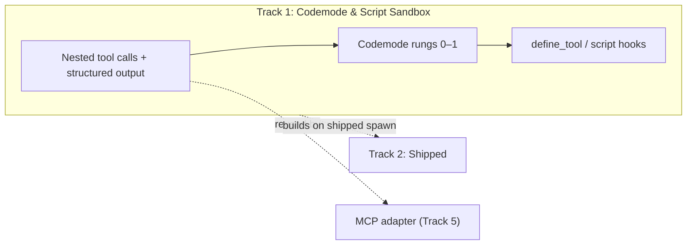
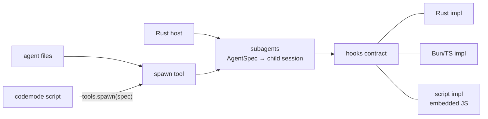

# axo plan: active work & open discussions

This is the live planning document for unbuilt work and active design discussions. It changes freely as we work.

- **Goals & settled architecture:** [`design.md`](design.md)
- **Implemented reference:** [`crates/axo/docs/README.md`](../crates/axo/docs/README.md)
- **Background studies:** [`pi/`](pi/README.md) and [`research/`](research/README.md)

## Overview of tracks

M1–M5 plus Tracks 2, 3, 4 and 7 are complete. See [Shipped tracks](#shipped-tracks) for landed work; this overview tracks the remaining work.



| Track | Scope | Status |
|---|---|---|
| **1. Codemode & script extensions** | Embedded JS sandbox (QuickJS/Boa engine evaluation), nested tool calls, structured tool output, `codemode` tool (rungs 0–1), then `define_tool` and script hooks on spawned specs (rungs 2–5) | Rungs 0–1 scoped; rungs 2+ in discussion. Not the current implementation priority |
| **5. MCP, `ast_edit` & extension follow-ups** | MCP tool adapter, optional structural edits and follow-ups to the shipped Bun bridge | Deferred |
| **6. ACP binary (`axo-acp`, M6)** | Stdio JSON-RPC binary mapping ACP onto `Session` | Deferred: rethink whether axo itself should ship ACP or leave it to a host |
| **7. Ask documents** | Rework `ask` from a list of option questions into one Markdown document with typed questions placed in reading order, one validated answer object, and notes | **Shipped.** See [Shipped tracks](#shipped-tracks) |
| **Tool surface & session modes** | Deferred tools, action tools, scoped host policy, cache-safe root mode overlays and completion | **Shipped (A–H).** See [Shipped tracks](#shipped-tracks) |

---

## Track 1: Codemode and script extensions

Notes from the design discussion of 2026-10-22. Only items marked **Decided** are settled; items marked **Direction** remain open for discussion.

### Where we landed

- **Decided:** axo builds a codemode tool in pi's shape (rungs 0–1 below): a stateless, sandboxed JavaScript script per call whose only powers are tool calls. It is built in, behind a Cargo feature, on an embedded engine. It does not wait for the Bun extension host.
- **Direction:** state lives in resources that tools own, not in the script; everything addressable is reachable from scripts; and scripts may configure the harness of the subagents they spawn, but not change the session the user talks to.
- **Shape:** three separate systems, each useful alone. Codemode composes them but owns none of them:
  1. subagents, specified by an `AgentSpec`;
  2. the script sandbox;
  3. the hooks contract, with a script implementation among others.

### omp `eval` vs pi `codemode`

Both let the model write code that calls tools, built for different jobs. Sources: pi 1.3.0 (`packages/coding-agent/docs/codemode.md`, `packages/codemode/README.md`, `extensions/codemode/`), omp 18.12.2 (`docs/tools/eval.md`, `src/prompts/tools/eval.md`).

| | omp `eval` | pi `codemode` |
|---|---|---|
| Unit | One cell per call, notebook-style | One script per call |
| State | Kernel stays alive between calls; lost on restart ("Kernel-loss notice means reload setup") | Fresh VM per script; small JSON values via `store`/`load`, saved as session entries per branch |
| Runtime | Bun worker (`Bun`, `fs`, `fetch`, `process`, `require`) and a Python subprocess | QuickJS compiled to WebAssembly: no files, network, timers or modules |
| Packages | `%bun add`, `%pip install`, `%load ./script.py` | None |
| Reach | Anything bash can, plus `tool.<name>()` | Only `tools.<name>()` and `models.*` |
| Host helpers | `agent()`, `workpool()`, `wait()`, `judge()`/`judgeBatch()`, `completion()`, `@tool` for subagents, extension preludes such as `browser` | `searchTools`, `describeTool`, `describeNamespace`, `models.classify`/`generateImages` |
| Output | Printed text, images, tables, DataFrame views, figures | `text()`, `image()`, `return`, `console`; capped by an output-token budget |
| Safety | `approval="exec"`, bash's trust level | Sandbox: 256 MB heap, interrupt handler, at most two workers per process |
| Long runs | Optional auto-backgrounding into an async job | Hard `timeout_ms` |
| Portability | Tied to omp | No pi dependencies; also runs on Cloudflare Workers |

#### Intent

- **omp: an agent workbench and orchestration language.** The doc opens with "Do not shell out to `python -c`, `bun -e`, or `node -e` through `bash`." Eval is the better home for code the agent was already running through bash:
  - state across calls for notebook-style exploration (DataFrame views, figure capture, `%pip`);
  - orchestration, through `agent()`, `workpool()`, `wait()` and `judge()`, so the agent runs other agents from code;
  - a home for extensions: preludes add globals such as `browser`.

  It is bash with better ergonomics, so it gets bash's trust level.
- **pi: composing tool calls and saving context.** "Only the script's output reaches the model, so a script can run calls in parallel and filter large results before the model sees them."
  - tool results are structured values, and only the script's output reaches the model;
  - MCP tools default to script-only exposure, so large servers stay out of the prompt and are found with `searchTools()`;
  - every effect is a tool call, so hooks, blocking and validation apply;
  - no hidden state, which suits durability.

  [INFERENCE: the name and framing match Cloudflare's "Code Mode"; pi's docs do not cite it.]

#### What pi's codemode cannot do

Impossible in pi's codemode as shipped:

1. **Keep a large working set across calls.** Example: load every session JSONL file once, then answer follow-up questions. `store` holds at most 256 KiB per value and 1 MiB in total.
2. **Take in a large file in one go.** `tools.read` returns the same 2000-line / 50 KB slice the model sees (`read.ts:216` builds the script value from the truncated content); `tools.bash` returns at most 1 MiB.
3. **Call an LLM or run agents from code.** Chat models "cannot be run from scripts"; only non-LLM classifiers and image models. pi has no subagent tool in core.
4. **Hold a live connection across calls.** A logged-in browser tab, a DB connection, a websocket. Inside a script there are no sockets at all.
5. **Keep working after its call returns.** For example, a 20-minute benchmark sweep while the conversation continues.
6. **Define tools that subagents call back into** (omp's `@tool`).

Possible only by going through `bash`, at the cost of a process per step, text in and out, and often a second language:

| Task | omp eval | pi codemode |
|---|---|---|
| Collect dependency versions from 30 `Cargo.toml` files | A TOML parser via `%bun add`, or `tomllib` | Regex by hand, or `cargo metadata` through bash |
| Fetch 50 PRs from the GitHub API | `fetch` in a loop | `curl` through bash per request |
| Plot cost per day | pandas and matplotlib | Write a `.py` file, run it with bash, `tools.read` the PNG, then `image()` |
| Poll CI every 30 s | A sleep loop | No timers; `bash sleep 30` between checks |
| Fuzzy-dedupe 50k strings | V8 or Python speed | QuickJS interprets with a 256 MB heap; slow, or bash a real runtime |
| Hash files, diff text, resize images | Standard library or packages | `sha256sum`, `diff`, `magick` through bash |

Codemode plus bash covers everything eval does except state between calls and orchestration. Items 3 and 6 are not sandbox limits: `agent()` or `completion()` is another host function or tool call. What a sandbox cannot give on its own is state or a handle that outlives the script.

### Embedded, not the Bun host

**Decided.** Earlier notes linked eval to the Bun extension host as a reuse shortcut ("the Bun host is already a JS runtime"). The two have opposite requirements:

| Need | Extensions (why Bun) | Codemode scripts |
|---|---|---|
| Access | Full runtime: `fetch`, fs, processes, npm, OAuth servers | Only tool calls, so `before_tool_call` cannot be bypassed |
| Sandbox | Given up on purpose | The point |
| Lifetime | Long-lived extension registrations and owned resources | One short script per call |
| Isolation | [Supervised Bun process per extension or user group](design.md#extension-parity-and-authority); installed code is trusted | A runaway script must not take extensions down |
| Cost when unused | Bun is host-supplied; the runner starts only when needed | Nothing to install |

- **pi does the same.** Its extensions run in Node/Bun, yet codemode runs in a separate QuickJS-wasm VM in a worker with a 256 MiB cap (`execute.ts`, `config.ts:491`).
- **Fewer hops.** In the Bun host, every nested tool call would cross the stdio bridge twice: script → Bun → axo's tool pipeline → Bun → script. Embedded, a nested call is an in-process call into the tool pipeline.
- **The VM has no power of its own.** QuickJS starts with nothing. Every capability is a Rust host function that axo injects. Rust decides what is possible; JS lets the agent express runtime logic (loops, conditions, filtering).
- **Engine candidates** (to verify in a short spike before coding):

  | Engine | Notes |
  |---|---|
  | QuickJS (`rquickjs`) | Initial candidate: verify async Rust integration, memory/interrupt controls and per-context overhead; no engine selected |
  | `boa` | Rust implementation; user interested in evaluating it for codemode (2026-11-15). Not selected; compare during the engine spike |
  | V8 (`deno_core`) | Fast, but tens of MB in the binary; against the memory goal |

### The model: a ladder of power

#### Three ideas

- **A. Data lives in a tool or resource, not in the script.** The script stays stateless. Anything that lasts has an owner and a name; scripts refer to it by name. Each resource has its own crash behavior, unlike an eval kernel where everything dies together:

  | Resource | Owner | Name |
  |---|---|---|
  | A dataset | A query tool, e.g. SQLite in the session directory | `table://sessions` |
  | A browser tab | The browser tool | `browser://tab/3` |
  | A long command | The job registry | `proc://bg_2` |
  | A subagent | Child sessions | `agent://reviewer-4` |

- **B. Everything addressable is callable.** URL schemes supply the nouns, tools the verbs, subagents the workers. A script sees all of them as one object model, and every call passes through the tool pipeline.
- **C. Scripts extend axo.** Once scripts can call everything, the next step is letting them add things.

#### The ladder

| Rung | The script can… | Example |
|---|---|---|
| 0 | call tools | pi's codemode |
| 1 | call named resources (A, B) | query `sessions`, wait on `agent://…` |
| 2 | define functions that later scripts reuse | a `parseCargoLock()` helper for this session |
| 3 | register tools the model or subagents can call | a `pr_status` tool wrapping `gh` |
| 4 | register hooks | after each edit to a `.rs` file, run `cargo check` and attach errors |
| 5 | change the prompt or tool set | add a section; hide tools for a focused task |

**Decided:** rungs 0–1 are the initial codemode build scope, not a prerequisite for the current extension work. Rungs 2 and up need the design below.

- **Rungs 2 and 3 merge.** A saved function is a defined tool that only scripts can call.
- **Tools and hooks differ in kind.** A tool runs only when called; the call and its result are visible, and a bad tool is one the model can stop using. A hook runs on every matching event without being called, and can block, rewrite or redirect other calls or decide whether the loop continues. A tool adds a new verb; a hook changes how the existing ones behave.
- **Skills can carry scripts.** A markdown skill can come with a script that sets up the hooks and tools its task needs. The agent can also write such a script mid-task and save it as a skill afterward.
- **Seams, not internals.** Scripts only plug into published seams: before/after tool call, prepare request, finish turn, the steer and follow-up queues, context edits, prompt sections, tool registration.

#### Parent and children

**Direction:**

> A script may **add** to the parent: functions and script-callable tools (rungs 2–3). It may **change behavior** (hooks, prompt sections, tool set, loop control; rungs 4–5) only in children it spawns.

The session the user talks to is changed only by the user. Children are disposable agents a script builds for one job; their hooks die with them.

This proposed restriction concerns model-written scripts, not user-installed Bun extensions acting with the user's authority. See [extension parity and authority](design.md#extension-parity-and-authority).

- **The invariant.** Children inherit the parent's policy: user settings, user and project extensions, project trust, the exec environment. Script hooks run **before** that inherited policy, so the policy always sees the final arguments that will run. A script can tighten a child's rules, never loosen them past the user's.
- **What it fixes:**
  - persistent prompt injection cannot take over the parent;
  - silent interference, and hooks outliving their reason, are confined to a child with one task;
  - the parent's tool set, and so its prompt cache, never changes;
  - provenance comes naturally ("child `reviewer-3`, built by the script at entry #N, with hooks X and Y");
  - durability is mostly free: child sessions are linked to the call that spawned them, and the child's harness setup is system messages in its own transcript.
- **What it costs:**
  - delegation overhead: a child needs a briefing and its own context, so it uses more tokens and takes longer;
  - children should return small schema-shaped results, not transcripts;
  - changes to the parent session move to user-level config.

### Three systems, one job each



1. **Subagents (Rust core).** An `AgentSpec` is plain data (`name`, `description`, `model`, `tools`, `contextFiles`, `sections`, `output`, `maxTurns`, body); inline specs in `spawn` restrict prompt, tools, model, and output. Spawning it returns a handle (`agent://<id>`) to wait on. It knows nothing about JS.
2. **The script sandbox.** Runs JS with injected host functions under limits. Codemode is a thin tool on top of it; `define_tool` sources and script hooks reuse the same sandbox.
3. **Hooks.** One Rust contract with several implementations: Rust (hosts and first-party features), TypeScript (Bun extensions), and a script implementation that runs stored JS in the sandbox when the hook fires.

#### Which tool grants each rung

| Rung | Tool | Applies to |
|---|---|---|
| 2–3 | `define_tool` (name TBD) | The current session, as an addition |
| 4 | `spawn`, through a proposed `hooks` field on the spec | Only the spawned child |
| 5 | `spawn`, through the spec's `prompt` and `tools` fields | Only the spawned child |

`define_tool`:

```json
{
  "name": "cargo_errors",
  "description": "Run cargo check on one crate; return only error lines",
  "parameters": { "type": "object", "properties": { "crate": { "type": "string" } }, "required": ["crate"] },
  "source": "const r = await tools.bash({ command: `cargo check -p ${args.crate} --message-format short` }); return r.output.split('\\n').filter(l => l.startsWith('error'));"
}
```

- `source` runs in the sandbox, so the tool can only call other tools.
- Saved as a session entry: replayed on resume, scoped to its branch, kept through compaction.
- Script-only exposure by default, so the parent's declared tool set does not change. Children can be given it by name.

`spawn` with a child harness:

```json
{
  "spec": {
    "prompt": "Refactor compaction/summary.rs to …",
    "tools": ["read", "edit", "bash", "cargo_errors"],
    "hooks": [{
      "on": "after_tool_call",
      "tools": ["edit", "write"],
      "source": "if (call.args.path.endsWith('.rs')) result.append(await tools.cargo_errors({ crate: 'axo' }));"
    }],
    "output": { "type": "object", "properties": { "summary": { "type": "string" } } }
  },
  "task": "Refactor compaction/summary.rs to …"
}
```

**Codemode is only as powerful as the tools it can call.** Two caveats:
- the ceiling is the most powerful callable tool (`bash`); the sandbox guarantees that effects pass through the tool pipeline and its hooks, not that they are restricted;
- scale is new: a script can make 500 calls where the model would make 5, so call-count limits and timeouts belong on codemode itself.

### Scenarios and risks

| User says | What gets set up | Uses | Under the parent/child rule |
|---|---|---|---|
| "Refactor the compaction module, keep it compiling" | After each edit to `crates/axo/**/*.rs`, run `cargo check -p axo` and attach the first errors | after-tool hook | ✅ Runs in a child; the parent orchestrates |
| "Don't touch generated files, never run `cargo update`" | Block edits under `**/generated/**` and bash matching `cargo update` | before-tool hook | ❌ for the parent (user settings/policy); ✅ imposed on children |
| "Plan first, change nothing until I say go" | Block `write`, `edit` and mutating bash; add a "planning" prompt section; remove both on "go" | before-tool hook, prompt section | ❌ for the parent (a user command; shipped as a root mode with tool limits and `bash: readOnly`); ✅ as a read-only planner child |
| "Keep fixing until the tests pass, at most 5 tries" | When the model would stop, run tests; if they fail and tries remain, continue with failures as a follow-up | finish-turn hook, follow-up queue | ✅ A child with the loop returns the final result |
| "Check my PRs' CI" (repeatedly) | A `pr_status` tool defined once (`gh api` + parsing) | `define_tool` | ✅ An addition |
| `/review:adversarial` | 6 scouts with output schemas, a skeptic per finding, triage, report | agents, resources | ✅ Already children |
| "Debug this flaky test" (huge logs) | For `cargo test` output, keep only failing tests and panics; full output in an artifact | after-tool hook rewriting results | ✅ A child runs and filters the tests |
| "Analyze my axo sessions" | Load sessions into a table once, define helper queries, reuse across turns | query resource, saved functions | ✅ An addition |

Key risks to design around when building step 3 (script hooks):
1. **Persistent prompt injection:** contained to children by the parent/child rule and inherited-policy-last ordering; hooks may also get a narrower set of host functions than scripts.
2. **Silent interference:** every block or rewrite must carry provenance ("blocked by hook `no-update`, defined at entry #123"), and active hooks/tools must be inspectable.
3. **Bugs and stalls on the hot path:** per-hook time budget, auto-disable after errors with a notice, no recursive self-triggering, and cancellation propagation.
4. **Prompt cache churn:** new tools default to script-only exposure so the declared tool set stays stable.
5. **VM lifetime for hooks:** measure a fresh embedded-engine context per hook invocation (stateless, durable) against one VM per session.

### Step 1 build scope: Codemode rungs 0–1

1. **Embedded-engine spike:** compare `rquickjs` and Boa for async/tokio bridging, language compatibility, memory and execution limits, cancellation and per-context overhead against the PSS target. The user is interested in Boa for codemode; no engine has been selected.
2. **Core prerequisites (`axo-agent` & `axo`):**
   - **Nested tool calls:** extend `ToolContext` with a nested-call runner that goes through prepare, validate, `ToolHooks` / `ToolPolicy::before_tool_call`, and `ToolPolicy::after_tool_call`, inheriting the parent's `ToolScope` (mode, `BashAccess`, `writes`, depth). Hosts and policies therefore see both the outer `codemode` call (with script source) and each inner nested call with its resolved arguments. Assign `<parent>/<n>` IDs, tag `AgentEvent::ToolExecution*` with `parent_call_id`, and record nested calls (preserving `details.files` / `FileChange` snapshots from nested `edit`/`write` calls) on the parent `ToolResultMessage` so compaction extracts file operations and hosts can render collapsed script blocks with real diffs and rebuild them from the journal.
   - **Structured tool output:** add `output_schema` and `structured_content: Option<Value>` on `ToolOutput` (for `bash`: `{ output, truncated, full_output_path, exit_code, wall_time_seconds }` with a 1 MiB output cap; for `read`: text string or image object).
3. **Sandbox module (`axo::script`):** standalone module (not buried inside the tool) that runs JS on a blocking worker thread with a memory cap, interrupt budget/timeout, concurrency semaphore, and channel bridge for async host functions.
4. **`codemode` tool (`axo::tools::codemode`):**
   - Globals: `tools.*`, `searchTools()` / `describeTool()` (backed by the deferred tool catalog / `tool://`), `text()`, `image()`, `return`, `console.*`, `exit()`, `store(k, v)` / `load(k)` (backed by branch-scoped `custom` session entries committed only when the script succeeds), and `// @options: {"max_output_tokens", "timeout_ms"}`.
   - Keep the tool description compact (at most active direct tools' declarations) and discover deferred, extension, and MCP tools on demand via `searchTools()` / `describeTool()` so large catalogs do not bloat context or churn the prompt cache.
   - User-only enablement (never auto-enabled by project-level config, matching `extensions`).
   - `Replay::Never`: crash recovery reports the script as interrupted and lists completed nested calls.

---

## Shipped tracks

- **Track 2 (Agents, `spawn`, teams):** Landed in code; settled architecture decisions in [`design.md`](design.md#agents-and-child-sessions-axo) and runtime reference in [`crates/axo/docs/prompts-and-context.md`](../crates/axo/docs/prompts-and-context.md#agent-definitions), [`crates/axo/docs/sessions-and-compaction.md`](../crates/axo/docs/sessions-and-compaction.md#child-sessions), and [`crates/axo/docs/extending.md`](../crates/axo/docs/extending.md#spawning-child-sessions). Grounding research in [`research/subagents.md`](research/subagents.md).
- **Track 3 (Async `bash`, background jobs & `wait`):** Landed in code; settled decisions in [`design.md`](design.md#settled-core-decisions) and runtime reference in [`crates/axo/docs/configuration.md`](../crates/axo/docs/configuration.md#command-supervision-axosupervision) and [`crates/axo/docs/sessions-and-compaction.md`](../crates/axo/docs/sessions-and-compaction.md#background-job-durability). Historical verification log preserved in [`research/track3-supervision.md`](research/track3-supervision.md).
- **Track 4 (URL scheme registry):** Landed in code; settled decisions in [`design.md`](design.md#settled-core-decisions) and runtime reference in [`crates/axo/docs/extending.md`](../crates/axo/docs/extending.md#3-rust-extension-traits).
- **Host surface:** Landed in code: typed job and child state over one ordered event stream with complete attach snapshots, live command output, persisted switchable root personas, durable host messages, and introspection getters. Settled contracts in [`design.md`](design.md#host-contract-axo); persona and mode grounding in [`research/personas-and-modes.md`](research/personas-and-modes.md).
- **Tool surface & session modes, A–H:** Landed in code: public model tool-change capability (A), deferred dispatch with one inner tool identity (B), `kill`/`send` replacing action writes (C), deferred exposure, read-only `tool://`, `call`, promotion and reconciled catalog notices (D), root mode definitions/catalog (E), scoped `ToolPolicy` replacing session-level `tool_hooks` (F), journal-derived mode selection, boundary effectiveness, reconciled instructions, call-time limits, inherited child limits, model restoration, commands and events (G), and deferred `enter_mode`, schema-validated mode `yield`, typed result review, continuation and shared pending-decision machinery (H). The approved tool-surface/session-mode plan is complete. Settled contracts in [`design.md`](design.md#session-modes-axo) and [`design.md`](design.md#built-in-tools-and-execution-environment-axo); runtime reference in [`crates/axo/docs/extending.md`](../crates/axo/docs/extending.md), [`crates/axo/docs/prompts-and-context.md`](../crates/axo/docs/prompts-and-context.md), and [`crates/axo/docs/sessions-and-compaction.md`](../crates/axo/docs/sessions-and-compaction.md).
- **Definitions, inspection and tree usage:** Landed in code: persona and child spec bodies in their own `agent` prompt section; `:`-namespaced mode and skill names derived from folders; `ModeSpec::parse`, `AgentSpec::parse` and `KeywordSpec::parse` for host-bundled markdown; keyword definitions with persistent, `/model`-equivalent model selection; side-effect-free host tool inspection (`Session::tools`, host `tool://` reads); read-only `bash` through `BashAccess` and Landlock; typed `ResultResolution` and persisted review `details`; structured `kill`/`send` details; `Session::resume_wakes`; executing child tools and unread mail on child rows; and journal-derived whole-tree usage (`Session::tree_usage`, `SessionEvent::TreeUsage`). Opening a child while its root is closed stays a documented root-first flow, not a new API. Settled contracts in [`design.md`](design.md#settled-core-decisions); runtime reference in [`crates/axo/docs/prompts-and-context.md`](../crates/axo/docs/prompts-and-context.md#keyword-definitions), [`crates/axo/docs/configuration.md`](../crates/axo/docs/configuration.md#keywords-keywords--keywordsettings), [`crates/axo/docs/sessions-and-compaction.md`](../crates/axo/docs/sessions-and-compaction.md#tree-usage), and [`crates/axo/docs/extending.md`](../crates/axo/docs/extending.md#background-jobs-for-hosts).
- **Host capability handoff:** Landed in code: `ConfigLayer::skill_roots` with Read/Trust project skills gates and existing discovery precedence; synchronized activity snapshots/events plus `is_running` (observation, not reservation); selected/effective mode surfaces; schema-validated edited acceptance retaining original and accepted values; built-versus-recorded prompt inspection, context-file inventories and ledger hashes; rich retry events; typed `kill`/`send`/`wait`/`spawn` receipts and routed host `send` with provenance; stdout/stderr capture with durable `.streams` sidecars and retained-log reads. Raw artifacts stay merged; stream ordering is capture order, not true chronology. No host `prepare_request` hook or event envelope was added; the provider `RequestRewrite` is the separate level-2 wire seam. Runtime contracts live in [`extending.md`](../crates/axo/docs/extending.md).
- **Keyword replay and write scopes:** Landed in code: `Entry::Submission::keywords` records the keywords that fired, and reopen requeues from those recorded names instead of matching again; frontmatter `writes` on modes and agents scopes `write`/`edit` (`ModeSpec::writes`, `AgentSpec::writes`, `ToolScope::writes`, `SessionTools::check_write`) and persists onto children as the `SpawnLink::writes` ceiling.
- **File-change snapshots:** File tools report accesses in `details.files`, with a `FileChange` for each mutation (before/after `SnapshotBlob`s and a `LineDiff` for diffable text). Raw snapshots are content-addressed, never-pruned blobs under `<session>/snapshots/`; `edit` refuses non-UTF-8 files. Hosts read blobs (`Session::read_snapshot`, lock-free `Axo::read_snapshot`) and squash ranges (`squash`, `squash_changes`); forks link only the blobs their path references. Runtime contract in [`crates/axo/docs/extending.md`](../crates/axo/docs/extending.md#file-changes-for-hosts).
- **Queue control:** Landed in code: input sent after a Stop is delivered when the stopped run settles (a Stop latches when pressed, a failed run when it settles); `Session::resume_wakes` also sends held steers and follow-ups; `steeringMode` defaults to `"all"`; `Session::withdraw` takes queued input back, recorded as `Entry::SubmissionWithdrawn` so reopening never requeues it; `LiveSnapshot::queued` lists `QueuedInput` with submission ids; a queued steer settles a pending `ask` question or reviewed `yield` (`ResultResolution::Steered`) instead of waiting behind it. Runtime contract in [`crates/axo/docs/extending.md`](../crates/axo/docs/extending.md#queued-input-for-hosts).
- **Track 5 (Bun extensions):** Phases 1–4 and extension API parity plans A and B shipped independently of codemode. See [settled architecture](design.md#extension-parity-and-authority) and the [runtime reference](../crates/axo/docs/extending.md#4-bun-extensions-axo-extensions).
- **Extension host inspection and provenance:** Landed in code: typed provider and extension origins, attributed blocked tool results, typed extension problems, live Bun replacement across scopes, disk-only package inspection and authored-package listings, provider ownership, and installed-copy revision/time metadata. Install records use whole copies with no old-format migration. Runtime contract in [Bun extensions](../crates/axo/docs/extending.md#4-bun-extensions-axo-extensions).
- **Track 7 (Ask documents):** Landed in code: `ask` takes one document of Markdown and typed `choice`/`text`/`number` blocks (`AskBlock`), validates the call and the host's submission against it (an invalid `Session::answer` returns `Error::InvalidInput` and stays pending), and returns one answer object keyed by question id; a timeout submits only `recommended`/`prefill`/`default` values. Runtime contract in [`crates/axo/docs/extending.md`](../crates/axo/docs/extending.md#ask-documents-for-hosts).
- **Decomplect cleanup:** Completed the model-registry and session responsibility splits, shared provider overlays and rewrite-once dispatch, finite tier validation, host/layer `Registrations`, pre-factory tool restrictions, atomic agent selection and queue-withdrawal tokens, provenance-only submissions, and one gated parked-child revival path. Extension dispatch now separates host and model calls and names bash execution `tools.runBash`; root and scoped extensions share `ExtensionSet`, validate options at construction, serialize dependency-failure resets, and use socket-bound wire identity with code-only runner errors. Test helpers were consolidated without changing the dependency direction. Settled ownership is recorded in [`design.md`](design.md#architecture); live contracts are in the [embedding reference](../crates/axo/docs/extending.md).

---

## Track 5: Extensions (Bun host), MCP & `ast_edit`

General extension-to-host UI requests and provider level 3 is `ProviderTransport` (Rust registrations own the HTTP exchange while axo encodes, retries and decodes); extension-emitted normalized events and custom streams remain deferred. Projects declaring managed extension installs are not scheduled.

### Background studies

The [extension-system study](research/extensions.md) records OMP, pi, Octet, Claude Mods, Goose, OpenCode and Zed, plus provider/auth research. pi/OMP's host-owned login/refresh/auth contract is the main precedent; OpenCode's custom-fetch approach and Octet's transport boundary illustrate broader options, not the selected level-2 scope. Octet's protocol types do not establish a working extension login, and source-only or current-branch features are not release guarantees.

The [Bun study](research/bun-topology.md) preserves the original shared-loop/Worker experiment and a separate process-per-extension follow-up. The latter informed the selected process default. Whole-tree PSS, workloads, retained dependencies and measurement availability matter; the follow-up's programs/raw data were not retained, and its figures are not directly comparable to the earlier workload. Killing a Bun runner does not kill the Rust host. Process boundaries permit cleanup and attribution, not automatic quotas or OS sandboxing.

Live vendor verification is separate from the bridge's deterministic offline checks and opt-in real-Bun scenarios.

Unbuilt: extension providers reporting account usage (a `usage` handler mirroring `ProviderUsage`, like `listModels` mirrors `ProviderModels`); their `Provider::usage` is `None` until a Bun provider needs it.

### MCP tool adapter

- **Configuration files.** Read the first existing ecosystem project-root file of `.mcp.json`, then `mcp.json`, plus host-supplied user MCP configuration (separate from settings), using the `{ "mcpServers": { name: { command, args, env } | { url, headers } } }` format.
- **Trust gate.** Project MCP servers require `ProjectAccess::Trust`; at `Read` access they emit a diagnostic rather than starting. Add `project.files.mcp` (default `true`) when MCP lands.
- **Transport.** Target stdio for local servers and stateless Streamable HTTP (`/mcp`, MCP 2026-07-28 spec) for remote servers; skip legacy stateful SSE transport.
- **Tool exposure.** Direct and deferred exposure already ship with the tool surface: MCP adapters can reuse the deferred catalog and `call` without flooding native declarations, and large remote MCP catalogs pair naturally with caller-side `codemode` (`searchTools()` / `describeTool()`). Server-side Code Mode endpoints (exposing `search` and `execute`) work as ordinary MCP tools. Codemode/script-only and hidden exposure remain part of this track's design, not additional shipped exposure variants.

### `ast_edit`

- Optional extension or Cargo feature providing structural search-and-rewrite via `ast-grep` patterns (`research/edit-formats.md` §7, `research/pi-edit.md`). Kept out of the default build to avoid pulling `tree-sitter` C grammars unless requested.

---

## Track 6: ACP binary (`axo-acp`, M6 — deferred)

Deferred pending a rethink of whether axo itself should ship ACP or leave it to a host. The notes below record the mapping if it is resumed.

Maps the [Agent Client Protocol](https://agentclientprotocol.com) over stdio onto `axo::Session`:

| ACP | `Session` |
|---|---|
| `session/new` and `session/load` | `create_session` and `open_session` + `attach` |
| `session/prompt` | `Session::parse_command` + `run_command` for `/<builtin>` and `/<mode>` text (ACP clients send commands as prompt text), otherwise `prompt` (and `steer` / `follow_up` mapping) |
| `session/cancel` | `abort` |
| `session/update` | Streams `AgentEvent`s through `Accumulator` |
| `availableCommands` | Publishes `Session::commands()`: built-ins with their `parameters` schema, then modes, registered commands and skills with `argumentHint` (→ `input.hint`) |

Decisions when resumed:
1. Use the `agent-client-protocol` crate or handwritten serde types (<1k lines).
2. Default to `RecoveryPolicy::MarkInterrupted` on interactive open so the user decides whether to resume an interrupted run.
3. Optional ACP `terminal/create` backend for `bash`.

---

## Track 7: Ask documents

Shipped; the contract lives in [Ask documents for hosts](../crates/axo/docs/extending.md#ask-documents-for-hosts). Axome and Sworm adopt it on their next axo bump.

Later, not in this track: pasted images on notes, and re-answering a settled question on a sibling branch (both exist in omp).

---

## Deferred studies

- **Compaction follow-ups (`research/compaction-methods.md`):** background precomputed summaries before the threshold; optional provider server-side compaction; Factory-style probe-based prompt evaluation harness.
- **Token-efficiency / output minimizer:** evaluate source-time output filtering for noisy build/test commands (with full output recoverable via spool paths).
- **Swarm versus teams (`research/swarm.md`, pinned 2026-11-21):** compared against shipped teams and not adopted. Teams already meet the spec's activation, delivery, pause and reopen recovery contracts through receiver-side mail. The unbuilt parts are a shared board, a changeable roster, a finish/cancel seal and idempotent send retries. A board readable by every member is not wanted by default: it invites over-reading and breaks independent review, and the parent and host, who want the full trail, can read mail from the child journals. No second coordination system is planned beside teams; a host may name a coordinator protocol "swarm" in its own keyword. Revisit only for large rosters or a first-class host timeline. One open check: whether each member run's result starts a parent turn, which keeps the parent a hub.
  - **Planned, unbuilt: spawner broadcast.** The only change taken from the study. The agent that spawned a team, usually the root, can message every member at once; members still have no broadcast. Sketch: `send` accepts the team id (`team_N`, which cannot collide with a roster name) and queues one ordinary child follow-up per member in roster order, or a steer with `steer: true`, reusing the single-child path. Hosts get the same operation as a typed method returning one receipt per member. Open: the receipt shape, and how a failure after some members were reached is reported.

---

## Open questions

1. **Are codemode rungs 2+ in scope?** From rung 2 up (defined tools and script hooks), model-written scripts may consume a restricted subset of shared integration contracts. They are not a prerequisite or necessarily the first consumer of extensions.
2. **Higher-rung script overlap.** Trusted full-runtime Bun extensions and bounded embedded-engine codemode are separate. Which shared operations model-written tools/hooks may use, and how those definitions persist/promote, remain open; do not reopen [Bun extension authority](design.md#extension-parity-and-authority) as a generic sandbox question. Deferred work lives in [Track 5](#track-5-extensions-bun-host-mcp--ast_edit).
3. **Parent-and-children rule** (Track 1, codemode rungs 2+). Adopt the rule strictly (scripts may add tools to the parent, but may only attach hooks/prompt changes to spawned children), or allow some parent hooks? Shipped `InlineSpec` enforces the strict form by shape: inline specs carry only `prompt`, `tools`, `model`, and `output`, while host policies and hooks are inherited (see [`design.md`](design.md#agents-and-child-sessions-axo)).
4. **Where model-written tools/scripts live and how they promote.** Session-scoped (`custom` entries) by default; what is the file format and workflow for promoting a useful tool to a host-provided location?
5. **Hook safety without approvals** (Track 1, codemode rungs 2+). Since axo has no approval system (`design.md`), should child script hooks be restricted to a narrower host-function set (e.g. no network/write outside cwd), or rely strictly on the parent's inherited policy hooks running last?
6. **Which stateful resources ship built-in:** a SQLite-backed `table` tool, browser? (Subagents ship with Track 2; background `bash` jobs ship with Track 3.)
7. **VM lifetime for script hooks:** fresh embedded-engine context per hook invocation vs one retained context per child session (measure PSS impact).
8. **Naming:** tool names (`codemode` vs `eval` vs `script`, `define_tool`) and module path (`axo::script`).
9. **Orchestration in scripts** (Track 1, codemode rungs 2+): expose subagents and one-shot completions strictly through `tools.spawn(...)` (preserving "no powers beyond tools"), or also as top-level helpers?
10. ~~**Per-host identity.**~~ Resolved in Track 2: `axo` by default, renamed per host through `AxoBuilder::name`.
