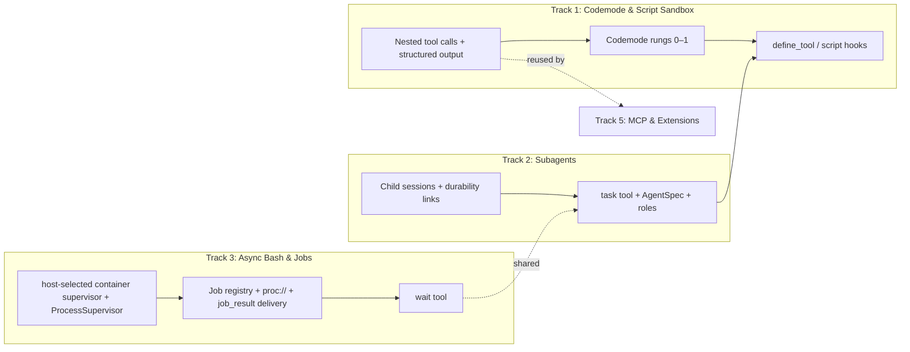
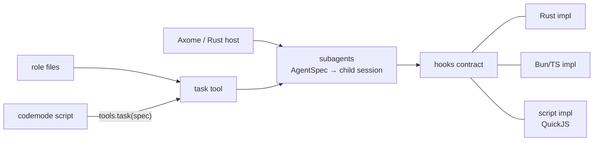

# axo plan: active work & open discussions

This is the live planning document for unbuilt work and active design discussions. It changes freely as we work.

- **Goals & settled architecture:** [`design.md`](design.md)
- **Implemented reference (M1–M5):** [`crates/axo/docs/README.md`](../crates/axo/docs/README.md)
- **Background studies:** [`pi/`](pi/README.md) and [`research/`](research/README.md)

## Overview of tracks

M1–M5 are complete. The remaining work splits into independent tracks (`axo-acp` is on hold):



| Track | Scope | Status |
|---|---|---|
| **1. Codemode, script extensions & agent specs** | Embedded JS sandbox (`rquickjs`), nested tool calls, structured tool output, `codemode` tool (rungs 0–1), then `define_tool` and child script hooks (rungs 2–5) | **Active focus.** Rungs 0–1 decided; rungs 2+ in discussion |
| **2. Subagents (`task`) & `AgentSpec`** | In-process child sessions linked to parent tool calls, `.agents/agents` / `~/.axo/agents` role definitions, schema-validated outputs | Planned |
| **3. Async `bash`, background jobs & `wait`** | Host-selected supervision (`Supervision`: default process groups, opt-in cgroup v2 through an embedded supervisor entry point), per-session `JobRegistry`, promotion (`async`, 60 s, steer), `proc://`, `job_result` follow-up delivery, `wait` tool | Implemented and verified: ordinary workspace gates, explicit cgroup failure/success, process-group crash cleanup and live drive checks in both modes pass |
| **4. URL scheme registry** | Per-session `scheme://` handlers resolved by `read`/`write`/`edit`/`grep`/`find` (and bash arguments); first wave `artifact://`, `skill://`, `axo://`, `local://`; host-registered schemes | Implemented |
| **5. Extensions (Bun host), MCP & `ast_edit`** | Extension contract, Bun stdio host & `@axo/sdk`, `.mcp.json` / `~/.axo/mcp.json` tool adapter, optional `ast_edit` | Planned |
| **6. ACP binary (`axo-acp`, M6)** | Stdio JSON-RPC binary mapping ACP onto `Session` | On hold |

---

## Track 1: Codemode, script extensions and agent specs

Notes from the design discussion of 2026-10-22. Only items marked **Decided** are settled; items marked **Direction** remain open for discussion.

### Where we landed

- **Decided:** axo builds a codemode tool in pi's shape (rungs 0–1 below): a stateless, sandboxed JavaScript script per call whose only powers are tool calls. It is built in, behind a Cargo feature, on an embedded engine. It does not wait for the Bun extension host.
- **Direction:** state lives in resources that tools own, not in the script; everything addressable is reachable from scripts; and scripts may configure the harness of the subagents they spawn, but not change the session the user talks to.
- **Shape:** three separate systems, each useful alone. Codemode composes them but owns none of them:
  1. subagents, specified by an `AgentSpec`;
  2. the script sandbox;
  3. the hooks contract, with a script implementation among others.

### omp `eval` vs pi `codemode`

Both let the model write code that calls tools, built for different jobs. Sources: pi 1.3.0 (`packages/coding-agent/docs/codemode.md`, `packages/codemode/README.md`, `extensions/codemode/`), omp 18.12.2 (`docs/tools/eval.md`, `src/prompts/tools/eval.md`).

| | omp `eval` | pi `codemode` |
|---|---|---|
| Unit | One cell per call, notebook-style | One script per call |
| State | Kernel stays alive between calls; lost on restart ("Kernel-loss notice means reload setup") | Fresh VM per script; small JSON values via `store`/`load`, saved as session entries per branch |
| Runtime | Bun worker (`Bun`, `fs`, `fetch`, `process`, `require`) and a Python subprocess | QuickJS compiled to WebAssembly: no files, network, timers or modules |
| Packages | `%bun add`, `%pip install`, `%load ./script.py` | None |
| Reach | Anything bash can, plus `tool.<name>()` | Only `tools.<name>()` and `models.*` |
| Host helpers | `agent()`, `workpool()`, `wait()`, `judge()`/`judgeBatch()`, `completion()`, `@tool` for subagents, extension preludes such as `browser` | `searchTools`, `describeTool`, `describeNamespace`, `models.classify`/`generateImages` |
| Output | Printed text, images, tables, DataFrame views, figures | `text()`, `image()`, `return`, `console`; capped by an output-token budget |
| Safety | `approval="exec"`, bash's trust level | Sandbox: 256 MB heap, interrupt handler, at most two workers per process |
| Long runs | Optional auto-backgrounding into an async job | Hard `timeout_ms` |
| Portability | Tied to omp | No pi dependencies; also runs on Cloudflare Workers |

#### Intent

- **omp: an agent workbench and orchestration language.** The doc opens with "Do not shell out to `python -c`, `bun -e`, or `node -e` through `bash`." Eval is the better home for code the agent was already running through bash:
  - state across calls for notebook-style exploration (DataFrame views, figure capture, `%pip`);
  - orchestration, through `agent()`, `workpool()`, `wait()` and `judge()`, so the agent runs other agents from code;
  - a home for extensions: preludes add globals such as `browser`.

  It is bash with better ergonomics, so it gets bash's trust level.
- **pi: composing tool calls and saving context.** "Only the script's output reaches the model, so a script can run calls in parallel and filter large results before the model sees them."
  - tool results are structured values, and only the script's output reaches the model;
  - MCP tools default to script-only exposure, so large servers stay out of the prompt and are found with `searchTools()`;
  - every effect is a tool call, so hooks, blocking and validation apply;
  - no hidden state, which suits durability.

  [INFERENCE: the name and framing match Cloudflare's "Code Mode"; pi's docs do not cite it.]

#### What pi's codemode cannot do

Impossible in pi's codemode as shipped:

1. **Keep a large working set across calls.** Example: load every session JSONL file once, then answer follow-up questions. `store` holds at most 256 KiB per value and 1 MiB in total.
2. **Take in a large file in one go.** `tools.read` returns the same 2000-line / 50 KB slice the model sees (`read.ts:216` builds the script value from the truncated content); `tools.bash` returns at most 1 MiB.
3. **Call an LLM or run agents from code.** Chat models "cannot be run from scripts"; only non-LLM classifiers and image models. pi has no subagent tool in core.
4. **Hold a live connection across calls.** A logged-in browser tab, a DB connection, a websocket. Inside a script there are no sockets at all.
5. **Keep working after its call returns.** For example, a 20-minute benchmark sweep while the conversation continues.
6. **Define tools that subagents call back into** (omp's `@tool`).

Possible only by going through `bash`, at the cost of a process per step, text in and out, and often a second language:

| Task | omp eval | pi codemode |
|---|---|---|
| Collect dependency versions from 30 `Cargo.toml` files | A TOML parser via `%bun add`, or `tomllib` | Regex by hand, or `cargo metadata` through bash |
| Fetch 50 PRs from the GitHub API | `fetch` in a loop | `curl` through bash per request |
| Plot cost per day | pandas and matplotlib | Write a `.py` file, run it with bash, `tools.read` the PNG, then `image()` |
| Poll CI every 30 s | A sleep loop | No timers; `bash sleep 30` between checks |
| Fuzzy-dedupe 50k strings | V8 or Python speed | QuickJS interprets with a 256 MB heap; slow, or bash a real runtime |
| Hash files, diff text, resize images | Standard library or packages | `sha256sum`, `diff`, `magick` through bash |

Codemode plus bash covers everything eval does except state between calls and orchestration. Items 3 and 6 are not sandbox limits: `agent()` or `completion()` is another host function or tool call. What a sandbox cannot give on its own is state or a handle that outlives the script.

### Embedded, not the Bun host

**Decided.** Earlier notes linked eval to the Bun extension host as a reuse shortcut ("the Bun host is already a JS runtime"). The two have opposite requirements:

| Need | Extensions (why Bun) | Codemode scripts |
|---|---|---|
| Access | Full runtime: `fetch`, fs, processes, npm, OAuth servers | Only tool calls, so `before_tool_call` cannot be bypassed |
| Sandbox | Given up on purpose | The point |
| Lifetime | One long-lived process | One short script per call |
| Isolation | One process for all extensions | A runaway script must not take extensions down |
| Cost when unused | Bun must be installed | Nothing to install |

- **pi does the same.** Its extensions run in Node/Bun, yet codemode runs in a separate QuickJS-wasm VM in a worker with a 256 MiB cap (`execute.ts`, `config.ts:491`).
- **Fewer hops.** In the Bun host, every nested tool call would cross the stdio bridge twice: script → Bun → axo's tool pipeline → Bun → script. Embedded, a nested call is an in-process call into the tool pipeline.
- **The VM has no power of its own.** QuickJS starts with nothing. Every capability is a Rust host function that axo injects. Rust decides what is possible; JS lets the agent express runtime logic (loops, conditions, filtering).
- **Engine candidates** (to verify in a short spike before coding):

  | Engine | Notes |
  |---|---|
  | QuickJS (`rquickjs`) | Small; memory and interrupt limits; can await Rust futures. The default |
  | `boa` | Pure Rust, slower. The fallback |
  | V8 (`deno_core`) | Fast, but tens of MB in the binary; against the memory goal |

### The model: a ladder of power

#### Three ideas

- **A. Data lives in a tool or resource, not in the script.** The script stays stateless. Anything that lasts has an owner and a name; scripts refer to it by name. Each resource has its own crash behavior, unlike an eval kernel where everything dies together:

  | Resource | Owner | Name |
  |---|---|---|
  | A dataset | A query tool, e.g. SQLite in the session directory | `table://sessions` |
  | A browser tab | The browser tool | `browser://tab/3` |
  | A long command | The job registry | `proc://bg_2` |
  | A subagent | Child sessions | `agent://reviewer-4` |

- **B. Everything addressable is callable.** URL schemes supply the nouns, tools the verbs, subagents the workers. A script sees all of them as one object model, and every call passes through the tool pipeline.
- **C. Scripts extend axo.** Once scripts can call everything, the next step is letting them add things.

#### The ladder

| Rung | The script can… | Example |
|---|---|---|
| 0 | call tools | pi's codemode |
| 1 | call named resources (A, B) | query `sessions`, wait on `agent://…` |
| 2 | define functions that later scripts reuse | a `parseCargoLock()` helper for this session |
| 3 | register tools the model or subagents can call | a `pr_status` tool wrapping `gh` |
| 4 | register hooks | after each edit to a `.rs` file, run `cargo check` and attach errors |
| 5 | change the prompt or tool set | add a section; hide tools for a focused task |

**Decided:** rungs 0–1 are the immediate build target. Rungs 2 and up need the design below.

- **Rungs 2 and 3 merge.** A saved function is a defined tool that only scripts can call.
- **Tools and hooks differ in kind.** A tool runs only when called; the call and its result are visible, and a bad tool is one the model can stop using. A hook runs on every matching event without being called, and can block, rewrite or redirect other calls or decide whether the loop continues. A tool adds a new verb; a hook changes how the existing ones behave.
- **Skills can carry scripts.** A markdown skill can come with a script that sets up the hooks and tools its task needs. The agent can also write such a script mid-task and save it as a skill afterward.
- **Seams, not internals.** Scripts only plug into published seams: before/after tool call, prepare request, finish turn, the steer and follow-up queues, context edits, prompt sections, tool registration.

#### Parent and children

**Direction:**

> A script may **add** to the parent: functions and script-callable tools (rungs 2–3). It may **change behavior** (hooks, prompt sections, tool set, loop control; rungs 4–5) only in children it spawns.

The session the user talks to is changed only by the user. Children are disposable agents a script builds for one job; their hooks die with them.

- **The invariant.** Children inherit the parent's policy: user settings, user and project extensions, project trust, the exec environment. Script hooks run **before** that inherited policy, so the policy always sees the final arguments that will run. A script can tighten a child's rules, never loosen them past the user's.
- **What it fixes:**
  - persistent prompt injection cannot take over the parent;
  - silent interference, and hooks outliving their reason, are confined to a child with one task;
  - the parent's tool set, and so its prompt cache, never changes;
  - provenance comes naturally ("child `reviewer-3`, built by the script at entry #N, with hooks X and Y");
  - durability is mostly free: child sessions are linked to the call that spawned them, and the child's harness setup is system messages in its own transcript.
- **What it costs:**
  - delegation overhead: a child needs a briefing and its own context, so it uses more tokens and takes longer;
  - children should return small schema-shaped results, not transcripts;
  - changes to the parent session move to user-level config.

### Three systems, one job each



1. **Subagents (Rust core).** An `AgentSpec` is plain data: role, model, tools, prompt sections, hooks, output schema, inherited policy. Spawning it returns a handle (`agent://<id>`) to wait on. It knows nothing about JS.
2. **The script sandbox.** Runs JS with injected host functions under limits. Codemode is a thin tool on top of it; `define_tool` sources and script hooks reuse the same sandbox.
3. **Hooks.** One Rust contract with several implementations: Rust (Axome, first-party features), TypeScript (Bun extensions), and a script implementation that runs stored JS in the sandbox when the hook fires.

#### Which tool grants each rung

| Rung | Tool | Applies to |
|---|---|---|
| 2–3 | `define_tool` (name TBD) | The current session, as an addition |
| 4 | `task`, through the spec's `hooks` field | Only the spawned child |
| 5 | `task`, through the spec's `prompt` and `tools` fields | Only the spawned child |

`define_tool`:

```json
{
  "name": "cargo_errors",
  "description": "Run cargo check on one crate; return only error lines",
  "parameters": { "type": "object", "properties": { "crate": { "type": "string" } }, "required": ["crate"] },
  "source": "const r = await tools.bash({ command: `cargo check -p ${args.crate} --message-format short` }); return r.output.split('\\n').filter(l => l.startsWith('error'));"
}
```

- `source` runs in the sandbox, so the tool can only call other tools.
- Saved as a session entry: replayed on resume, scoped to its branch, kept through compaction.
- Script-only exposure by default, so the parent's declared tool set does not change. Children can be given it by name.

`task` with a child harness:

```json
{
  "role": "worker",
  "input": "Refactor compaction/summary.rs to …",
  "tools": ["read", "edit", "bash", "cargo_errors"],
  "hooks": [{
    "on": "after_tool_call",
    "tools": ["edit", "write"],
    "source": "if (call.args.path.endsWith('.rs')) result.append(await tools.cargo_errors({ crate: 'axo' }));"
  }],
  "output": { "type": "object", "properties": { "summary": { "type": "string" } } }
}
```

**Codemode is only as powerful as the tools it can call.** Two caveats:
- the ceiling is the most powerful callable tool (`bash`); the sandbox guarantees that effects pass through the tool pipeline and its hooks, not that they are restricted;
- scale is new: a script can make 500 calls where the model would make 5, so call-count limits and timeouts belong on codemode itself.

### Scenarios and risks

| User says | What gets set up | Uses | Under the parent/child rule |
|---|---|---|---|
| "Refactor the compaction module, keep it compiling" | After each edit to `crates/axo/**/*.rs`, run `cargo check -p axo` and attach the first errors | after-tool hook | ✅ Runs in a child; the parent orchestrates |
| "Don't touch generated files, never run `cargo update`" | Block edits under `**/generated/**` and bash matching `cargo update` | before-tool hook | ❌ for the parent (user settings/policy); ✅ imposed on children |
| "Plan first, change nothing until I say go" | Block `write`, `edit` and mutating bash; add a "planning" prompt section; remove both on "go" | before-tool hook, prompt section | ❌ for the parent (a user command); ✅ as a read-only planner child |
| "Keep fixing until the tests pass, at most 5 tries" | When the model would stop, run tests; if they fail and tries remain, continue with failures as a follow-up | finish-turn hook, follow-up queue | ✅ A child with the loop returns the final result |
| "Check my PRs' CI" (repeatedly) | A `pr_status` tool defined once (`gh api` + parsing) | `define_tool` | ✅ An addition |
| `/review:adversarial` | 6 scouts with output schemas, a skeptic per finding, triage, report | agents, resources | ✅ Already children |
| "Debug this flaky test" (huge logs) | For `cargo test` output, keep only failing tests and panics; full output in an artifact | after-tool hook rewriting results | ✅ A child runs and filters the tests |
| "Analyze my axo sessions" | Load sessions into a table once, define helper queries, reuse across turns | query resource, saved functions | ✅ An addition |

Key risks to design around when building step 3 (script hooks):
1. **Persistent prompt injection:** contained to children by the parent/child rule and inherited-policy-last ordering; hooks may also get a narrower set of host functions than scripts.
2. **Silent interference:** every block or rewrite must carry provenance ("blocked by hook `no-update`, defined at entry #123"), and active hooks/tools must be inspectable.
3. **Bugs and stalls on the hot path:** per-hook time budget, auto-disable after errors with a notice, no recursive self-triggering, and cancellation propagation.
4. **Prompt cache churn:** new tools default to script-only exposure so the declared tool set stays stable.
5. **VM lifetime for hooks:** measure a fresh QuickJS context per hook invocation (stateless, durable) against one VM per session.

### Step 1 build scope: Codemode rungs 0–1

1. **`rquickjs` spike:** verify async/tokio bridging, memory and interrupt limits, and per-context memory overhead against the PSS target (`boa` fallback).
2. **Core prerequisites (`axo-agent` & `axo`):**
   - **Nested tool calls:** pass a call context into `Tool::execute` that runs nested calls through prepare, validate, `before_tool_call`, and `after_tool_call`. Assign `<parent>/<n>` IDs, tag `AgentEvent::ToolExecution*` with `parent_call_id`, and record nested calls on the parent `ToolResultMessage` so compaction still extracts file operations.
   - **Structured tool output:** add `output_schema` and `structured_content: Option<Value>` on `ToolOutput` (for `bash`: `{ output, truncated, full_output_path, exit_code, wall_time_seconds }` with a 1 MiB output cap; for `read`: text string or image object).
3. **Sandbox module (`axo::script`):** standalone module (not buried inside the tool) that runs JS on a blocking worker thread with a memory cap, interrupt budget/timeout, concurrency semaphore, and channel bridge for async host functions.
4. **`codemode` tool (`axo::tools::codemode`):**
   - Globals: `tools.*`, `ALL_TOOLS`, `text()`, `image()`, `return`, `console.*`, `exit()`, `store(k, v)` / `load(k)` (backed by branch-scoped `custom` session entries committed only when the script succeeds), and `// @options: {"max_output_tokens", "timeout_ms"}`.
   - Renders TypeScript declarations from callable tools' JSON schemas in its description.
   - `Replay::Never`: crash recovery reports the script as interrupted and lists completed nested calls.

---

## Track 2: Subagents (`task`) & `AgentSpec`

- **In-process child sessions.** A subagent is a `Session` in the same process with `Header.parent_session` set.
- **Durability links.** A child session is linked to the parent tool call ID that spawned it (`research/durable.md`). When a parent session recovers on reopen, `task` finds its existing child session instead of spawning a duplicate.
- **Role definitions (`research/agents-dir.md`).** Walk `.agents/agents/*.md`, `~/.axo/agents/*.md`, and `~/.agents/agents/*.md` (when `homeAgentsDir` is enabled) using the shared discovery walk. Frontmatter: `name`, `description`, `tools`, `model`, `thinking`, `output` (JSON Schema); body is the system prompt. Tolerate omp keys (`blocking`, `spawns`) as ignored.
- **`AgentSpec` and `task` tool.** Spawns one or more children (in parallel by default), validates structured outputs against `output` schema when present, and returns their results.

---

## Track 3: Async `bash`, background jobs & `wait`

**Implemented and verified.** A follow-up supervision plan replaced the mandatory supervisor binary and delegated cgroup with default process-group execution and explicit embedded cgroup supervision. Ordinary workspace tests (including doctests), all-target check, strict Clippy and formatting pass without delegation. Opt-in cgroup tests fail closed without delegation and pass inside a delegated scope; real process-group host-SIGKILL cleanup and live `drive` calls in both modes pass (evidence below). The job registry, promotion, delivery, `proc://`, Stop and reopen behavior is unchanged. Earlier cgroup-only verification also covered dev-shell capture success/timeout/failure and fixed an inherited-file-descriptor journal-lock race with explicit last-local-owner unlock and a regression test. Earlier live-model acceptance with `openai-codex/gpt-6-astra` promoted `sleep 70 && echo finished` after 60 s (`durationMs: 60006`), then `wait` delivered `finished` once without polling; evidence: `/home/toph/.axo/sessions/--tmp--/2026-11-03T20-39-22-767Z_01a1a323-4f8f-74a3-b015-c91cb536532f.jsonl`. Historical comparisons and measurements remain in [`research/track3-supervision.md`](research/track3-supervision.md).

End state: every command runs in its own container, a process group by default or, when the host opts in, a cgroup v2 job directory watched by a supervisor process the host itself provides. Bash can be promoted to a background job (`async: true`, after 60 s, or when the user steers). Results come back exactly once, through `wait` or an automatic follow-up, survive crashes and reopen, and jobs are inspectable and killable through `proc://`.

### Settled contract

- **Host-selected supervision, two modes, no automatic fallback.** `AxoBuilder::supervision(Supervision)` picks the mode for every local command (bash, dev-shell capture, host tools using `SessionTools::supervisor`); it is not a settings key. `Supervision::ProcessGroup` (default) needs no extra executable and no cgroup delegation; it fits desktop hosts, where agents live only while the application runs. `Supervision::Cgroup { program, args, cgroup_root }` is the explicit opt-in for durable server hosts such as Axome Server. A selected mode is never downgraded: when cgroup prerequisites are missing, local execution fails closed with `Command supervision unavailable: …`. No systemd runtime API and no PID namespaces in either mode; systemd is one way for a host to provide delegation, not the supervisor implementation.
- **Embedded supervisor, no companion binary.** In cgroup mode the host provides the supervisor process: axo runs `program args… guard <dir>` and `program args… enter <dir> <command…>`, and the host routes those arguments to `axo::exec::supervisor::run` as the first statement of its own `main`, before any runtime or host setup. `program` is a path or a bare name resolved on axo's own `PATH` at spawn; `args` is the host's routing prefix. An `exec`-only wrapper is fine; a forking wrapper breaks the guard's parent check. axo never assumes its own `current_exe` implements the supervisor. The supervisor inherits axo's trusted launch environment, so a wrapped host executable (for example a Nix `wrapProgram` with `LD_LIBRARY_PATH`) starts; the command's environment travels over stdin and is applied only after cgroup entry, at `exec`. The guardian and axo watch each other; whichever survives writes `cgroup.kill`.
- **Cgroup root (cgroup mode only).** `cgroup_root` if the host supplies one, otherwise axo's own cgroup (from `/proc/self/cgroup`) when usable. If neither works, the error names the root and says: run the host in a delegated cgroup (systemd: `Delegate=yes`), set `cgroup_root`, or use `Supervision::ProcessGroup`. A host running axo in a root-owned `Delegate=no` cgroup (the current Axome service) needs `Delegate=yes` before cgroup mode works there; process-group mode works without it.
- **Fail closed, before user code runs (cgroup mode).** The first command probes the root by creating and removing an `axo-probe-<uuidv7>` cgroup that must expose `cgroup.kill`; the result, success or failure, is cached. A guardian that fails to start or does not answer `ready` fails the spawn with a message naming the program and the routing contract. The entry wrapper verifies its own placement before `exec`. The probe never moves the embedding host. Process-group mode probes nothing.
- **Process-group limits are documented, not hidden.** In-group descendants are tracked, signalled and killed with the group; descendants that leave the group (`setsid`, double fork) escape tracking and survive a host crash. The guard is best effort: if `sh` cannot be spawned, axo logs a warning and runs without it. A pgid freed and reused between the group emptying and `close` disarming the guard could be killed if the host dies in that window; cgroup mode has no such window. Neither mode keeps jobs running across a host restart; cgroup mode only guarantees cleanup after host death.
- **Command completion and resource ownership differ.** A command's result returns when the root shell exits plus a fixed 100 ms drain ceiling. Surviving descendants stay supervised, inspectable and killable, and keep draining to the spool. Their later exit never creates a second result.
- **Navigation keeps jobs.** Within a Session, results land on the selected branch and name the originating command. A fork gets no running handles.
- **Stop matches omp.** `Session::abort` stops only the current turn/foreground command; background jobs continue. A Stop that interrupted an active run pauses automatic continuation until the next user submission; an idle Stop does not.
- **Automatic continuation pauses** after an active Stop or any run that ends other than `Done`, including persist/journal failures. It resumes at the next user submission.
- **Spool failure does not kill execution.** The command keeps running, keeps bounded partial output, and reports capture loss separately from its exit status. Journal failure stops further model progress.
- **Promotion:** `async: true`, 60 s of foreground waiting, or a pending steer. The existing optional `timeout` keeps no default; promotion never resets it.
- **Environment resolution stays in the foreground.** Dev-shell capture runs before any job exists; the 60 s timer and steer promotion start once the process runs, and Stop still cancels capture.
- **`wait` takes no arguments.**
- **Mid-run results** are injected at the next turn boundary, after the current tool batch. They never count as a steer, so they never interrupt `wait` or promote bash.
- **Reopen never starts a model run** for pending or interrupted job results. They reach the model with the next prompt, the steering point of a resumed run, or `wait`.
- **Guarantee boundary:** in cgroup mode cleanup holds if either axo or its guardian dies, not if both die together; in process-group mode it holds for in-group members if axo dies while the `sh` guard lives, and never for `setsid` escapees. Ordinary orphan reaping requires a functioning init/subreaper. Authorized cgroup migration, work requested from external daemons, and uninterruptible kernel tasks are outside the guarantee; this is containment, not a sandbox.

### Files and types

The three-crate dependency direction holds: `axo-agent` gains generic loop features and learns nothing about jobs.

| Home | Responsibility |
|---|---|
| `crates/axo/src/exec/supervisor.rs` | The embedded supervisor entry point (sync std + rustix), not a binary target: `pub fn run(args) -> ExitCode` runs `guard <job-dir>` (the guardian) or `enter <job-dir> <program> [args…]` (enters the cgroup and becomes the command). Hosts that choose `Supervision::Cgroup` route one of their own command lines to it first in `main`; axo never assumes its own `current_exe` implements it. `crates/axo/tests/supervisor.rs` (`harness = false`) and `examples/drive.rs --cgroup` are the reference embeddings, each routing `axo-supervisor` as the first argument of its own executable. |
| `crates/axo/src/exec/host.rs` | `Supervision { ProcessGroup (default), Cgroup { program, args, cgroup_root } }`, `ExecSpec { program, args, cwd, env }`, `ProcessSupervisor` (`new(supervision)`, `spawn`, `output`; the cgroup root probe is lazy, cached and cgroup-only), `Process` (`capture_output`, `wait`, `guardian_lost`, `container`, `close`; `Drop` kills the container), mode-agnostic `Container` (`kill`, `populated`, `terminate`) over a private `Scope { Cgroup(dir), Group(pgid) }`. The process-group spawn, best-effort `sh` guard and TERM → KILL group termination were restored from the pre-cgroup implementation with the guard disarm fixed. |
| `crates/axo/src/axo.rs`, `exec/devshell.rs` | `AxoBuilder::supervision(Supervision)`, defaulting to `ProcessGroup`; `Axo` builds one shared `Arc<ProcessSupervisor>`, and `build()` never fails for supervision reasons. `SessionSetup` and `SessionTools` carry it, forks included. `DevShellEnv::new` takes it: `direnv`, `git ls-files`, `nix print-dev-env` and the capture `bash` run through `output`/`spawn`; supervision errors take the existing capture-failure path (host env plus a notice). |
| `crates/axo-agent/src/{tool,agent,run,event,message}.rs` | `Tool::execute(&self, cx: ToolContext<'_>)` with `ToolContext { call, cancel, updates, steer, invocation }`; `ToolInvocationId`; `SteerSignal` (pending while steering input is queued and not yet drained); `QueuedMessage { message, id }` for prompt/steer/follow-up queues and `LoopHooks::{steering, follow_up}`; `MessageOrigin { Run, Input(Option<String>), Tool(ToolInvocationId) }` on `AgentEvent::MessageEnd`. |
| `crates/axo/src/store/{entry,jsonl}.rs` | `Entry::JobStart { session_id, job_id, call_id, command, artifact }`, `Entry::JobEnd { job_id, text, is_error }`, and `admitted_jobs`/`delivered_jobs` receipts on `Entry::Message`; all of these are synced. Job records never enter model context. |
| `crates/axo/src/jobs.rs` | `JobRegistry`, one per Session (forks get their own): phases (running, retained, closed), mode (foreground, promoted, done), admission and delivery state (not deliverable, pending, reserved, delivered), stop reasons and `proc://` views. No owner concept yet; Track 2 adds owner scopes to this registry rather than a second manager. |
| `crates/axo/src/tools/bash.rs`, `tools/wait.rs` | Bash splits into a command task that owns the `Process`, readers and spool, and a foreground waiter that renders progress and promotes. `wait` is a built-in, `Replay::Safe`. |
| `crates/axo/src/schemes/{proc,mod}.rs` | `ProcScheme` (`proc://`, `proc://bg_N`, `proc://bg_N/kill`) is registered per Session; `Axo::schemes` has no registry and omits it. Fork snapshots live spools by copy. |
| `crates/axo/src/session.rs` | `SessionHooks` implements the registry's journal host, binds receipts from `MessageOrigin`, drives delivery and idle wake, holds the Stop latch, reconciles interrupted jobs on reopen, and shuts jobs down on `shutdown`/`Drop`. |

Host infrastructure is supplied programmatically, not through project settings. The `axo-ai` auth/config `!command` resolver is not a Track 3 job and is not supervised; do not advertise supervision of every subprocess in the workspace.

### Native execution ownership

Both modes share `ProcessSupervisor::spawn`, `Process` and `Container`; callers (`bash`, the job registry, dev-shell capture, `Session` shutdown) see no mode.

**Process-group mode (default):**

1. `spawn` starts the command directly with `process_group(0)`, the command's environment, null stdin and piped stdout/stderr, and derives the pgid from the child's pid. A spawn error is `Failed to start {program}: {err}`. Nothing is awaited before `Process` exists, so cancellation cannot leak a child.
2. It then starts the best-effort guard `sh -c 'read _; kill -KILL -- -"$0"' <pgid>` with a piped stdin that axo holds: pipe EOF (axo died or dropped the handle) kills the group. A guard that fails to spawn is a warning, not a spawn failure. There is a workload-before-guard startup interval; descendants that leave the group (`setsid`, double fork) are never tracked.
3. `Process::wait` reaps the root; `guardian_lost` never fires, because losing a best-effort guard must not kill the job.
4. Ordinary cancellation is TERM → 1 s → KILL on the group: `Container::terminate` sends `SIGTERM` to the group (ESRCH means it is already gone), polls `populated` every 20 ms for up to `KILL_GRACE`, then sends `SIGKILL`. `populated` treats EPERM members as present; the caller keeps reaping the leader meanwhile, since an unreaped zombie still counts as a member.
5. Root exit does not release containment. `close` waits for the root, polls until the group is empty, then disarms the guard by `kill().await` while still holding its stdin, which sends `SIGKILL` and reaps it, so no zombie is left (the pre-cgroup `disarm` used `start_kill` plus one `try_wait` and leaked one). Only then is the stdin dropped. Known window: a pgid freed and reused between the group emptying and that disarm could be killed if the host dies in between.
6. `Drop` of an unclosed `Process` sends the group `SIGKILL`; the guard's stdin EOF then kills the same, already-dying group, which is harmless, and tokio's orphan reaper collects the guard.

**Cgroup mode (`Supervision::Cgroup`):**

1. `spawn` probes the root once (cached), creates a never-reused `axo-job-<uuidv7>` cgroup under it, then starts the guardian as `program args… guard <dir>`, which stays in axo's cgroup. A guardian that fails to start is `Command supervisor {program} failed to start: {err}`; one that does not answer `ready` within 5 s is `Command supervisor {program} did not report ready; the host must route these arguments to axo::exec::supervisor::run`.
2. The guardian pins axo with a pidfd (checking `getppid()` did not change) and polls that pidfd and its stdin control pipe. Pidfd readable (axo died) or pipe EOF/error (the handle was dropped while axo lives) → cleanup: `cgroup.kill`, wait for `populated 0`, remove the directory, retrying on EBUSY. `release` on the pipe means axo already removed the directory. No PDEATHSIG.
3. The root is `program args… enter <dir> <command…>`, started with axo's own trusted launch environment so a wrapped host executable can start. It reads the command environment from stdin as `KEY=VALUE\0` records, so nothing like `LD_PRELOAD` runs before entry; writes itself into `cgroup.procs`; verifies `/proc/self/cgroup`; then `exec`s with exactly that environment and null stdin. Entry failures exit 125; exec failures 127 (not found) or 126. OS strings pass unchanged; stdout and stderr are real pipes. The root carries `kill_on_drop` for the window before it has entered the cgroup.
4. `Process` owns the root child, the guardian child and the control pipe; each child has one reaper. If the guardian exits first, `Process::wait` kills the cgroup.
5. Ordinary cancellation keeps TERM → 1 s → KILL: `Container::terminate` signals each member through a pidfd after checking that `/proc/<pid>/cgroup` names this container, so a reused pid fails with ESRCH; `cgroup.kill` finishes the subtree. No saved numeric PGID is ever ownership.
6. Root exit does not release containment. `close` waits for the cgroup to empty, removes the directory, then releases the guardian. `Drop` of an unclosed `Process` writes `cgroup.kill`, and the dropped control pipe makes the guardian kill and remove the directory too.

In both modes `output` (used for dev-shell capture) runs to completion or its deadline, kills leftovers and closes; these internal operations never become model-visible jobs.

No service manager, restart policy, backend framework, quota system, named-service feature or cross-restart job survival is included.

### Bash, promotion and delivery

- **Command task.** Keeps today's URL rewriting, artifact allocation, noninteractive env, `CI`, output shaping and every existing output string. Root exit sets one fixed drain deadline (`EXIT_IDLE`, 100 ms) that chunks do not extend. A timeout or Stop calls `Container::terminate`. If the container (process group or cgroup) is still populated at the result, the job becomes **retained** and the result says `Processes started by this command are still running as bg_N …`; the task keeps spooling until the container empties, then closes. A kill through `proc://` reports `Command was stopped (proc://bg_N/kill)`.
- **Promotion** (at most one attempt per call; an already finished command is preferred over promotion): journal `JobStart` first. If that append fails, the call stays in the foreground. Then promote and return `bg_N`, the current output snapshot and `artifact://N`, with details `{ job, fullOutput }`. The admission is bound to the tool result's invocation. After promotion the tool's cancel no longer reaches the job; only `proc://` kill, the original timeout and session shutdown stop it.
- **Registry rules.** A result racing admission stays ineligible until the receipt commits. `JobEnd` is journaled for promoted jobs, except after shutdown (reconciled on reopen); if that append fails, the result is still kept and the receipt-bearing write surfaces any persistent journal failure. Never-promoted jobs leave no registry state after they close.
- **`wait`.** Takes its subscription first, then loops: pending steer → `Wait interrupted by a new message; …`; reserved results under its invocation → rendered results; no running admitted job → `No background jobs are running.`; otherwise block on a registry change, steer or cancel.
- **Automatic delivery** is a `CustomMessage` with `custom_type = "job_result"` (`Background job results:` + each `[bg_N] <first command line>` and its text, ascending id order), queued with id `delivery-<uuidv7>` after reserving under that input id. It is a follow-up, never a second ToolResult for the original call. Automatic delivery and `wait` reserve from one pending set; batching is whatever is pending at the boundary.
- **One session driver.** `LoopHooks::steering` supplies a delivery at each steering drain point of an active run. Settle releases uncommitted reservations, rechecks pending results before releasing `running`, and starts the continuation itself unless paused or shutting down. An idle completion wakes the driver under the log lock. `prompt_with` puts pending results before the user's message.

### Durability and recovery

- **Jobs journal only on promotion.** Foreground commands write no new records; an interrupted foreground call still recovers through the existing bash spool scan with `Replay::Never`.
- **Receipts.** `SessionHooks::persist` maps `MessageOrigin` to the reservation: `Tool(inv)` carries the promotion admission and any `wait` deliveries; `Input(id)` with reservations is a delivery, otherwise an ordinary submission id. The receipt rides on the same `Entry::Message` that carries the result. Append success commits admission and delivery; failure releases them and returns the error. A synthetic result has origin `Run`, so it never consumes a reservation. Submission ids now come from queued-input identity, not message equality.
- **Rebuild** reads all raw entries, not the projection, so navigation and compaction never erase ledger state. The id counter starts above every `bg_N` in the file, copied history included, so forks never reuse ids. For this session's `JobStart`s: admitted and ended, not delivered → pending; delivered → done; unadmitted → ignored; admitted, not ended → reconciled.
- **Reopen reconciliation** (when a recovery policy runs) writes one `JobEnd` per admitted unfinished job before recovery: `Command was interrupted when the session closed; it may have partially run. Output so far: artifact://N` (or `Its output is unavailable.`). A second open finds it and writes nothing. Recovery never signals a persisted pid or adopts an old handle.
- **Shutdown and drop.** `Session::shutdown` waits for the run, then stops every open job and awaits its task; `Drop` kills every job container synchronously.
- **Fork** copies each live spool's flushed bytes (no chmod or hard link of the live source) and marks only the copy read-only; finished artifacts keep the link-or-copy path. Copied parent job records are history, not ownership.
- Exactly once means one committed session result, not exactly-once observation by a provider across a retried request. A torn final line is not a receipt.

### Build order

| Step | Deliverable | Status |
|---|---|---|
| 1. Native execution | `ProcessSupervisor`/`Process`/`Container`, builder wiring, dev-shell capture cutover; host-selected `Supervision` with embedded `exec::supervisor::run` and a process-group default | Complete; ordinary workspace gates, explicit cgroup fail-closed/delegated tests, process-group host-SIGKILL smoke and live drive checks in both modes pass. Earlier cgroup-only dev-shell success/timeout/failure evidence remains historical. |
| 2. Generic provenance | `ToolContext`, `SteerSignal`, `QueuedMessage`, `MessageOrigin`; message-equality submission matching removed | Implementation complete; named `axo-agent` and submission-id targeted tests pass |
| 3. Registry and supervised bash | `JobStart`/`JobEnd` and receipts, `JobRegistry`, bash command task, `proc://`, live-spool fork snapshots, old group guard deleted | Implementation complete; targeted lifecycle, journal, bash, and `proc://` tests pass |
| 4. Promotion and delivery | `async`, 60 s/steer promotion, `wait`, receipts, delivery, idle wake, Stop latch, reopen reconciliation | Implementation complete; targeted promotion, `wait`, delivery, Stop, and reopen tests pass |

### Acceptance

- **No delegation for the default suite.** `cargo test --workspace` runs in an ordinary shell: session tests build `Axo` with the default `Supervision::ProcessGroup`, and `tests/supervisor.rs` (`harness = false`, routing `axo-supervisor` to `axo::exec::supervisor::run` in its own executable) always runs `unusable_root_fails_closed` (a `Cgroup` root of `/proc`, no delegation needed) and `dropping_a_group_process_kills_its_group`, then prints `supervisor: cgroup cases skipped (set AXO_TEST_CGROUP=1 inside a delegated cgroup to run them)`. **Verified:** workspace check and every ordinary workspace test including doctests pass this way.
- **Opt-in cgroup acceptance passed.** `AXO_TEST_CGROUP=1 nix develop -c cargo test -p axo --test supervisor` exited 101 in the ordinary shell with `Command supervision unavailable` and permission denied under `/sys/fs/cgroup/system.slice/axome-server.service`, with no downgrade. The same command inside `systemd-run --user --scope --quiet -p Delegate=yes --` passed `dropping_a_process_kills_detached_descendants`, using the test executable itself as guard and entry process.
- **Permanent invariant tests:** passing `axo-agent` steer-signal and message-origin tests; `supervisor.rs` group-kill, fail-closed and (opt-in) detached-descendant cleanup cases; `jobs.rs` delivery, wait, promotion and retained-helper tests (the retained helper now stays in the process group, no `setsid`); `jobs_lifecycle.rs` Stop-latch and idempotent reopen tests; and `schemes.rs` live-spool fork snapshots.
- **Process-group crash smoke passed.** The throwaway `group_kill_smoke` example spawned an in-group sleeper and a `setsid` sleeper. After SIGKILL of the actual example host, the in-group PID was absent from `/proc` at the first observation within 44 ms; the detached PID remained alive, demonstrating the documented limit. It was explicitly killed and its `/proc` identity disappeared; the fixture was deleted. Earlier cgroup-only real-host cleanup and dev-shell success/timeout/failure probes were not repeated as part of this rework.
- **Live drive checks passed** with `openai-codex/gpt-6-astra`, each making exactly `bash {"command":"cat /proc/self/cgroup"}`. Default mode returned `0::/system.slice/axome-server.service`; delegated `drive --cgroup` returned a path ending in `axo-job-01a1a35d-3602-7690-bc7f-e672218079f9`. Both runs ended `Done`. Sessions: `/home/toph/.axo/sessions/--tmp--/2026-11-03T21-42-34-991Z_01a1a35d-2cef-7657-901c-0001b142809a.jsonl` (default) and `/home/toph/.axo/sessions/--tmp--/2026-11-03T21-42-34-991Z_01a1a35d-2cef-745a-8931-d3e94de6da46.jsonl` (cgroup).
- **Workspace gates passed** under `nix develop`: `cargo check --workspace --all-targets`, `cargo test --workspace` (doctests included), `cargo clippy --workspace --all-targets -- -D warnings`, and `cargo fmt --check`. `cargo build -p axo --examples` also passed.
- **Docs:** `crates/axo/docs/`, built-in tool guidance, the root README and the design status describe the implemented behavior.

Intentional differences from omp: stronger containment and reaping (in-group tracking by default, full descendant-tree containment in cgroup mode), restart-durable results, explicit capture-loss reporting, the bounded post-root drain, and axo's unchanged no-default timeout instead of omp's deadline/promotion arithmetic. Named services (`name`, readiness checks), persistent shell/PTY machinery, detached jobs surviving session shutdown, owner scopes and Track 2's task executor are not part of this track.

---

## Track 4: URL scheme registry — implemented

Schemes give the model short, stable names for things that are not project files. Tools are the verbs (`read`, `write`, `edit`, `grep`, `find`); schemes are the nouns. A new noun is one handler, not a new set of tools. Prior art: omp `internal-urls/` (v18.15.0, ~7.9k LOC, 21 schemes behind a process-global router).

### Why axo wants them

- **Host data is rarely files.** A host exposes its own nouns (Axome tasks, runs) through one trait; `read`/`grep` and later codemode and Bun extensions reach them through the same seam.
- **Transcripts outlive paths.** Shake markers and bash truncation notices use URLs instead of absolute paths in the permanent transcript. A URL resolves against the current session at read time, survives moves and forks, and costs fewer tokens.
- **Many tenants share one process.** A session resolves only its own resources: forks get their own files, and subagents will share their parent's (Track 2). Never unrelated sessions'. omp's `artifact://` scans every live session; axo does not. This is isolation, not a security boundary: `read` still accepts absolute paths.
- **No approvals in the core.** Scheme calls run through the normal tool pipeline, so host hooks see the URL in the arguments and own any policy.

### Settled

- **Per-session handlers.** Each session builds its handlers; built-ins hold `Arc`s to session internals (as tools hold `Arc<SessionTools>`). No global router or context bag.
- **Per-URL resolution, no static spec.** A handler resolves a URL to `File { path, writable }` (the normal file pipeline runs: images, truncation, stale-file guard, locks, ledger; `edit`/`write` refuse when not writable) or `Virtual` (handler renders text, paged by `read`'s `offset`/`limit`). No `:N-M` selector grammar.
- **The trait.** What a scheme author writes:

  ```rust
  pub trait Scheme: Send + Sync {
      fn name(&self) -> &str;        // "local"
      fn prompt_doc(&self) -> &str;  // one line for the prompt section
      async fn resolve(&self, url: &SchemeUrl, cx: &SchemeContext) -> Result<Target, ToolError>;
      async fn read(&self, url: &SchemeUrl, cx: &SchemeContext) -> Result<String, ToolError>; // Virtual only
      async fn write(&self, url: &SchemeUrl, content: &str, cx: &SchemeContext) -> Result<String, ToolError>; // Virtual only; default read-only
      fn write_replay(&self) -> Replay; // default Never
  }
  pub enum Target { File { path: PathBuf, writable: bool }, Virtual }
  ```

  `resolve` is the only call bash's rewriter and `grep`/`find` make.
- **`write` can act.** A handler may accept writes whose content is an instruction, not stored bytes (future `proc://bg_1/kill`, stdin, messages to a subagent). Content stays required; action writes receive `""` and keep `write_replay` at `Never`. Schemes that don't accept writes are read-only; file-backed schemes like `local://` keep normal write semantics.
- **`grep`/`find` on file-backed URLs only** at first. Virtual URLs fail with "use `read`"; a virtual handler may still map a URL to a file (a job's log). A listing method arrives only when a host needs it.
- **Host injection.** `SessionOptions` gained `tools: Vec<ToolFactory>` and `schemes: Vec<Arc<dyn Scheme>>`. Each tool factory is called with the session's `Arc<SessionTools>` at start and again for each fork, so host tools can use `locate`, `schemes` and `rewrite_urls`. Each scheme call gets `SchemeContext { session_id, session_dir, cwd }`, with no parent chain, so one handler can serve every session. Host tools replace built-ins by name or append.
- **Host schemes.** Names must match `^[a-z][a-z0-9+.-]+$`; `artifact` and `file` are reserved. Other host schemes replace built-ins by name in place or append.
- **Containment.** File roots reject absolute paths and `..` components. Only `local://` also checks realpaths; skills are often per-file symlinks into `/nix/store`.
- **Kept from omp:** normalizing model typos (`/cwd/local://x`, `local:/x`); one-line prompt doc per scheme in a prompt section stored in the transcript.
- **Dropped from omp:** approval tiers, write scopes, plan-mode sandbox roots; TUI parts (sync locate, OSC 8 links, autocomplete, render details); the virtual-filesystem layer for embedded shell, `grep` and `find`; MCP fallback routing; hashline unwrapping.

### Built-in schemes

`<session_dir>` is the session's `.jsonl` path without its extension. Side files live in `<session_dir>/artifacts/<n>.<tail>` and `<session_dir>/local/`. Old `context/` and `bash/` folders are ignored; no migration.

| Scheme | Names | Backing | omp precedent | axo decision |
|---|---|---|---|---|
| `artifact://<n>` | Shake recovery text, full output of truncated bash commands | File, read-only | Per-session counter, seeded by scanning the dir; branching copies the dir | `<session_dir>/artifacts/<n>.bash.<callid>.log` for bash (call id escaped for filenames), `<n>.shake.<ext>` for shake. The URL uses only `<n>`; crash recovery finds bash logs by call id. Forks hard-link artifacts with a copy fallback and continue the counter. |
| `skill://<name>[/<path>]` | A skill's `SKILL.md`, or a file in its directory | File, read-only, text-contained in the skill dir | Same forms, plus `skill://<plugin>/<name>` for plugin collisions | No namespaces: axo skill names are already unique (first wins, collisions diagnosed). Skill blocks use `location="skill://<name>"` and "References are relative to `skill://<name>/`". |
| `axo://<file>.md` | axo's bundled docs | File, read-only, over `<AXO_DIR>/cache/docs` | `omp://` is virtual (docs embedded in the binary) | Keep the on-disk copy (`ensure_bundled_docs` writes only when changed) so `grep`, `find` and bash work on it. |
| `local://<path>` | Per-session scratch folder (plans, notes, subagent handoffs) | File, writable, realpath-contained | `<artifacts>/local/`; subagents share the parent's root; branching and plan handoff copy it | `<session_dir>/local/`. Forks copy regular files and recreate directories, skipping symlinks; a fork's edits must not reach the parent. Subagents will share the parent's root (Track 2). |

Later, with the features that use them: `proc://` (Track 3), `agent://` (Track 2: the only subagent scheme, covering output, transcript and messages, e.g. `agent://<id>` and `agent://<id>/history`; no separate `history://`), and ideas like `table://<name>` (session-scoped SQLite), `pr://`, `issue://`, `browser://`.

### Schemes inside `bash`

omp's embedded shell (`crates/pi-shell`, `pi-natives/src/shell/vfs.rs`) sees each command after parsing and expansion:
- Redirections, globs, `cd` and its in-process utilities (`cat`, `find -exec`, `xargs`, …) open URLs through a virtual filesystem, virtual ones included.
- For external programs, an argument that is exactly a backed URL, or `--flag=URL`, becomes the host path it aliases. Unknown schemes, URLs inside larger words (`https://x/?next=local://y`) and bare roots (`local://`) pass unchanged. A URL the handler rejects fails the command before it runs.

axo runs real `bash -c`, so a hand-written scanner rewrites URLs before spawn. `brush-parser` was rejected: 0.4.0 pulls in insta+pest, bon, cached and peg. Whole-argument URLs (including wholly quoted URLs), `--flag=`/`NAME=` values and redirect targets become shell-quoted host paths, preserving unquoted globs. Heredoc bodies, comments, URLs embedded in quoted substrings or larger words, unknown schemes and bare roots stay unchanged. A rejected URL fails before spawn; virtual URLs fail with "use `read`", and read-only targets are refused as output redirects. URLs produced only by shell expansion are not seen (`f=local://x` itself is rewritten).

---

## Track 5: Extensions (Bun host), MCP & `ast_edit`

### Extension contract & Bun host

- **One shared Bun process (`design.md`).** Started only when at least one TS extension is enabled in `~/.axo/extensions/` or `<cwd>/.axo/extensions/` (project extensions require `ProjectAccess::Trust`).
- **Bidirectional JSON over stdio.** axo invokes extension tools and lifecycle hooks; extensions call back into axo (tools, session queries, child sessions). TypeScript types in `@axo/sdk` are generated from the Rust contract (`ts-rs` or `specta`).
- **Provider & OAuth split.** Extensions can register providers and own OAuth login/refresh, handing `ModelAuth { api_key, headers, base_url }` to Rust so token streaming stays in `axo-ai` for standard wire formats. Custom wire formats stream through the extension.
- **Tool description overrides.** The extension contract includes a hook over each tool's prompt-facing definition (description and guidelines) before requests are sent.

### MCP tool adapter

- **Configuration files.** Read the first existing project-root file of `.mcp.json`, then `mcp.json`, plus user `~/.axo/mcp.json` (not `settings.jsonc`), using the `{ "mcpServers": { name: { command, args, env } | { url, headers } } }` format.
- **Trust gate.** Project MCP servers require `ProjectAccess::Trust`; at `Read` access they emit a diagnostic rather than starting. Add `project.files.mcp` (default `true`) when MCP lands.
- **Tool exposure.** Introduce per-tool exposure (`direct`, `codemode` / script-only, `deferred`, `hidden`) so large MCP servers can be callable from `codemode` scripts without flooding the system prompt's tool declarations.

### `ast_edit`

- Optional extension or Cargo feature providing structural search-and-rewrite via `ast-grep` patterns (`research/edit-formats.md` §7, `research/pi-edit.md`). Kept out of the default build to avoid pulling `tree-sitter` C grammars unless requested.

---

## Track 6: ACP binary (`axo-acp`, M6 — on hold)

Maps the [Agent Client Protocol](https://agentclientprotocol.com) over stdio onto `axo::Session`:

| ACP | `Session` |
|---|---|
| `session/new` and `session/load` | `create_session` and `open_session` + `attach` |
| `session/prompt` | `Command::parse` + `run_command` for `/<builtin>` text (ACP clients send commands as prompt text), otherwise `prompt` (and `steer` / `follow_up` mapping) |
| `session/cancel` | `abort` |
| `session/update` | Streams `AgentEvent`s through `Accumulator` |
| `availableCommands` | Publishes `Session::commands()`: built-ins with their `parameters` schema and skills with `argumentHint` (→ `input.hint`) |

Decisions when resumed:
1. Use the `agent-client-protocol` crate or handwritten serde types (<1k lines).
2. Default to `RecoveryPolicy::MarkInterrupted` on interactive open so the user decides whether to resume an interrupted run.
3. Optional ACP `terminal/create` backend for `bash`.

---

## Deferred studies

- **Compaction follow-ups (`research/compaction-methods.md`):** background precomputed summaries before the threshold; optional provider server-side compaction; Factory-style probe-based prompt evaluation harness.
- **Token-efficiency / output minimizer:** evaluate source-time output filtering for noisy build/test commands (with full output recoverable via spool paths).
- **Additional OAuth logins:** Anthropic subscription login (`ModelAuth` flag for preamble/casing/beta headers) and GitHub Copilot.

---

## Open questions

1. **Are codemode rungs 2+ in scope?** From rung 2 up (`define_tool`, script hooks), the script API is a slice of the extension contract, making codemode its first consumer.
2. **How do the embedded sandbox and the Bun host relate?** Is the embedded sandbox for session/role scripts and Bun for full-runtime extensions, or one extension contract with two runtimes?
3. **Parent-and-children rule.** Adopt the rule strictly (scripts may add tools to the parent, but may only attach hooks/prompt changes to spawned children), or allow some parent hooks?
4. **Where model-written tools/scripts live and how they promote.** Session-scoped (`custom` entries) by default; what is the file format and workflow for promoting a useful tool to `<cwd>/.axo/` or `~/.axo/`?
5. **Hook safety without approvals.** Since axo has no approval system (`design.md`), should child script hooks be restricted to a narrower host-function set (e.g. no network/write outside cwd), or rely strictly on the parent's inherited policy hooks running last?
6. **Which stateful resources ship built-in:** a SQLite-backed `table` tool, subagents, browser? (Background `bash` jobs ship with Track 3.)
7. **VM lifetime for script hooks:** fresh QuickJS context per hook invocation vs one retained context per child session (measure PSS impact).
8. **Naming:** tool names (`codemode` vs `eval` vs `script`, `define_tool`) and module path (`axo::script`).
9. **Orchestration in scripts:** expose subagents and one-shot completions strictly through `tools.task(...)` (preserving "no powers beyond tools"), or also as top-level helpers?
