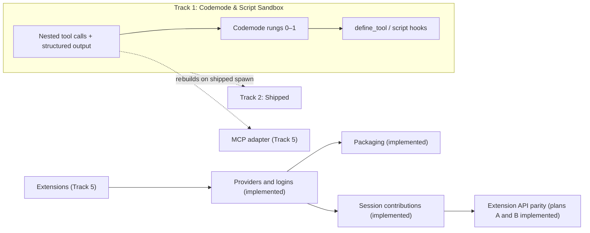
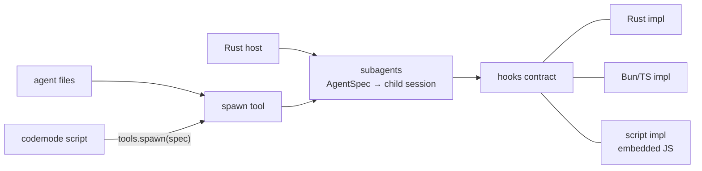

# axo plan: active work & open discussions

This is the live planning document for unbuilt work and active design discussions. It changes freely as we work.

- **Goals & settled architecture:** [`design.md`](design.md)
- **Implemented reference:** [`crates/axo/docs/README.md`](../crates/axo/docs/README.md)
- **Background studies:** [`pi/`](pi/README.md) and [`research/`](research/README.md)

## Overview of tracks

M1–M5 plus Tracks 2, 3 and 4 are complete. Track 5 has shipped providers, logins, session contributions, extension API parity and packaging through `axo-extensions`. Extensions do not wait for codemode; `axo-acp` is deferred.



| Track | Scope | Status |
|---|---|---|
| **1. Codemode & script extensions** | Embedded JS sandbox (QuickJS/Boa engine evaluation), nested tool calls, structured tool output, `codemode` tool (rungs 0–1), then `define_tool` and script hooks on spawned specs (rungs 2–5) | Rungs 0–1 scoped; rungs 2+ in discussion. Not the current implementation priority |
| **5. Extensions (Bun runtime), MCP & `ast_edit`** | Trusted TS/JS contributions through shared Rust APIs | **Phases 1–4 and extension API parity plans A and B implemented.** MCP and `ast_edit` are deferred |
| **6. ACP binary (`axo-acp`, M6)** | Stdio JSON-RPC binary mapping ACP onto `Session` | Deferred: rethink whether axo itself should ship ACP or leave it to a host |
| **7. Ask documents** | Rework `ask` from a list of option questions into one Markdown document with typed questions placed in reading order, one validated answer object, and notes | Designed 2026-11-21; not started |
| **Tool surface & session modes** | Deferred tools, action tools, scoped host policy, cache-safe root mode overlays and completion | **Shipped (A–H).** See [Shipped tracks](#shipped-tracks) |

---

## Track 1: Codemode and script extensions

Notes from the design discussion of 2026-10-22. Only items marked **Decided** are settled; items marked **Direction** remain open for discussion.

### Where we landed

- **Decided:** axo builds a codemode tool in pi's shape (rungs 0–1 below): a stateless, sandboxed JavaScript script per call whose only powers are tool calls. It is built in, behind a Cargo feature, on an embedded engine. It does not wait for the Bun extension host.
- **Direction:** state lives in resources that tools own, not in the script; everything addressable is reachable from scripts; and scripts may configure the harness of the subagents they spawn, but not change the session the user talks to.
- **Shape:** three separate systems, each useful alone. Codemode composes them but owns none of them:
  1. subagents, specified by an `AgentSpec`;
  2. the script sandbox;
  3. the hooks contract, with a script implementation among others.

### omp `eval` vs pi `codemode`

Both let the model write code that calls tools, built for different jobs. Sources: pi 1.3.0 (`packages/coding-agent/docs/codemode.md`, `packages/codemode/README.md`, `extensions/codemode/`), omp 18.12.2 (`docs/tools/eval.md`, `src/prompts/tools/eval.md`).

| | omp `eval` | pi `codemode` |
|---|---|---|
| Unit | One cell per call, notebook-style | One script per call |
| State | Kernel stays alive between calls; lost on restart ("Kernel-loss notice means reload setup") | Fresh VM per script; small JSON values via `store`/`load`, saved as session entries per branch |
| Runtime | Bun worker (`Bun`, `fs`, `fetch`, `process`, `require`) and a Python subprocess | QuickJS compiled to WebAssembly: no files, network, timers or modules |
| Packages | `%bun add`, `%pip install`, `%load ./script.py` | None |
| Reach | Anything bash can, plus `tool.<name>()` | Only `tools.<name>()` and `models.*` |
| Host helpers | `agent()`, `workpool()`, `wait()`, `judge()`/`judgeBatch()`, `completion()`, `@tool` for subagents, extension preludes such as `browser` | `searchTools`, `describeTool`, `describeNamespace`, `models.classify`/`generateImages` |
| Output | Printed text, images, tables, DataFrame views, figures | `text()`, `image()`, `return`, `console`; capped by an output-token budget |
| Safety | `approval="exec"`, bash's trust level | Sandbox: 256 MB heap, interrupt handler, at most two workers per process |
| Long runs | Optional auto-backgrounding into an async job | Hard `timeout_ms` |
| Portability | Tied to omp | No pi dependencies; also runs on Cloudflare Workers |

#### Intent

- **omp: an agent workbench and orchestration language.** The doc opens with "Do not shell out to `python -c`, `bun -e`, or `node -e` through `bash`." Eval is the better home for code the agent was already running through bash:
  - state across calls for notebook-style exploration (DataFrame views, figure capture, `%pip`);
  - orchestration, through `agent()`, `workpool()`, `wait()` and `judge()`, so the agent runs other agents from code;
  - a home for extensions: preludes add globals such as `browser`.

  It is bash with better ergonomics, so it gets bash's trust level.
- **pi: composing tool calls and saving context.** "Only the script's output reaches the model, so a script can run calls in parallel and filter large results before the model sees them."
  - tool results are structured values, and only the script's output reaches the model;
  - MCP tools default to script-only exposure, so large servers stay out of the prompt and are found with `searchTools()`;
  - every effect is a tool call, so hooks, blocking and validation apply;
  - no hidden state, which suits durability.

  [INFERENCE: the name and framing match Cloudflare's "Code Mode"; pi's docs do not cite it.]

#### What pi's codemode cannot do

Impossible in pi's codemode as shipped:

1. **Keep a large working set across calls.** Example: load every session JSONL file once, then answer follow-up questions. `store` holds at most 256 KiB per value and 1 MiB in total.
2. **Take in a large file in one go.** `tools.read` returns the same 2000-line / 50 KB slice the model sees (`read.ts:216` builds the script value from the truncated content); `tools.bash` returns at most 1 MiB.
3. **Call an LLM or run agents from code.** Chat models "cannot be run from scripts"; only non-LLM classifiers and image models. pi has no subagent tool in core.
4. **Hold a live connection across calls.** A logged-in browser tab, a DB connection, a websocket. Inside a script there are no sockets at all.
5. **Keep working after its call returns.** For example, a 20-minute benchmark sweep while the conversation continues.
6. **Define tools that subagents call back into** (omp's `@tool`).

Possible only by going through `bash`, at the cost of a process per step, text in and out, and often a second language:

| Task | omp eval | pi codemode |
|---|---|---|
| Collect dependency versions from 30 `Cargo.toml` files | A TOML parser via `%bun add`, or `tomllib` | Regex by hand, or `cargo metadata` through bash |
| Fetch 50 PRs from the GitHub API | `fetch` in a loop | `curl` through bash per request |
| Plot cost per day | pandas and matplotlib | Write a `.py` file, run it with bash, `tools.read` the PNG, then `image()` |
| Poll CI every 30 s | A sleep loop | No timers; `bash sleep 30` between checks |
| Fuzzy-dedupe 50k strings | V8 or Python speed | QuickJS interprets with a 256 MB heap; slow, or bash a real runtime |
| Hash files, diff text, resize images | Standard library or packages | `sha256sum`, `diff`, `magick` through bash |

Codemode plus bash covers everything eval does except state between calls and orchestration. Items 3 and 6 are not sandbox limits: `agent()` or `completion()` is another host function or tool call. What a sandbox cannot give on its own is state or a handle that outlives the script.

### Embedded, not the Bun host

**Decided.** Earlier notes linked eval to the Bun extension host as a reuse shortcut ("the Bun host is already a JS runtime"). The two have opposite requirements:

| Need | Extensions (why Bun) | Codemode scripts |
|---|---|---|
| Access | Full runtime: `fetch`, fs, processes, npm, OAuth servers | Only tool calls, so `before_tool_call` cannot be bypassed |
| Sandbox | Given up on purpose | The point |
| Lifetime | Long-lived extension registrations and owned resources | One short script per call |
| Isolation | Execution placement is open; installed code is trusted, not sandboxed | A runaway script must not take extensions down |
| Cost when unused | No extension runtime should start without enabled extensions; runtime acquisition is still to be designed | Nothing to install |

- **pi does the same.** Its extensions run in Node/Bun, yet codemode runs in a separate QuickJS-wasm VM in a worker with a 256 MiB cap (`execute.ts`, `config.ts:491`).
- **Fewer hops.** In the Bun host, every nested tool call would cross the stdio bridge twice: script → Bun → axo's tool pipeline → Bun → script. Embedded, a nested call is an in-process call into the tool pipeline.
- **The VM has no power of its own.** QuickJS starts with nothing. Every capability is a Rust host function that axo injects. Rust decides what is possible; JS lets the agent express runtime logic (loops, conditions, filtering).
- **Engine candidates** (to verify in a short spike before coding):

  | Engine | Notes |
  |---|---|
  | QuickJS (`rquickjs`) | Initial candidate: verify async Rust integration, memory/interrupt controls and per-context overhead; no engine selected |
  | `boa` | Rust implementation; user interested in evaluating it for codemode (2026-11-15). Not selected; compare during the engine spike |
  | V8 (`deno_core`) | Fast, but tens of MB in the binary; against the memory goal |

### The model: a ladder of power

#### Three ideas

- **A. Data lives in a tool or resource, not in the script.** The script stays stateless. Anything that lasts has an owner and a name; scripts refer to it by name. Each resource has its own crash behavior, unlike an eval kernel where everything dies together:

  | Resource | Owner | Name |
  |---|---|---|
  | A dataset | A query tool, e.g. SQLite in the session directory | `table://sessions` |
  | A browser tab | The browser tool | `browser://tab/3` |
  | A long command | The job registry | `proc://bg_2` |
  | A subagent | Child sessions | `agent://reviewer-4` |

- **B. Everything addressable is callable.** URL schemes supply the nouns, tools the verbs, subagents the workers. A script sees all of them as one object model, and every call passes through the tool pipeline.
- **C. Scripts extend axo.** Once scripts can call everything, the next step is letting them add things.

#### The ladder

| Rung | The script can… | Example |
|---|---|---|
| 0 | call tools | pi's codemode |
| 1 | call named resources (A, B) | query `sessions`, wait on `agent://…` |
| 2 | define functions that later scripts reuse | a `parseCargoLock()` helper for this session |
| 3 | register tools the model or subagents can call | a `pr_status` tool wrapping `gh` |
| 4 | register hooks | after each edit to a `.rs` file, run `cargo check` and attach errors |
| 5 | change the prompt or tool set | add a section; hide tools for a focused task |

**Decided:** rungs 0–1 are the initial codemode build scope, not a prerequisite for the current extension work. Rungs 2 and up need the design below.

- **Rungs 2 and 3 merge.** A saved function is a defined tool that only scripts can call.
- **Tools and hooks differ in kind.** A tool runs only when called; the call and its result are visible, and a bad tool is one the model can stop using. A hook runs on every matching event without being called, and can block, rewrite or redirect other calls or decide whether the loop continues. A tool adds a new verb; a hook changes how the existing ones behave.
- **Skills can carry scripts.** A markdown skill can come with a script that sets up the hooks and tools its task needs. The agent can also write such a script mid-task and save it as a skill afterward.
- **Seams, not internals.** Scripts only plug into published seams: before/after tool call, prepare request, finish turn, the steer and follow-up queues, context edits, prompt sections, tool registration.

#### Parent and children

**Direction:**

> A script may **add** to the parent: functions and script-callable tools (rungs 2–3). It may **change behavior** (hooks, prompt sections, tool set, loop control; rungs 4–5) only in children it spawns.

The session the user talks to is changed only by the user. Children are disposable agents a script builds for one job; their hooks die with them.

This proposed restriction concerns model-written scripts, not user-installed Bun extensions acting with the user's authority. See [extension parity and authority](design.md#extension-parity-and-authority).

- **The invariant.** Children inherit the parent's policy: user settings, user and project extensions, project trust, the exec environment. Script hooks run **before** that inherited policy, so the policy always sees the final arguments that will run. A script can tighten a child's rules, never loosen them past the user's.
- **What it fixes:**
  - persistent prompt injection cannot take over the parent;
  - silent interference, and hooks outliving their reason, are confined to a child with one task;
  - the parent's tool set, and so its prompt cache, never changes;
  - provenance comes naturally ("child `reviewer-3`, built by the script at entry #N, with hooks X and Y");
  - durability is mostly free: child sessions are linked to the call that spawned them, and the child's harness setup is system messages in its own transcript.
- **What it costs:**
  - delegation overhead: a child needs a briefing and its own context, so it uses more tokens and takes longer;
  - children should return small schema-shaped results, not transcripts;
  - changes to the parent session move to user-level config.

### Three systems, one job each



1. **Subagents (Rust core).** An `AgentSpec` is plain data (`name`, `description`, `model`, `tools`, `contextFiles`, `sections`, `output`, `maxTurns`, body); inline specs in `spawn` restrict prompt, tools, model, and output. Spawning it returns a handle (`agent://<id>`) to wait on. It knows nothing about JS.
2. **The script sandbox.** Runs JS with injected host functions under limits. Codemode is a thin tool on top of it; `define_tool` sources and script hooks reuse the same sandbox.
3. **Hooks.** One Rust contract with several implementations: Rust (hosts and first-party features), TypeScript (Bun extensions), and a script implementation that runs stored JS in the sandbox when the hook fires.

#### Which tool grants each rung

| Rung | Tool | Applies to |
|---|---|---|
| 2–3 | `define_tool` (name TBD) | The current session, as an addition |
| 4 | `spawn`, through a proposed `hooks` field on the spec | Only the spawned child |
| 5 | `spawn`, through the spec's `prompt` and `tools` fields | Only the spawned child |

`define_tool`:

```json
{
  "name": "cargo_errors",
  "description": "Run cargo check on one crate; return only error lines",
  "parameters": { "type": "object", "properties": { "crate": { "type": "string" } }, "required": ["crate"] },
  "source": "const r = await tools.bash({ command: `cargo check -p ${args.crate} --message-format short` }); return r.output.split('\\n').filter(l => l.startsWith('error'));"
}
```

- `source` runs in the sandbox, so the tool can only call other tools.
- Saved as a session entry: replayed on resume, scoped to its branch, kept through compaction.
- Script-only exposure by default, so the parent's declared tool set does not change. Children can be given it by name.

`spawn` with a child harness:

```json
{
  "spec": {
    "prompt": "Refactor compaction/summary.rs to …",
    "tools": ["read", "edit", "bash", "cargo_errors"],
    "hooks": [{
      "on": "after_tool_call",
      "tools": ["edit", "write"],
      "source": "if (call.args.path.endsWith('.rs')) result.append(await tools.cargo_errors({ crate: 'axo' }));"
    }],
    "output": { "type": "object", "properties": { "summary": { "type": "string" } } }
  },
  "task": "Refactor compaction/summary.rs to …"
}
```

**Codemode is only as powerful as the tools it can call.** Two caveats:
- the ceiling is the most powerful callable tool (`bash`); the sandbox guarantees that effects pass through the tool pipeline and its hooks, not that they are restricted;
- scale is new: a script can make 500 calls where the model would make 5, so call-count limits and timeouts belong on codemode itself.

### Scenarios and risks

| User says | What gets set up | Uses | Under the parent/child rule |
|---|---|---|---|
| "Refactor the compaction module, keep it compiling" | After each edit to `crates/axo/**/*.rs`, run `cargo check -p axo` and attach the first errors | after-tool hook | ✅ Runs in a child; the parent orchestrates |
| "Don't touch generated files, never run `cargo update`" | Block edits under `**/generated/**` and bash matching `cargo update` | before-tool hook | ❌ for the parent (user settings/policy); ✅ imposed on children |
| "Plan first, change nothing until I say go" | Block `write`, `edit` and mutating bash; add a "planning" prompt section; remove both on "go" | before-tool hook, prompt section | ❌ for the parent (a user command; shipped as a root mode with tool limits and `bash: readOnly`); ✅ as a read-only planner child |
| "Keep fixing until the tests pass, at most 5 tries" | When the model would stop, run tests; if they fail and tries remain, continue with failures as a follow-up | finish-turn hook, follow-up queue | ✅ A child with the loop returns the final result |
| "Check my PRs' CI" (repeatedly) | A `pr_status` tool defined once (`gh api` + parsing) | `define_tool` | ✅ An addition |
| `/review:adversarial` | 6 scouts with output schemas, a skeptic per finding, triage, report | agents, resources | ✅ Already children |
| "Debug this flaky test" (huge logs) | For `cargo test` output, keep only failing tests and panics; full output in an artifact | after-tool hook rewriting results | ✅ A child runs and filters the tests |
| "Analyze my axo sessions" | Load sessions into a table once, define helper queries, reuse across turns | query resource, saved functions | ✅ An addition |

Key risks to design around when building step 3 (script hooks):
1. **Persistent prompt injection:** contained to children by the parent/child rule and inherited-policy-last ordering; hooks may also get a narrower set of host functions than scripts.
2. **Silent interference:** every block or rewrite must carry provenance ("blocked by hook `no-update`, defined at entry #123"), and active hooks/tools must be inspectable.
3. **Bugs and stalls on the hot path:** per-hook time budget, auto-disable after errors with a notice, no recursive self-triggering, and cancellation propagation.
4. **Prompt cache churn:** new tools default to script-only exposure so the declared tool set stays stable.
5. **VM lifetime for hooks:** measure a fresh embedded-engine context per hook invocation (stateless, durable) against one VM per session.

### Step 1 build scope: Codemode rungs 0–1

1. **Embedded-engine spike:** compare `rquickjs` and Boa for async/tokio bridging, language compatibility, memory and execution limits, cancellation and per-context overhead against the PSS target. The user is interested in Boa for codemode; no engine has been selected.
2. **Core prerequisites (`axo-agent` & `axo`):**
   - **Nested tool calls:** extend `ToolContext` with a nested-call runner that goes through prepare, validate, `ToolHooks` / `ToolPolicy::before_tool_call`, and `ToolPolicy::after_tool_call`, inheriting the parent's `ToolScope` (mode, `BashAccess`, `writes`, depth). Hosts and policies therefore see both the outer `codemode` call (with script source) and each inner nested call with its resolved arguments. Assign `<parent>/<n>` IDs, tag `AgentEvent::ToolExecution*` with `parent_call_id`, and record nested calls (preserving `details.files` / `FileChange` snapshots from nested `edit`/`write` calls) on the parent `ToolResultMessage` so compaction extracts file operations and hosts can render collapsed script blocks with real diffs and rebuild them from the journal.
   - **Structured tool output:** add `output_schema` and `structured_content: Option<Value>` on `ToolOutput` (for `bash`: `{ output, truncated, full_output_path, exit_code, wall_time_seconds }` with a 1 MiB output cap; for `read`: text string or image object).
3. **Sandbox module (`axo::script`):** standalone module (not buried inside the tool) that runs JS on a blocking worker thread with a memory cap, interrupt budget/timeout, concurrency semaphore, and channel bridge for async host functions.
4. **`codemode` tool (`axo::tools::codemode`):**
   - Globals: `tools.*`, `searchTools()` / `describeTool()` (backed by the deferred tool catalog / `tool://`), `text()`, `image()`, `return`, `console.*`, `exit()`, `store(k, v)` / `load(k)` (backed by branch-scoped `custom` session entries committed only when the script succeeds), and `// @options: {"max_output_tokens", "timeout_ms"}`.
   - Keep the tool description compact (at most active direct tools' declarations) and discover deferred, extension, and MCP tools on demand via `searchTools()` / `describeTool()` so large catalogs do not bloat context or churn the prompt cache.
   - User-only enablement (never auto-enabled by project-level config, matching `extensions`).
   - `Replay::Never`: crash recovery reports the script as interrupted and lists completed nested calls.

---

## Shipped tracks

- **Track 2 (Agents, `spawn`, teams):** Landed in code; settled architecture decisions in [`design.md`](design.md#agents-and-child-sessions-axo) and runtime reference in [`crates/axo/docs/prompts-and-context.md`](../crates/axo/docs/prompts-and-context.md#agent-definitions), [`crates/axo/docs/sessions-and-compaction.md`](../crates/axo/docs/sessions-and-compaction.md#child-sessions), and [`crates/axo/docs/extending.md`](../crates/axo/docs/extending.md#spawning-child-sessions). Grounding research in [`research/subagents.md`](research/subagents.md).
- **Track 3 (Async `bash`, background jobs & `wait`):** Landed in code; settled decisions in [`design.md`](design.md#settled-core-decisions) and runtime reference in [`crates/axo/docs/configuration.md`](../crates/axo/docs/configuration.md#command-supervision-axosupervision) and [`crates/axo/docs/sessions-and-compaction.md`](../crates/axo/docs/sessions-and-compaction.md#background-job-durability). Historical verification log preserved in [`research/track3-supervision.md`](research/track3-supervision.md).
- **Track 4 (URL scheme registry):** Landed in code; settled decisions in [`design.md`](design.md#settled-core-decisions) and runtime reference in [`crates/axo/docs/extending.md`](../crates/axo/docs/extending.md#3-rust-extension-traits).
- **Host surface:** Landed in code: typed job and child state over one ordered event stream with complete attach snapshots, live command output, persisted switchable root personas, durable host messages, and introspection getters. Settled contracts in [`design.md`](design.md#host-contract-axo); persona and mode grounding in [`research/personas-and-modes.md`](research/personas-and-modes.md).
- **Tool surface & session modes, A–H:** Landed in code: public model tool-change capability (A), deferred dispatch with one inner tool identity (B), `kill`/`send` replacing action writes (C), deferred exposure, read-only `tool://`, `call`, promotion and reconciled catalog notices (D), root mode definitions/catalog (E), scoped `ToolPolicy` replacing session-level `tool_hooks` (F), journal-derived mode selection, boundary effectiveness, reconciled instructions, call-time limits, inherited child limits, model restoration, commands and events (G), and deferred `enter_mode`, schema-validated mode `yield`, typed result review, continuation and shared pending-decision machinery (H). The approved tool-surface/session-mode plan is complete. Settled contracts in [`design.md`](design.md#session-modes-axo) and [`design.md`](design.md#built-in-tools-and-execution-environment-axo); runtime reference in [`crates/axo/docs/extending.md`](../crates/axo/docs/extending.md), [`crates/axo/docs/prompts-and-context.md`](../crates/axo/docs/prompts-and-context.md), and [`crates/axo/docs/sessions-and-compaction.md`](../crates/axo/docs/sessions-and-compaction.md).
- **Definitions, inspection and tree usage:** Landed in code: persona and child spec bodies in their own `agent` prompt section; `:`-namespaced mode and skill names derived from folders; `ModeSpec::parse`, `AgentSpec::parse` and `KeywordSpec::parse` for host-bundled markdown; keyword definitions with persistent, `/model`-equivalent model selection; side-effect-free host tool inspection (`Session::tools`, host `tool://` reads); read-only `bash` through `BashAccess` and Landlock; typed `ResultResolution` and persisted review `details`; structured `kill`/`send` details; `Session::resume_wakes`; executing child tools and unread mail on child rows; and journal-derived whole-tree usage (`Session::tree_usage`, `SessionEvent::TreeUsage`). Opening a child while its root is closed stays a documented root-first flow, not a new API. Settled contracts in [`design.md`](design.md#settled-core-decisions); runtime reference in [`crates/axo/docs/prompts-and-context.md`](../crates/axo/docs/prompts-and-context.md#keyword-definitions), [`crates/axo/docs/configuration.md`](../crates/axo/docs/configuration.md#keywords-keywords--keywordsettings), [`crates/axo/docs/sessions-and-compaction.md`](../crates/axo/docs/sessions-and-compaction.md#tree-usage), and [`crates/axo/docs/extending.md`](../crates/axo/docs/extending.md#background-jobs-for-hosts).
- **Host capability handoff:** Landed in code: `ConfigLayer::skill_roots` with Read/Trust project skills gates and existing discovery precedence; synchronized activity snapshots/events plus `is_running` (observation, not reservation); selected/effective mode surfaces; schema-validated edited acceptance retaining original and accepted values; built-versus-recorded prompt inspection, context-file inventories and ledger hashes; rich retry events; typed `kill`/`send`/`wait`/`spawn` receipts and routed host `send` with provenance; stdout/stderr capture with durable `.streams` sidecars and retained-log reads. Raw artifacts stay merged; stream ordering is capture order, not true chronology. No host `prepare_request` hook or event envelope was added; the provider `RequestRewrite` is the separate level-2 wire seam. Runtime contracts live in [`extending.md`](../crates/axo/docs/extending.md).
- **Keyword replay and write scopes:** Landed in code: `Entry::Submission::keywords` records the keywords that fired, and reopen requeues from those recorded names instead of matching again; frontmatter `writes` on modes and agents scopes `write`/`edit` (`ModeSpec::writes`, `AgentSpec::writes`, `ToolScope::writes`, `SessionTools::check_write`) and persists onto children as the `SpawnLink::writes` ceiling.
- **File-change snapshots:** File tools report accesses in `details.files`, with a `FileChange` for each mutation (before/after `SnapshotBlob`s and a `LineDiff` for diffable text). Raw snapshots are content-addressed, never-pruned blobs under `<session>/snapshots/`; `edit` refuses non-UTF-8 files. Hosts read blobs (`Session::read_snapshot`, lock-free `Axo::read_snapshot`) and squash ranges (`squash`, `squash_changes`); forks link only the blobs their path references. Runtime contract in [`crates/axo/docs/extending.md`](../crates/axo/docs/extending.md#file-changes-for-hosts).
- **Queue control:** Landed in code: input sent after a Stop is delivered when the stopped run settles (a Stop latches when pressed, a failed run when it settles); `Session::resume_wakes` also sends held steers and follow-ups; `steeringMode` defaults to `"all"`; `Session::withdraw` takes queued input back, recorded as `Entry::SubmissionWithdrawn` so reopening never requeues it; `LiveSnapshot::queued` lists `QueuedInput` with submission ids; a queued steer settles a pending `ask` question or reviewed `yield` (`ResultResolution::Steered`) instead of waiting behind it. Runtime contract in [`crates/axo/docs/extending.md`](../crates/axo/docs/extending.md#queued-input-for-hosts).
---

## Track 5: Extensions (Bun host), MCP & `ast_edit`

### Status and settled direction

**Phases 1–4 and extension API parity plans A and B implemented.** The `axo-extensions` bridge loads TS/JS providers and session contributions under supervised Bun runners, installs their npm dependencies and manages a store of installed extensions. See the [runtime reference](../crates/axo/docs/extending.md#4-bun-extensions-axo-extensions) and [enablement setting](../crates/axo/docs/configuration.md#extensions-extensions--axoenabledextension). The MCP adapter does not exist.

The [parity and authority rules](design.md#extension-parity-and-authority) govern which public Rust methods are bound and why a method may be withheld. There is no codemode dependency.

- **Runtime and ownership:** TS/JS on a host-supplied Bun binary; axo bundles none. The bridge crate sits above `axo`, uses only public APIs, and shares this repository with the SDK. Hosts choose paths, acquisition and presentation; no fixed application directories or required terminal UI.
- **Placement:** one supervised process per extension, not per session. Users may group extensions to save memory, accepting a shared failure domain. No Workers, author isolation hints or automatic relocation. Missing Bun diagnoses unavailable extensions, leaving unrelated core functionality usable.
- **Recovery:** restart a stuck/crashed runner; three failures in five minutes disable it with a host-visible event. Load-time failure disables only that extension. Interrupted calls fail visibly, not replayed blindly; an unavailable provider or policy cannot be silently bypassed. Grouped runners require group-aware accounting rather than guessed individual blame.
- **Contributions:** tools (including replaceable built-ins), policies, spawn hooks, schemes, sections, definitions, providers, commands, messages, branch-scoped custom state and events. User-enabled extension order determines collisions, with provenance diagnostics and no priority syntax; reserved core names remain reserved.
- **Host ownership:** the bridge composes manifest registrations into the session's layer (`Session::set_layer`) without replacing host registrations or startup services. Lifecycle and project trust remain host decisions; extensions can navigate, answer pending questions and decide mode reviews.
- **Files and configuration:** no extension-defined settings keys. Pass a host-chosen data directory as a convention, not a sandbox; authors choose file formats. Core enable/group configuration is user-only. A trusted Bun extension can still write anywhere the user's OS permissions allow.
- **Loading and trust:** start enabled code lazily from host-supplied roots; project-discovered executable extensions require trust. Explicit user installation/authorization is distinct from discovering code in a checkout.
- **Resource reporting:** no default memory cap. Report process/group metrics with attribution scope, not exact per-extension allocations inside a shared runner. Optional user caps wait for a concrete need.

### Shared Rust contracts

Preserve the [implemented extension contracts](../crates/axo/docs/extending.md#3-rust-extension-traits) within the scope above:

- Tool factories run with each session's own tools handle, supporting fresh per-session state or deliberately captured shared state. Child/fork creation reruns factories; existing children retain shaped tools.
- `append_custom` / `custom` provide branch-scoped metadata without adding model context. Reuse them rather than inventing extension persistence; extension-owned settings files serve a different purpose.
- Tool, section, persona, mode, model and thinking controls retain their Rust behavior during a run. Subsequent requests see changes at their boundaries; routed calls keep implementation snapshots.
- Reopen requires executable registrations and host section configuration to be supplied again; the journal does not reconstruct closures. Preserve replay/error contracts and never retry an uncertain external effect merely because a runner restarted.
- Live host setters replace tool policies, spawn hooks, schemes, sections, commands and definitions; `Session::set_layer` independently replaces the layer (see [Live definitions](../crates/axo/docs/extending.md#live-definitions) for definition precedence). Store, configuration and default streamer remain builder choices. `LoopHooks` is the session's driver, not an arbitrary request-rewrite plugin.

Directly submitted slash text can expand a skill hidden in the command catalog: prompt submission is distinct from command parsing. The catalog and parser use built-ins, modes, registered commands, then skills.

Source anchors: [session API](../crates/axo/src/session/mod.rs), [tool factories](../crates/axo/src/tools/mod.rs), [shaping](../crates/axo/src/session/prompt.rs), [child inheritance](../crates/axo/src/session/spawn.rs), [schemes](../crates/axo/src/schemes/mod.rs), [commands](../crates/axo/src/commands.rs), [definitions](../crates/axo/src/context), [configuration](../crates/axo/src/config.rs).

### Providers and logins: levels 1 and 2 now

The primary need is a complete provider implemented outside axo, including model metadata, login, refresh and request shaping.

- **Level 1:** a runtime Rust provider/login registration supplies login, refresh and credential-to-auth (`ModelAuth`: key, headers, base URL). Rust retains credential storage and locked refresh with the existing expiry margin. Codex becomes a native implementation of the same contract; provider OAuth availability comes from registration, not a hardcoded provider-id check.
- **Login interaction:** typed URL, device-code, prompt, selection, progress and cancellation exchanges rendered by the host. This narrow required channel does not wait on the later general UI/lifecycle channel.
- **Level 2:** after the standard adapter builds its request, let the provider rewrite URL, headers and body; Rust still sends HTTP and parses the stream. This is a provider-wire seam, not a separate session transcript-injection hook.
- **Runtime lifecycle:** register/unregister providers and model catalogs while sessions remain open; deliberate removal of an override restores the previous registration. Unavailability is different: a required-but-loading/crashed/disabled extension fails the request naming it, never falls back or sends an unrewritten request.
- **Proof:** an axo-local TS package (`crates/axo-extensions/tests/fixtures/lab-provider`) exercises login, refresh, request rewrite and actual streaming through the public Rust API against loopback fixtures. The mechanism is vendor-neutral; a named subscription provider and its acceptance of a credential are outside axo. Existing Codex remains native on the shared contract.
- **Bounded scope:** keep the three existing wire families closed. Extension-owned HTTP transport (level 3) and custom event streams are not scheduled; do not claim this scope supports Antigravity's distinct protocol.

Phase 1 closed the shared Rust gaps: [models](../crates/axo-ai/src/models/mod.rs) are one long-lived, swappable registry (`register`/`unregister`/`reload`, owned `find`, snapshot `all`); the [auth resolver](../crates/axo-ai/src/auth/resolve.rs) refreshes through any provider's `ProviderLogin`, with [Codex](../crates/axo-ai/src/auth/codex.rs) as the built-in implementation; and the [Anthropic](../crates/axo-ai/src/api/anthropic.rs), [Completions](../crates/axo-ai/src/api/completions.rs) and [Codex](../crates/axo-ai/src/api/codex.rs) adapters run the provider's `RequestRewrite` before sending. Phase 2 added the owned provider layer and composes several extension contributors to one id by publishing only the winner.

### Implementation phases

Phase 1 precedes 2; phases 3 and 4 depend on 2 and can proceed independently. API parity builds on phase 3.

#### Phase 1: Provider and login seam in Rust (implemented)

**Goal:** a Rust host adds a complete provider at runtime with no Bun dependency.

- Generic login/refresh/credential-to-auth registration and typed interaction; migrate Codex onto it and remove hardcoded provider-id checks.
- Mutable provider/model registration, ordered replacement and restoration on unregister, with catalog reads safe across updates.
- Level-2 request rewrite across all three adapters, preserving infallible streams and existing locked refresh.
- Migrate every affected axo caller atomically, including generic login; provider changes apply to the live registry (`Models::reload`) instead of requiring a rebuilt one.

**Acceptance:** an offline provider fixture logs in, refreshes an expiring credential and sends rewritten URL/headers/body to a loopback HTTP fixture (`crates/axo-ai/tests/providers.rs`); the built-in Codex login runs through `Models::login`.

#### Phase 2: Bridge and providers from TypeScript (implemented)

**Goal:** a Rust embedder loads a trusted TS/JS provider under supervision and uses it through the normal `Models` APIs.

- **Embedding.** `axo_extensions::Extensions::new(axo, options)` uses the model registry and supervisor of the host's `Arc<Axo>`; `configure(&[EnabledExtension])` reconciles, `status`/`collisions`/`diagnostics`/`subscribe` report typed state, `retry` re-arms a disabled member, `reload` replaces a placement after a code-only package change, and `shutdown` reaps runners and removes the layer. The user-only `extensions` setting (`[{ id, group? }]`) supplies order and grouping; project layers cannot enable code. No session is created to start providers.
- **Static catalog, lazy code.** Each enabled package's `extension.json` declares its id, entry and providers with full model metadata and `login`/`rewrite` capabilities. Discovery reads only enabled IDs from host roots and never executes code; the last enabled declaring extension wins a provider id, and hidden contributors are reported. Winners are published as one atomic `ProviderLayer` replacement. A failed rescan keeps the last accepted declarations, marked unavailable. Bun starts on the first login, refresh or rewrite that needs it.
- **Runner and transport.** The TS runner is embedded with `include_str!`, written per generation into a private `0700` directory under `runtime_dir` with a `bunfig.toml` disabling auto-install, and run as `bun run <runner>` through the host's `ProcessSupervisor` in either process-group or cgroup mode. Length-prefixed JSON frames (64 MiB bound) travel over a Unix-domain socket bound before spawn and authenticated by a per-generation nonce; stdin/stdout carry no protocol. The bridge is therefore Unix-only. Authors write against the type-only `@axo/extension-sdk` (`packages/axo-extension-sdk`); there is no runtime SDK (Phase 4 added dependency installs and the manifest's `sdk` check).
- **Contract.** The runner serves `login` (with nested URL/device-code/prompt/select/progress callbacks to the host's `LoginInteraction`), `refresh` and `rewrite` (complete URL/headers/body replacement, preserving duplicate and binary header values). Rust validates every reply, keeps credential storage and locked refresh, and sends and parses HTTP itself; inference bytes never cross the socket.
- **Lifecycle.** One placement per extension or user group, shared across sessions. States `Cold`, `Starting`, `Ready`, `Restarting`, `Disabled`, `Unavailable` (Phase 4 added `Installing`). A 2 s heartbeat with a 10 s deadline detects blocked JS; handshake and per-member activation are bounded at 15 s; refresh/rewrite calls at 60 s, while human login stays cancelable without a short deadline. Runner death, protocol corruption or a hang counts one failure for the whole placement; restarts follow failures 1 and 2, and a third within 300 s disables the placement with an event. A clean import/activation rejection disables only that member. Missing or unusable Bun leaves claims in place as `Unavailable`.
- **Failure boundary.** Interrupted callbacks fail with `ProviderUnavailable`, carried as a nonretryable `provider_unavailable` terminal failure, and are never replayed. Killing Bun **before** a rewrite replies fails that request without sending HTTP; killing it **after** Rust sent the rewritten request leaves that stream to finish normally. A canceled waiter does not cancel an in-flight refresh, which completes and saves its credential.

**Acceptance:** deterministic checks (`cargo test -p axo-ai --test providers`, `-p axo --test settings`, `-p axo-extensions --test bridge`) need no Bun. The real-process target `cargo test -p axo-extensions --test bun_provider` runs only with `AXO_TEST_BUN` set to an absolute Bun path (an unusable value fails rather than skips) and covers login, a single locked refresh under concurrency, rewritten streaming with an unchanged tool name, both kill points, the shared 3-in-5 disable, a synchronous hang, descendant cleanup and shutdown reaping. Adding `AXO_TEST_CGROUP=1` in a delegated cgroup repeats the lifecycle under `Supervision::Cgroup`, including a detached in-cgroup child. Process groups cannot contain descendants that leave their group; only the cgroup mode claims that.

**Not part of Phase 2:** live vendor smoke tests, response adaptation or level-3 transport, and Phase 3/4 scope. UI, Bun acquisition, roots and data paths are host choices.

#### Phase 3: Session capabilities and commands from TypeScript (implemented)

- Static declarations compose tools (including updates and cancel), policies, spawn hooks, schemes, sections, definitions and registered commands. The host composes options (the extensions go into `SessionOptions::layer`) before opening and attaches the live session for actions, journal events and layer reapplication on reconfiguration.
- Per-session factories and live setters preserve child/fork inheritance, request boundaries and tool provenance. Replay is declared statically; an unavailable tool policy or spawn hook fails closed.
- The bridge uses the existing custom journal state and registered-command catalog, parser and dispatch. The SDK returns handlers by kind.

**Acceptance:** `cargo test -p axo-extensions --test bridge sessions` exercises replacement, blocking, state across fork/reopen, commands, events and restart/disable; the opt-in `bun_provider` target also exercises real handler cancellation.

#### Extension API parity, plan A (implemented)

Each public `Session` method has an exposure decision: `#[expose]` generates dispatch for `#[ext]` methods and records a reason for every skip. Explicitly registered blocks drive both `Session::invoke` and the checked-in TypeScript bindings generated with specta. The runner forwards positional arguments rather than implementing methods. Wire adapters replace live handles with receipts, pages or snapshots; typed subscriptions deliver session events. The bridge refuses recursive registered commands in the same call chain and detects stalled queues of nested host calls.

#### Extension API parity, plan B (implemented)

Tool handlers get guarded file and command operations; the host object delegates lifecycle requests to an optional host hook, and the models object supports one-off and streamed completions. The [surface guard](../crates/axo/tests/ext_surface.rs) checks method and free-function decisions. See the [generated reference](../crates/axo/docs/extension-api.md) for callable methods and reasons for withholding others.

#### Phase 4: Packaging and install (implemented)

**Goal:** extensions with npm dependencies run without manual steps, whether the user wrote them or installed them. Phase 4 is axo-only; host integration is outside it.

**Two independent axes.** *Scope* is where an extension applies: every session of the user, or only one project's sessions. *Management* is who owns its files: an *authored* extension is written and maintained by the user or the repo (edited by hand, kept in git); an *installed* extension is fetched by axo's install call and owned by axo (updated, rolled back and removed by axo, never edited by hand). An extension the user writes in their home extensions folder is authored even though it applies everywhere.

| | Authored | Installed |
|---|---|---|
| **User** | a host root in the user's home, e.g. `~/.axome/extensions/bun-guard/` | axo's managed store, a host-supplied directory inside the host's data dir |
| **Project** | a host root inside the repo, e.g. `repo/.axome/extensions/lint-rules/`, committed with it | not scheduled: a project declaring that it wants an installed extension |

Location decides the kind: host roots hold authored extensions, the managed store holds installed ones, and the two never mix.

- **Manifests stay.** Every extension keeps declaring its contributions in `extension.json`; the runner never runs code to learn them, so lazy start, visible failures and pre-execution collision handling remain. omp/pi-style registration in code, or axo generating the manifest from code, was weighed and set aside for now; revisit if writing real extensions shows the manifest is a burden.
- **Identity follows management.** Authored extensions keep a plain name, with no publisher, origin, rollback or uninstall; two sharing a name resolve by host root order, as today. Installed extensions are named `publisher/name` and pinned to the host-supplied origin string recorded at first install; an update from another origin is refused unless the host passes an explicit replace flag. A plain name never collides with an installed `publisher/name`.

**Authored extensions: dependencies install themselves.**

- When discovery finds an authored extension whose `package.json` declares dependencies and whose install stamp is missing or stale, axo starts `bun install` in its folder in the background, under `ProcessSupervisor`, without blocking `configure`. The stamp lives under `node_modules` and records a hash of `package.json` and `bun.lock`, so a fresh clone, a pull that changes dependencies, or an edit to `package.json` triggers a new install; an extension without dependencies never installs.
- An activation that arrives while the install runs waits for it. Status reports the extension as `Installing`, then `Cold` (or its live phase), or `Disabled` with Bun's output when the install fails; an unchanged failed package is not reinstalled until `retry`, `reload` or a change to `package.json`/`bun.lock`. A runner that was already live is reloaded once the install changed its dependencies. One install runs per extension at a time.
- No lockfile is required: a plain `bun install` creates `bun.lock` if absent, exactly as running it by hand would, including in a repo. Lifecycle scripts run.
- Installing dependencies needs no trust beyond running the extension: a project's extensions run only when the host includes that project's folder as a root.
- A host option (`ExtensionOptions::auto_install`) turns automatic installs off; discovery then reports the extension `Unavailable` as needing install and the host calls `Extensions::install_dependencies`.

**Installed extensions: one install call does everything.**

- **Acquisition stays host-owned.** The host fetches a package into any folder and hands it, with its origin string, to axo's install call; axo copies it, installs its dependencies and places it in the managed store. One call covers first install and update. Typed errors distinguish missing Bun, missing `bun.lock`, an invalid manifest, an SDK mismatch, a refused origin change, a failed `bun install` (exit status and Bun's output) and an install already running for that extension.
- **Install** runs `bun install --frozen-lockfile` with the host's Bun under `ProcessSupervisor` and refuses a package without `bun.lock`: an installed version must be reproducible. Lifecycle scripts run: they add no authority a trusted extension lacks, and native packages need them.
- **Update and rollback.** Each install copies the package into a fresh per-version folder beside an `install.json` record naming the current and previous versions; renaming a new record into place is the only switch, so it is atomic, and a running runner keeps its own version folder until it is reloaded. The record switches only on success, then the extension reloads immediately: in-flight calls of the extension, and of group peers sharing its runner, fail visibly and are not replayed. A failed install leaves the running version untouched. The replaced version is kept as one previous copy; a `rollback` call swaps current and previous, since a version that installs cleanly can still fail on its first lazy activation.
- **Uninstall** is distinct from disabling (removal from the enabled list, which already withdraws every contribution). axo's uninstall refuses an enabled extension, then deletes its package folder and previous copy. Deleting its data is an explicit option, off by default, and removes only the data directory axo assigned (`<data root>/@installed/<publisher>/<name>`, kept apart from authored extensions' `<data root>/<id>` so an authored `lab` never contains an installed `lab/pkg`'s data); the docs state plainly that files an extension wrote anywhere else are untouched, because that directory is a suggestion, not a sandbox.

**Both kinds.**

- **Pre-bundled single file** needs no install: `bun build --target=bun` output with no external imports already loads as an `entry`. Document it and cover it with a fixture; native `.node` and `.wasm` assets must ship beside the bundle.
- **SDK compatibility.** `extension.json` declares the SDK version it was built against; Rust checks it during discovery, before Bun starts, and refuses a mismatch naming both versions. Settled: while axo is in development the SDK version stays `0.0.0` and is not bumped for breaking changes; versioning becomes meaningful only when Toph declares axo out of development.
- **Memory reporting** by runner (process group, or cgroup under cgroup supervision), never split per member of a shared runner. No memory cap.

**Acceptance:** an authored fixture extension with an npm dependency and no `node_modules` installs itself after `configure` and runs a tool, and a second `configure` with the stamp current does not reinstall; through axo's public install API a test host installs an installed fixture with an npm dependency and calls one of its tools; an update from another origin is refused without the replace flag; a manifest declaring another SDK version is refused with both versions named; a failed update leaves the previous version running. `cargo test -p axo-extensions --test bridge install` covers these offline with a scripted `bun install`; the opt-in `bun_provider` target runs the `lab-deps` fixture (a `file:` dependency, so still offline) authored, installed and pre-bundled, and reads runner memory.

### Evidence and remaining phase-plan work

The [extension-system study](research/extensions.md) records OMP, pi, Octet, Claude Mods, Goose, OpenCode and Zed, plus provider/auth research. pi/OMP's host-owned login/refresh/auth contract is the main precedent; OpenCode's custom-fetch approach and Octet's transport boundary illustrate broader options, not the selected level-2 scope. Octet's protocol types do not establish a working extension login, and source-only or current-branch features are not release guarantees.

The [Bun study](research/bun-topology.md) preserves the original shared-loop/Worker experiment and a separate process-per-extension follow-up. The latter informed the selected process default. Whole-tree PSS, workloads, retained dependencies and measurement availability matter; the follow-up's programs/raw data were not retained, and its figures are not directly comparable to the earlier workload. Killing a Bun runner does not kill the Rust host. Process boundaries permit cleanup and attribution, not automatic quotas or OS sandboxing.

Phase 4 reuses the supervised transport and lifecycle without widening extension authority.

- Deterministic offline contract checks; real Bun scenarios opt in, and live provider proof is separate from normal test suites.

General UI requests, provider level 3/custom streams, MCP and `ast_edit` remain deferred.


### MCP tool adapter

- **Configuration files.** Read the first existing ecosystem project-root file of `.mcp.json`, then `mcp.json`, plus host-supplied user MCP configuration (separate from settings), using the `{ "mcpServers": { name: { command, args, env } | { url, headers } } }` format.
- **Trust gate.** Project MCP servers require `ProjectAccess::Trust`; at `Read` access they emit a diagnostic rather than starting. Add `project.files.mcp` (default `true`) when MCP lands.
- **Transport.** Target stdio for local servers and stateless Streamable HTTP (`/mcp`, MCP 2026-07-28 spec) for remote servers; skip legacy stateful SSE transport.
- **Tool exposure.** Direct and deferred exposure already ship with the tool surface: MCP adapters can reuse the deferred catalog and `call` without flooding native declarations, and large remote MCP catalogs pair naturally with caller-side `codemode` (`searchTools()` / `describeTool()`). Server-side Code Mode endpoints (exposing `search` and `execute`) work as ordinary MCP tools. Codemode/script-only and hidden exposure remain part of this track's design, not additional shipped exposure variants.

### `ast_edit`

- Optional extension or Cargo feature providing structural search-and-rewrite via `ast-grep` patterns (`research/edit-formats.md` §7, `research/pi-edit.md`). Kept out of the default build to avoid pulling `tree-sitter` C grammars unless requested.

---

## Track 6: ACP binary (`axo-acp`, M6 — deferred)

Deferred pending a rethink of whether axo itself should ship ACP or leave it to a host. The notes below record the mapping if it is resumed.

Maps the [Agent Client Protocol](https://agentclientprotocol.com) over stdio onto `axo::Session`:

| ACP | `Session` |
|---|---|
| `session/new` and `session/load` | `create_session` and `open_session` + `attach` |
| `session/prompt` | `Session::parse_command` + `run_command` for `/<builtin>` and `/<mode>` text (ACP clients send commands as prompt text), otherwise `prompt` (and `steer` / `follow_up` mapping) |
| `session/cancel` | `abort` |
| `session/update` | Streams `AgentEvent`s through `Accumulator` |
| `availableCommands` | Publishes `Session::commands()`: built-ins with their `parameters` schema, then modes, registered commands and skills with `argumentHint` (→ `input.hint`) |

Decisions when resumed:
1. Use the `agent-client-protocol` crate or handwritten serde types (<1k lines).
2. Default to `RecoveryPolicy::MarkInterrupted` on interactive open so the user decides whether to resume an interrupted run.
3. Optional ACP `terminal/create` backend for `bash`.

---

## Track 7: Ask documents

Notes from the design discussion of 2026-11-21. Items marked **Decided** are settled; items marked **Proposed** came up while planning the code and still need a yes.

### Why

Today `ask` (`crates/axo/src/tools/ask.rs`) sends `questions[]`: each question is one sentence plus options with a short description. The user has to decide without the context the model had. omp solved this in 18.18.3 by replacing its question list with one HTML `<form>` that mixes prose, tables and controls. The result is good, but it makes the model write HTML and makes the harness or host own a form language and parser. We take the idea and drop the HTML.

### Where we landed

- **Decided:** `ask` takes one document: an ordered list of blocks, each either Markdown or a typed question. Order is reading order, so the model builds context first and places each question where it belongs.
- **Decided:** axo never parses the Markdown. It is passed through to the host, which renders it with whatever it has.
- **Decided:** questions are typed data, never syntax inside the Markdown. A question sits between blocks, not inside a table cell or sentence.
- **Decided:** the tool keeps the name `ask` and has one schema. Clean cutover: the old `questions[]` shape, its types and its result formatting are deleted, with no translation of old calls.
- **Decided:** three question kinds: `choice`, `text`, `number`. No disabled options, date/email/url formats, sliders, hidden values, length limits or regex patterns. A ruled-out option belongs in the prose.
- **Decided:** every `choice` gets a host-supplied free-text "Other" answer; the model never adds its own.
- **Decided:** one note per question ("anything else to say"), accompanying the answer rather than replacing it. No per-option notes.
- **Decided:** timeout stays off by default (`ask.timeoutMs`). When it elapses, only the model's recommended and default values are submitted; if a required question has neither, the result says no answer was given. The first option is never guessed.
- **Decided:** axo validates a host's submission against the document before settling. An invalid submission is rejected and the question stays pending.
- **Decided:** the tool description says only "write Markdown", with no judgement on how rich or plain. How a host tells the model what it can render is the host's business; the docs say so and name host prompt sections (`SessionOptions::sections`, `Session::set_section`) as one way, without prescribing a section name.
- **Proposed:** `recommended` is a flag on the option, not a value named on the question. It reads the same for single and multi-select and cannot name a missing option.
- **Proposed:** a skipped optional question is `null` in the result, so every question `id` is always present.
- **Proposed:** event names stay `QuestionPending` / `QuestionResolved`; only the payload changes.
- **Proposed:** this track changes axo only. Axome and Sworm adopt it when they bump their axo revision, since each needs its own UI for the document.

### Model contract

```json
{
  "blocks": [
    { "type": "markdown", "text": "## Session store\nSessions live in memory and die on restart.\n\n| | SQLite | Redis |\n|---|---|---|\n| New service | no | yes |" },
    { "type": "choice", "id": "store", "question": "Which store?",
      "options": [
        { "value": "sqlite", "label": "SQLite", "recommended": true },
        { "value": "redis", "label": "Redis", "description": "shared across instances" }
      ] },
    { "type": "markdown", "text": "Lifetime decides how often people get logged out." },
    { "type": "number", "id": "ttl_days", "question": "Session lifetime (days)", "default": 30, "min": 1 }
  ]
}
```

| Block | Fields |
|---|---|
| `markdown` | `text` |
| `choice` | `id`, `question`, `optional`, `options[]` (`value`, `label`, `description`, `recommended`), `multi` |
| `text` | `id`, `question`, `optional`, `multiline`, `placeholder`, `default` |
| `number` | `id`, `question`, `optional`, `min`, `max`, `default` |

Checks axo makes on the call, each returned as a tool error the model can fix:

- at least one question block;
- question ids non-empty and unique;
- a `choice` has at least two options with unique, non-empty values;
- a single-select `choice` has at most one `recommended` option;
- a `number` has `min` ≤ `max` and a `default` inside that range.

Yes/no is a two-option `choice`. The description keeps today's guidance on when to ask (only when a decision the user must make blocks progress) and adds: put what the user needs to decide in Markdown blocks, place each question after its context, mark the pick with `recommended` or `default`, never add "Other".

### Result

The model receives `User answers:` followed by one JSON object keyed by question `id`; `details` carries the same object under `answers` (plus `timedOut` when set), so a host can rebuild a settled card from the tool call and its result alone.

```json
{
  "store":    { "value": "sqlite", "note": "keep the schema portable to Postgres" },
  "features": { "value": ["ci"], "other": "terraform" },
  "ttl_days": { "value": 30 },
  "comment":  null
}
```

- `value`: the chosen option `value` (never a display label), an array for `multi`, the typed text, or the number.
- `other`: the user's own answer. On a single-select it replaces the pick; on a multi-select it is one more entry beside the picks.
- `note`: a remark alongside the answer.
- Dismissal, cancellation and the steered result (`details.outcome == "steered"`) keep today's behavior and text.

### Host contract

Public types in `crates/axo/src/tools/ask.rs`, exported from `axo` (names are a sketch):

```rust
pub enum AskBlock { Markdown { text: String }, Choice(ChoiceQuestion), Text(TextQuestion), Number(NumberQuestion) }
pub struct QuestionOption { pub value: String, pub label: String, pub description: Option<String>, pub recommended: bool }
pub struct Answer { pub id: String, pub value: Option<AnswerValue>, pub other: Option<String>, pub note: Option<String> }
pub enum AnswerValue { Text(String), Number(serde_json::Number), Many(Vec<String>) }
```

- `SessionEvent::QuestionPending { call_id, blocks: Vec<AskBlock> }` and `LiveSnapshot::pending_questions: Vec<(String, Vec<AskBlock>)>` replace the `Vec<Question>` payloads.
- `Session::answer(call_id, Vec<Answer>)` keeps its signature. It returns `Error::NoPendingQuestion` as today and `Error::InvalidInput` for a submission that does not fit the document; in the second case the question stays pending and no `QuestionResolved` is sent.
- `Session::dismiss` is unchanged.

Rules for a submission:

| Question | Accepted |
|---|---|
| any | each answer names a question id once; a required question has an answer; blank `other` and `note` count as absent |
| single `choice` | `value` is one option value, or `other` is set; not both |
| multi `choice` | `value` is a list of distinct option values, optionally with `other`; a required one needs at least one of them |
| `text` | `value` is non-blank text; no `other`, no `note` |
| `number` | `value` is a number within `min`/`max`; no `other` |

### What does not change

- The pending registry, late attachment, `Replay::Safe` re-execution after restart, and withdrawal on cancel.
- A queued steer settling the question with a non-error result.
- `SessionOptions::ask_enabled`, agent allowlists, and children never getting `ask`.

### Implementation plan

1. **`tools/pending.rs`:** add a settle that computes the outcome from the stored payload under the lock and leaves the entry in place on error; `settle` becomes the infallible case of it. Mode results (`modes::ResultOutcome`) keep using `settle`.
2. **`tools/ask.rs`:** replace `Question`/`Answer`/`QuestionResult` and both text formatters with the block types, one `check` for the model's call, and one function that turns `(&[AskBlock], Vec<Answer>)` into the result object or an error. Validation and result building are the same pass, so nothing unvalidated can reach the model. `PendingQuestions::answer` runs that function through the new settle. A second function builds the timeout result from `recommended`/`default`. Add an explicit timed-out outcome instead of reusing `Dismissed` for it.
3. **Schema:** one flat block object (`type` enum plus every field optional, `additionalProperties: false`); per-kind requirements are enforced by deserializing into `AskBlock` with unknown fields denied. No tool in the workspace uses `anyOf`/`oneOf` today, and serde's errors ("missing field `options`") read better to a model than a failed union.
4. **`session/mod.rs`, `tools/mod.rs`, `lib.rs`:** payload type and exports. `tools/edit.rs` only constructs `PendingQuestions` in a test and needs no change.
5. **`examples/drive.rs`:** print Markdown blocks, answer each question from its `recommended`/`default`.
6. **Tests (`crates/axo/tests/ask.rs`):** update the steer test to the new call shape. Add two that guard the contract: an invalid submission is rejected and the question is still pending and answerable; a timeout submits recommended/default values and reports no answer when a required question has none.
7. **Docs, same change:** `README.md` tool table; `crates/axo/docs/extending.md` (example, `answer` row, `QuestionPending` row, a new "Ask documents for hosts" section with the block types, submission rules, result shape and the rendering note); `crates/axo/docs/configuration.md` (`ask.timeoutMs` meaning); `plan/design.md` `ask` bullet.

### Open

- **`default` typing in the flat schema.** `text` wants a string and `number` wants a number under the same key. A two-type `type` array may not be accepted by every provider; the alternatives are an untyped `default` or separate keys. Check the adapters in `axo-ai` before choosing.
- **A note on a skipped optional question.** Keep it as `{ "note": … }` or drop it. Keeping it loses nothing the user typed.
- **Later, not in this track:** pasted images on notes, and re-answering a settled question on a sibling branch (both exist in omp).

---

## Deferred studies

- **Compaction follow-ups (`research/compaction-methods.md`):** background precomputed summaries before the threshold; optional provider server-side compaction; Factory-style probe-based prompt evaluation harness.
- **Token-efficiency / output minimizer:** evaluate source-time output filtering for noisy build/test commands (with full output recoverable via spool paths).
- **Swarm versus teams (`research/swarm.md`, pinned 2026-11-21):** compared against shipped teams and not adopted. Teams already meet the spec's activation, delivery, pause and recovery contracts through receiver-side mail; the unbuilt parts are a shared board, a changeable roster and a finish/cancel seal. A board readable by every member is not wanted by default: it invites over-reading and breaks independent review, and the parent and host, who want the full trail, can read mail from the child journals. No second coordination system is planned beside teams; a host may name a coordinator protocol "swarm" in its own keyword. Revisit only for large rosters or a first-class host timeline. One open check: whether each member run's result starts a parent turn, which keeps the parent a hub.
  - **Planned, unbuilt: spawner broadcast.** The only change taken from the study. The agent that spawned a team, usually the root, can message every member at once; members still have no broadcast. Sketch: `send` accepts the team id (`team_N`, which cannot collide with a roster name) and queues one ordinary child follow-up per member in roster order, or a steer with `steer: true`, reusing the single-child path. Hosts get the same operation as a typed method returning one receipt per member. Open: the receipt shape, and how a failure after some members were reached is reported.

---

## Open questions

1. **Are codemode rungs 2+ in scope?** From rung 2 up (defined tools and script hooks), model-written scripts may consume a restricted subset of shared integration contracts. They are not a prerequisite or necessarily the first consumer of extensions.
2. **Higher-rung script overlap.** Trusted full-runtime Bun extensions and bounded embedded-engine codemode are separate. Which shared operations model-written tools/hooks may use, and how those definitions persist/promote, remain open; do not reopen Bun extension authority as a generic sandbox question. Extension-specific choices and engineering work live in [Track 5](#track-5-extensions-bun-host-mcp--ast_edit).
3. **Parent-and-children rule** (Track 1, codemode rungs 2+). Adopt the rule strictly (scripts may add tools to the parent, but may only attach hooks/prompt changes to spawned children), or allow some parent hooks? Shipped `InlineSpec` enforces the strict form by shape: inline specs carry only `prompt`, `tools`, `model`, and `output`, while host policies and hooks are inherited (see [`design.md`](design.md#agents-and-child-sessions-axo)).
4. **Where model-written tools/scripts live and how they promote.** Session-scoped (`custom` entries) by default; what is the file format and workflow for promoting a useful tool to a host-provided location?
5. **Hook safety without approvals** (Track 1, codemode rungs 2+). Since axo has no approval system (`design.md`), should child script hooks be restricted to a narrower host-function set (e.g. no network/write outside cwd), or rely strictly on the parent's inherited policy hooks running last?
6. **Which stateful resources ship built-in:** a SQLite-backed `table` tool, browser? (Subagents ship with Track 2; background `bash` jobs ship with Track 3.)
7. **VM lifetime for script hooks:** fresh embedded-engine context per hook invocation vs one retained context per child session (measure PSS impact).
8. **Naming:** tool names (`codemode` vs `eval` vs `script`, `define_tool`) and module path (`axo::script`).
9. **Orchestration in scripts** (Track 1, codemode rungs 2+): expose subagents and one-shot completions strictly through `tools.spawn(...)` (preserving "no powers beyond tools"), or also as top-level helpers?
10. ~~**Per-host identity.**~~ Resolved in Track 2: `axo` by default, renamed per host through `AxoBuilder::name`.
