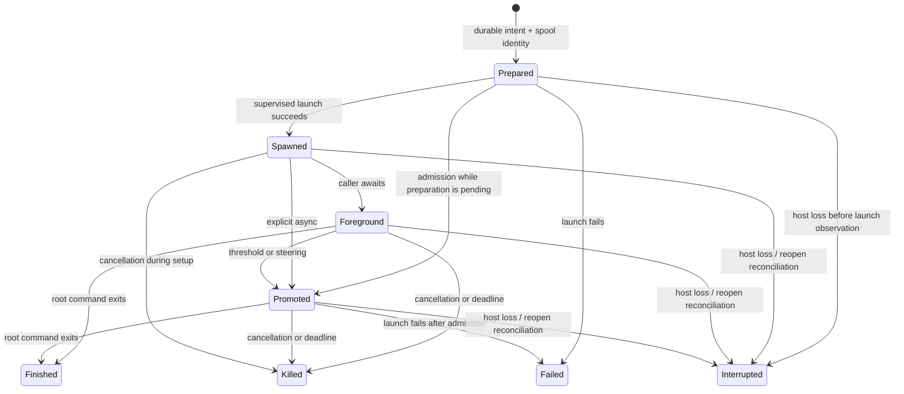

# Track 3: process supervision and session lifecycle

Research started 2026-11-03. This is evidence and a design decision record, not a claim that async jobs have been implemented. Production code is unchanged by this investigation. Runtime measurements are recorded separately from source observations.

## Source provenance

Axo source is the working tree at `/repo/rust/axo`; line numbers below are navigation hints. The probe reports record the identities of the files actually exercised. Workspace dependencies are Tokio 1.54.1 and rustix 1.1.5 (`Cargo.toml:28,38`). `nix develop` supplies Rust/Cargo 1.99.0 and GCC 16.2.0.

Installed omp is `/nix/store/k7wv0jlfkkfh0ibfbidz90gbk9gvbr5n-omp-18.15.0/bin/omp`. Its derivation `/nix/store/qzlrvfhnm423sgy84ndrp59as9awfb7r-omp-18.15.0.drv` identifies the exact source as `/nix/store/lml8bzv4vy2k9fxfizqxfv95fldi5f5b-source`; package version is 18.15.0. Below, `OMP/` means `packages/coding-agent/src/` under that source. The `lb6r…` source named in the older shell study is not the current binary's source.

## What the code does

### Axo execution and cleanup

- `ExecEnv::resolve` supplies an environment, not an execution backend (`crates/axo/src/exec/mod.rs:20-31`). `BashTool::execute` rewrites URLs, resolves that environment, finds real bash, creates an artifact spool, and owns a `ProcessGroup` locally (`tools/bash.rs:179-249`).
- `ProcessGroup::spawn` starts the workload in a new process group, then attempts to start a separate shell guard. The guard reads a pipe held open by axo; EOF executes `kill -KILL -- -<pgid>` (`exec/host.rs:45-102`). Guard failure is a warning, not a spawn failure. There is a workload-before-guard startup interval.
- Neither normal termination nor the guard enumerates descendants. `terminate_group` sends TERM, waits up to one second with 20 ms group-existence checks, then sends KILL (`exec/host.rs:155-169`). A process group is not a descendant-tree containment boundary.
- After leader exit, output is read until the pipes are quiet for 100 ms. The tool then calls `group.release()`, deliberately disarming the guard and allowing background descendants to remain (`tools/bash.rs:283-319`). This also occurs after the tool's termination/drain path; it is not a session-owned job handle.
- Spooling begins before spawn. Write failure only logs a warning and disables spooling; execution continues. A completed untruncated spool is deleted; truncated output retains an artifact URL (`tools/bash.rs:197-218,264-269,322-331`). A continuing child that keeps emitting output can keep resetting the post-leader idle timer.
- The current schema is `{command, timeout?}`. There is no default timeout, and zero is rejected; this differs from omp's 300-second default and zero-to-disable convention (`tools/bash.rs:91-95,114-123,156-168`).

### Axo loop, persistence and recovery

- `Tool::execute` receives a call, a cancellation token and an update callback. It has no steering signal (`crates/axo-agent/src/tool.rs:26-34`). `Agent::steer` and `follow_up` merely append to deques (`agent.rs:252-260`). Steering is read at safe turn boundaries; follow-ups are drained when the run would otherwise end (`run.rs:267-271,798-820`).
- `Session::queue` persists an input submission and queues it, but starts no idle run (`crates/axo/src/session.rs:2297-2310`). Track 3 must supply an explicit session-owned completion wakeup; a follow-up queue alone does not provide one.
- `Persist::persist` is awaited before events are broadcast and before finished messages enter the in-memory transcript (`axo-agent/src/event.rs:55-60`, `run.rs:887-908,930-968`). User messages cannot be injected between an assistant tool-call batch and its results.
- `Entry::Message.submission_id` links a consumed message to durable `Entry::Submission`. There are no job entries (`axo/src/store/entry.rs:138-281`). `JsonlWriter::append` writes/flushes each line but syncs only RunStart/RunEnd (`store/jsonl.rs:284-296`). Process SIGKILL and whole-machine power loss are different durability tests.
- Bash is `Replay::Never`. Recovery finds unanswered calls, associates the newest matching bash artifact, and writes `Tool bash was interrupted and may have partially run. Output so far: artifact://N` without executing the call again (`recovery.rs:246-279`, `session.rs:2023-2047`). There is no bg_N identity or background-result outbox to reconstruct.
- Artifact matching is not a durable start-time binding: `bash_outputs` explicitly notes that a crash before a new spool is created can select an older log with the same call ID (`schemes/artifact.rs:103-106`).
- Shutdown intentionally suppresses new non-AgentEnd persistence and omits RunEnd so the run can recover (`axo-agent/src/run.rs:956-968`, `axo/src/session.rs:1244-1277,2319-2331`). Background terminal events must not accidentally inherit that suppression and vanish.
- Navigation requires an idle run and changes the projected branch; compaction runs maintenance; fork copies the selected path and side files and marks any copied open run interrupted (`session.rs:2451-2653`). None currently defines ownership of jobs surviving a settled run.

### Omp promotion, wait and delivery

- Explicit async starts a managed job. Automatic promotion begins with a hidden foreground-backed job and races completion, abort, threshold and `ctx.toolCall.steeringSignal`; steering promotes without stopping the command (`OMP/tools/bash.ts:1253-1355`). At capacity, automatic mode falls back to ordinary foreground execution; explicit registration can reject at the cap.
- The threshold is 60,000 ms, bounded by `max(0,min(threshold,timeout-1000))` (`OMP/async/auto-background.ts:8-20`). The comment suggests inline deadline expiry, but the arithmetic actually permits promotion one second before expiry or immediate promotion for a deadline at or below one second. This distinction needs a runtime check, not a copied comment.
- `AsyncJobManager` shares bash/task/eval jobs, with owner-scoped routing. Rows, delivery queues, watches, suppression and consumed IDs are in memory (`OMP/async/job-manager.ts:49,305-320,389-485`). Retry and dead-letter machinery is not a durable job journal. A missing owner sink is not rerouted to another session (`:1264-1324`).
- `wait` consumes settled results; it is not just an observer. It temporarily watches jobs to suppress automatic delivery. Building its result marks completed jobs consumed in memory before the tool result is committed to the transcript. If a message wins, the unreported completion remains deliverable (`OMP/tools/wait.ts:138-161,176-305`, `async/job-control.ts:289-314`).
- Automatic delivery waits for a yield-queue receipt. Delivery epochs prevent results from a replaced session leaking into its replacement. The idle flush starts a follow-up turn (`OMP/session/agent-session.ts:3614-3640`, `session/async-job-delivery.ts:1-9,36-48`).
- Actual process termination sends signals to the group, individually tracked live descendants and the root; the hard wave walks the tree again (`crates/pi-shell/src/process.rs:833-889`). This is broader than axo's group-only signals, but a live descendant walk is not itself crash containment.
- Omp's `nohup command &` special case really detaches and double-forks: `crates/vendor/brush-core/src/sys/unix/commands.rs:141-168`. This is brush behavior, not an inherent property of GNU nohup. `packages/utils/src/procmgr.ts:141-148,245-282` describes the embedded-shell/external-shell boundary and process wrappers; it is not the whole supervisor.

## Where the existing plan and shell study mislead

| Existing statement | Correction from source |
|---|---|
| `shell-tool.md:188` retains PR_SET_PDEATHSIG | Current axo explicitly replaced that approach with a pipe-EOF group guard. |
| Track 3 says crash recovery kills orphaned groups through the pipe guard | The live external guard acts at host death; replay does not perform that cleanup. It covers the current PGID, can fail to start, and is disarmed on ordinary completion. |
| Follow-up submission wakes the session | Not in current axo. A session driver must arbitrate idle run creation and the completion/settlement race. |
| Similar TERM/grace/KILL policy implies the same cleanup as omp | Timing is similar; signal scope is not. Omp also walks descendants. |
| Persisted running job and interrupted bg_N recovery follow directly from Replay::Never | Current recovery only repairs unanswered tool calls. Promoted calls will already be answered and need independently journaled job state. |
| The old `bash.ts` line 1239 identifies steer promotion | Current installed source has it at approximately 1323-1355; the old source cannot establish current behavior. |
| Omp retries/retention are a model for crash-safe exactly-once delivery | Those sets and queues are in memory. Wait also consumes before its result reaches durable transcript persistence. |
| Omp's `nohup x &` double-forks | Correct for its patched brush path, not a portable shell fact. Test it separately under real bash. |

## Kernel and runtime contracts

These are documented contracts, not measurements:

- [PR_SET_PDEATHSIG](https://man7.org/linux/man-pages/man2/PR_SET_PDEATHSIG.2const.html) observes the death of the **creating thread**, not necessarily the parent process. It is cleared in forked children and by certain privileged-exec/credential changes. A post-spawn arming race must be considered.
- [PR_SET_CHILD_SUBREAPER](https://man7.org/linux/man-pages/man2/PR_SET_CHILD_SUBREAPER.2const.html) adopts orphaned descendants and allows reaping; it does not kill them. A subreaper installed only in the process being SIGKILLed cannot clean up afterward.
- [setpgid](https://man7.org/linux/man-pages/man2/setpgid.2.html) and [killpg](https://man7.org/linux/man-pages/man3/killpg.3.html) concern current group membership, not an immutable descendant tree.
- [pidfd_open](https://man7.org/linux/man-pages/man2/pidfd_open.2.html) gives a live identity handle. Without PIDFD_THREAD it observes whole-process termination; the descriptor is not restart-persistent and does not refer to a whole tree.
- [cgroup v2](https://docs.kernel.org/admin-guide/cgroup-v2.html) `cgroup.kill` kills the subtree and handles concurrent forks/migration during the kill operation. A surviving actor must perform the write after host death. Earlier authorized migration is a separate boundary. `populated=0` does not prove zombies disappeared from `/proc`.
- [Tokio process reaping](https://docs.rs/tokio/1.54.1/tokio/process/index.html) after a dropped Child is best effort; strict cleanup needs explicit wait/reap ownership.
- [systemd KillMode](https://www.freedesktop.org/software/systemd/man/latest/systemd.kill.html) defines service-level cleanup. A transient scope, a service main process and an arbitrary child PID are not interchangeable lifetimes.

Observed host prerequisites: Linux 7.3.0-cachyos-lto, UID 1000. The current host service has Delegate=no, KillMode=mixed. The user manager has Delegate=yes with cpu/memory/pids controllers, and its cgroup directory is owned by the user. Its bus is reachable with `XDG_RUNTIME_DIR=/run/user/1000 DBUS_SESSION_BUS_ADDRESS=unix:path=/run/user/1000/bus`. These observations establish a cgroup probe route, not a cleanup result.

## Historical model behavior

Qualitative examples from three historical sessions, excluding this investigation and its subagents. They do not establish polling prevalence or current-version correctness.

| Session / evidence | Observed sequence |
|---|---|
| `--repo-misc-axophyte--/2026-10-18T17-58-59-733Z_01a1502a-b995-70b9-ac83-c176770884b9.jsonl`, call `toolu_017FkXPZVrSPcrB9xQiW8Ro6` | Started 19:28:00.933Z; background result at 19:29:00.934Z: 60.001 s. Result preserved the total deadline and explicitly prohibited polling. |
| `--repo-Nix-dot.nix--/2026-09-27T04-47-15-380Z_01a0e130-51b4-761f-90bf-9c9c84c273b7/DotLayoutDocs.jsonl` | Start .965Z, early-background result .966Z, incoming message .971Z. The model nevertheless called `read proc://bg_2` 1.574 s later. This is transcript timing, not internal promotion latency. |
| `--repo-Nix-dot.nix--/2026-10-16T18-50-52-361Z_01a1460d-8049-74c4-888f-e3be309e4c15.jsonl` | One async-result batched a bash and task job. A wait was skipped for an already queued completion, then received the follow-up. Another wait returned bg_4 itself with “not auto-delivered; recovered by this snapshot.” |

Paths are relative to `/home/toph/.omp/agent/sessions/`. Private prompts and unrelated command output are intentionally omitted.

## Lifecycle model to evaluate

A single enum is insufficient: command completion, process ownership and result delivery are separate dimensions. The chart below describes command results, not permission to discard a nonempty process container. This remains unimplemented; the behavior policies and native-cgroup supervision direction are accepted below.



| Transition | Persistence requirement | Model-visible effect |
|---|---|---|
| Prepare before launch | Bind a stable internal job identity to owner session, originating assistant entry/call, spool and deadline before side effects. Distinguish “may have started” from an observed successful launch. | No completion claim. |
| Spawn / foreground | No additional journal record is required: the prepared intent already means execution may have begun. Registry ownership of process, output draining and cleanup is independent of the caller's await future. | Progress updates only until the call finishes or promotes. |
| Promote | Admission is the commit of the originating bash ToolResult, with trusted job identity in harness metadata. Before that commit, promotion is not independently deliverable. | Original bash call closes with bg_N, partial output and spool reference. |
| Foreground terminal | Persist one ordinary ToolResult after root exit and a bounded output-drain interval; no background completion message. If helpers remain, retain supervision and expose a stable job reference even though this command never promoted. | Normal output or recoverable command failure; retained processes remain inspectable and killable. Continuous descendant output must not indefinitely postpone the root command's result. |
| Promoted terminal | Persist terminal command outcome and recoverable result before declaring it deliverable. Do not discard any still-owned process container. | Exactly one later delivery, either a job_result message or a wait ToolResult. |
| Reopen unfinished execution | Reconcile nonterminal journaled jobs to interrupted; never signal a persisted numeric PID/PGID. Never replay a bash side effect. | `bg_N interrupted, partial output at <path>` for a previously acknowledged background job. Missing/truncated output must be stated truthfully. |
| Claim delivery | In-memory reservation only; no premature durable acknowledgement. | No visibility yet. |
| Commit delivery | The same persisted message that carries the result must identify the jobs it consumes. Rebuild consumption from those messages, not a later independent “delivered” write. | The result appears once in the JSONL/model projection. |
| Crash before commit | Drop the in-memory reservation and reoffer the unconsumed durable result. | No loss from consuming inside wait before Persist succeeds. |
| Launch fails | Before admission, persist the ordinary error ToolResult. After admission, persist a failed terminal job result for the shared delivery path. A failure to establish supervision must prevent user-code execution. | One launch error, delivered by the original call or later job_result according to admission—not both. |
| Retained descendants finally exit or are stopped | Release containment only after its processes are gone and reaped. Do not rewrite a previously delivered command exit status or create a second command result. | Process status changes; wait does not resume waiting on an already-completed command merely because helpers existed. |

“Exactly once” here means one committed result in the session transcript. A crash after sending an LLM request but before recording its reply can require resending that transcript; exactly-once provider observation is not enforceable by a local JSONL alone.

## Invariants and ownership constraints

1. **Call-result adjacency:** promotion closes the original bash call. Completion is never appended as another result for that closed call. A completion racing a tool batch waits for all results in that batch to be committed.
2. **Idle wakeup has one owner:** the session driver must serialize completion-triggered continuation with normal prompt start and run settlement. It must recheck durable pending work when settling; a one-time `if idle` test loses the completion/settlement race.
3. **One delivery receipt:** automatic delivery and wait reserve from the same pending set. `SessionHooks` binds the trusted reservation to `Entry::Message` harness metadata when that result-bearing message is committed; it must not depend on hook-overwritable `ToolOutput.details` or structural message equality. Read-only status inspection does not consume. Failure/cancellation before the commit leaves the result pending.
4. **Crash-safe ownership:** process termination belongs to a live guardian/containment boundary, not replay of a stale PGID. Recovery only reconstructs the journal and reports interruption. Startup must fail closed if the promised guardian cannot be established.
5. **Session scope is distinct from turn scope:** foreground waiter cancellation is not automatically background execution cancellation. User abort, explicit shutdown and final owner drop require named policies. User abort must not immediately wake the model again from its own cancellation results.
6. **History movement is not automatically an ownership change:** a fork cannot become a second owner of its parent's running handles, and a live spool cannot be hard-linked into its independent snapshot. Navigation policy must distinguish moving the active history point within a Session from closing/replacing that Session. Results retain their original command identity even if policy permits delivery on a newly selected branch.
7. **Compaction is not job deletion:** a job ledger and consumption receipts must remain reconstructible even when spawning tool messages leave active context. Compacting must not replay an already delivered completion.
8. **One registry for Track 2 and Track 3:** share job identity, owner scoping, completion notification, delivery claiming and wait. Process handles and child-session handles remain distinct execution implementations. Unrelated root sessions do not share a global job router; Track 2 children inherit the root registry with their own owner IDs, while forks get a new scope.
9. **Command completion does not relinquish process ownership:** leader exit alone does not establish that its descendants are gone. A final cleanup acknowledgement requires an empty, reaped process tree; a command result may precede that if the chosen policy retains helpers. Such helpers remain inspectable and killable, not forgotten or hidden.
10. **Storage failure is visible:** neither a missing spool nor a failed terminal/receipt append may be reported as a fully durable result. A failed journal append stops further unjournaled model activity. Spool-only failure leaves execution running with bounded partial capture and an explicit output-loss indication, as accepted below.

## Measurements

### An open spool remains mutable after chmod and hard-linking

An isolated filesystem smoke followed the sequence in `schemes::copy_for_fork` / `link_artifacts` (`crates/axo/src/schemes/mod.rs:287-375`): keep the source descriptor open, write `before\n`, chmod the path to 0444, hard-link it into a fork, then write `after\n` through the original descriptor. The fork had the same inode and read `before\nafter\n`. Making an already-open spool read-only does not freeze it.

Evidence: `/tmp/axo-track3-fork-spool-51sEHA/result.json`, with `parent.log` and `fork.log`. This exercises the filesystem mechanism, not a complete `Session::fork` run. The design consequence is concrete: live job spools need a snapshot/copy boundary or an explicit prohibition, not the current finalized-artifact hard-link path.

### PDEATHSIG follows an expiring Tokio blocking thread

Scratch Rust probe: `/tmp/axo-track3-threadsub-ubCA`; exact versions Tokio 1.54.1/rustix 1.1.5. Each exec'd child armed its signal, read it back, verified its parent, and sent READY before the spawning task returned. The external observation controller was a subreaper solely to collect statuses and clean surviving controls.

| Spawning context | Samples | While parent process remained alive | Whole-parent SIGKILL |
|---|---:|---|---|
| Main thread | 5 | Child survived the 1.5 s observation | Child died from configured SIGKILL |
| Persistent Tokio worker | 5 | Child survived the 1.5 s observation | Child died from configured SIGKILL |
| Exiting `std::thread` | 5 | Child died from SIGKILL after thread exit | Already dead |
| Tokio worker followed by runtime drop | 5 | Child died from SIGKILL while main process remained | Already dead |
| `spawn_blocking`, one worker, 50 ms keep-alive | 5 | In the final retained run, worker disappeared at 50.219–50.604 ms after task return; child died at 50.260–50.622 ms | Already dead |
| Same blocking case with PDEATHSIG=SIGUSR1 | 3 | Child died from SIGUSR1, confirming signal provenance | Already dead |

Controls without PDEATHSIG survived thread exit and parent death and were explicitly cleaned up. The parent-process pidfd (without PIDFD_THREAD) and pipe-EOF monitor did not fire on thread expiry; both fired after whole-parent death. All probe processes were reaped. The spawning thread may disappear even though the orphan's visible PPID remains the parent thread-group ID; a `getppid()` check alone does not eliminate this failure.

Evidence: `raw/e1-summary.txt`, `raw/e1-blocking-KILL.txt`, `raw/e1-blocking-USR1.txt`, and the other `e1-*.txt` files under that scratch directory.

### Actual axo cleanup, repeated reopen and output faults

An external scratch Rust executable linked the actual axo Session/BashTool/ProcessGroup. The controller was **not** a subreaper; orphans went to PID 1. Primary observations used a 5 ms `/proc` polling interval and recorded PID/starttime, PPID, PGID, SID, live/zombie state, `ps` and `pstree`. Separate runs used `strace -ff -tt -e trace=process,kill,prctl,setpgid,setsid`. Scratch source, build identity and raw evidence live at `/tmp/axo-track3-killrec-RhJ9/`.

| Workload shape | Timeout / abort / awaited shutdown / last Session drop | Runtime drop / armed ProcessGroup drop | Real host SIGKILL |
|---|---|---|---|
| Ordinary children and grandchildren | Workload gone in every case | Workload gone | Gone in 10/10 repeats; last observed disappearance 6.14–6.93 ms |
| GNU nohup, inherited pipes | Workload gone in every case | Workload gone | Workload gone |
| setsid descendant | Survived every trigger | Survived both | Survived 10/10 repeats and remained alive for the 6 s observation |
| setsid -f double-fork | Survived every trigger | Survived both | Survived |
| TERM-ignoring child, same group | Gone after the roughly 1 s TERM grace | Killed immediately | Gone |

The broad matrix has one sample per cell; only plain/setsid SIGKILL have ten repeats. The approximately 6 ms disappearance readings are polling resolution, not precise kernel cleanup latency. Timeout measurements are relative to READY rather than the exact timer event. Runtime teardown is a stress case, not a claimed production shutdown path. All survivors were explicitly cleaned up by verified identity.

Two normal-exit cases are also important: a shell that leaves a child holding pipes returns after the 100 ms idle window and releases that child; a child with pipes closed is released immediately. **Last Session Drop really does initiate cancellation**, confirmed by its `kill(-pgid, SIGTERM)` trace; it is not a no-op. Nevertheless, escaped groups survive it.

Reaping has a separate defect: in corrected setsid cancellation/drop cases and normal closed-pipe exit, the disarmed guard remained a zombie child of the still-live host through the 6 s observation. The trace shows `start_kill` followed by one nonblocking `try_wait` before death. Tokio's best-effort orphan reaper is not an explicit completion guarantee. Evidence includes `runs/v2/setsid-sessdrop/report.json` and `runs/strace-*/strace/`. No PDEATHSIG or subreaper prctl appeared in these actual axo traces.

**Recovery:** after `printf x >> side-effect; echo MARKER-7f3a; sleep 300`, SIGKILL and two MarkInterrupted reopens, the first open appended exactly one interrupted ToolResult and RunEnd; the second left the JSONL byte-identical. Neither open called the model; the side effect stayed exactly `x`. The retained marker was `MARKER-7f3a\n` in `0.bash.c1.log`, and the final JSONL SHA-256 was `74cbdd62f3f3288c5440d36ca165c23e83afac7c696bbf5d9228187be3248479`. Resume recovery likewise supplied the synthesized result to one model request, then made none on the second open, without repeating the command. This is the existing unanswered-foreground-call path, **not** background bg_N/job_result recovery.

| Injected output fault | Actual command/result behavior |
|---|---|
| Spool writes redirected to `/dev/full` | ENOSPC tracing warning; command continued and exited 0; successful truncated result omitted the artifact URL; spool path was deleted. Lines 801–28801 of the 30,001-line output were absent, unlike the control's 168,905-byte artifact. |
| Same write fault followed by SIGKILL | Recovery pointed to `artifact://1`, which resolved to the injected `/dev/full` symlink rather than captured output. |
| Artifacts parent is a regular file | Creation failed before command execution; no side effect. |
| Spool path is a directory | Creation failed before command execution; no side effect. |

No real disk was filled. `/dev/full` proves the write-error control path, not the exact residual contents of a regular file on a genuinely full filesystem. Raw evidence: `runs/fault-*/summary.json`, `runs/rec-*/summary.json`, `runs/rep.jsonl`, and `runs/v2/`. The first double-fork probe had an incorrect starttime capture caused by command substitution; it was corrected and every affected double-fork/setsid/leader-exit case was rerun. Those corrected records, not the erroneous initial cells, support this table.

### Actual omp 18.15.0 runtime comparison

The installed binary ran in RPC mode against a loopback, scripted OpenAI-compatible provider, with isolated HOME/session/config directories. This exercised the real tools, queues, persistence and native shell; it was **not a live-model test**. Harness and raw records: `/tmp/axo-track3-omp-h1/{driver.ts,fake-server.ts,scen/,runs/}`. Reproduction uses the embedded Bun runtime: `BUN_BE_BUN=1 /nix/store/k7wv0jlfkkfh0ibfbidz90gbk9gvbr5n-omp-18.15.0/bin/omp /tmp/axo-track3-omp-h1/driver.ts <scenario.json>`.

Process cases used `/run/current-system/sw/bin/sleep`: bare `sleep` is an in-process omp builtin and is not an equivalent descendant test. `nohup`/`timeout` wrappers also have builtin implementations. All measurements below are this RPC/non-PTY/default-shell configuration, not every omp mode.

| Scenario | Observed behavior |
|---|---|
| Explicit async and idle completion | Initial background result returned in 3 ms. Later completion started a new agent run carrying an `async-result` custom message. |
| Real default auto-promotion threshold | Two 72 s commands promoted after 60,002 and 59,983 ms. The second run stayed open and delivered completion as an idle wake; the first's harness idle cutoff deliberately closed stdin before completion. |
| Steering during foreground bash | Three unloaded samples promoted within 1 ms of steer. The process remained alive, the steer entered the next request, and completion was subsequently delivered. Loaded samples were slower. |
| Steering during wait | Three samples returned “Wait interrupted by message.” after 1, 1 and 297 ms; completion remained available and subsequently woke the idle agent. |
| Two completions | Idle completion caused one agent run with separate turns; a busy run batched both results. Two waits claimed one result each, with no later duplicate automatic message. |
| Foreground command finishes before promotion | One inline result, empty proc registry, empty wait, no later automatic result. The next async call reused bg_1. |
| Five empty waits | Every call returned “Nothing to wait for” and `useless: true`; no loop-guard nudge. Source exempts wait from that guard by default. Wait's 500 ms UI updates are not model polling. |
| Short deadlines | `timeout: 1` promoted after 2 ms, then delivered timeout asynchronously. `timeout: 2` also promoted shortly before timeout. This contradicts the nearby source comment, not the actual threshold arithmetic. |
| Capacity one, one job running | Implicit auto-promotion fell back to foreground; explicit async failed with a capacity error. |
| SIGKILL / SIGTERM of RPC host | All nine test workload processes survived, including ordinary children, and were explicitly cleaned up afterward. RPC SIGTERM exited with code 143 without the session disposal used by stdin EOF. |
| Graceful stdin EOF / proc kill | Active ordinary jobs were killed. Already-completed wrappers had released `nohup ... &`, `setsid -f ...`, and orphan-background-shell descendants, which survived until harness cleanup. |
| Reopen after SIGKILL | The old external sleep remained alive, but proc:// showed no jobs, bg_1 was not found, and wait returned empty. The prior background promise remained in model context without a recoverable registry or a subsequent result. |

Concrete records inspected: `runs/e2-wait-steer-latency-1793724336128/events.jsonl` (steer at 1474 ms, wait result at 1475 ms, later agent start at 5513 ms); `runs/q2-reopen-1793724403366/events.jsonl` (empty registry); `runs/p-kill-1793724066141/cleanup.jsonl` (nine live survivors, identity-checked cleanup, final empty set). Per-run records also include model requests, session JSONLs, `/proc` snapshots and exact command lines. A reopen-pair intentionally retained an orphan between runs, then cleaned it in the second run.

The first scenario batch ran concurrently and is not a precise latency benchmark. All cleanup was restricted to probe identities; unrelated worker brokers and the hosting service were left alone.

### Omp navigation and Stop: clarification probes

The user's practical questions exposed two distinctions the initial policy batch blurred: moving a conversation's history cursor is not closing its session, and command completion need not relinquish descendant ownership. Additional installed-omp RPC runs used the same isolated scripted-provider harness, including real async subagents and their own async bash calls.

| Omp action | Actual observed effect |
|---|---|
| User abort during a model turn | Current stream/foreground work stops. Already-backgrounded bash and async subagents continue, including the child's in-flight model request and its own bash job. |
| Abort while waiting | The wait call fails as aborted; the underlying background job continues. |
| Background completion after an active-turn abort | Result is recorded without starting another model turn; the next deliberate prompt sees it. |
| Abort while already idle | Does not latch that suppression; later completion can start a normal turn. |
| `navigate_tree` inside the same session, while idle | Changes the active history point without cancelling jobs. Completion lands on the newly selected branch and may start a turn, even if the spawning call is no longer in its projected history. |
| `navigate_tree` while streaming | Refused as session_busy; existing jobs are untouched. Background jobs alone do not count as busy. |
| `fork` without an entry ID | Jobs continue and deliver in the forked conversation. |
| `fork` at an entry, `branch`, `new_session`, switching to a different session file | Own jobs are cancelled and queued deliveries dropped. New-session cancellation also stops subagents and their jobs. |
| Switch to the same session file | Jobs continue. Switching to another cwd was refused in the tested fixture, so its jobs were untouched. |

Source: `OMP/session/agent-session.ts:2316-2331,3471,7650,11255-11372`; the suppression latch is set only for a user interrupt that stops streaming/queued work (`:11263-11270`). `OMP/task/executor.ts:2584-2676` supplies the child-session quiescence barrier, and `:5174` the owner-job cleanup path. RPC method definitions/handlers are in `modes/rpc/rpc-types.ts:49-167` and `rpc-mode.ts:2079-2204`.

Raw runs: `/tmp/axo-track3-omp-h1/runs/n1-abort-streaming-1793726450928/`, `n5b-navigate-idle-1793726527924/`, `t4-task-abort-streaming-1793726730975/`, and the other `n*`/`t*` scenarios. The t4 trace recorded parent abort at 1978 ms and a child result at 20579 ms without a new parent agent_start until the next deliberate prompt. No probe processes remained. `cancel_subagent`, `open_session` and combined abort-and-prompt methods were not exercised.

### Standalone subreaper containment

The thread probe also ran a per-job helper that becomes a subreaper **before** spawning the job. On control EOF it kills the group, then repeatedly kills adopted/direct children by pidfd and reaps until ECHILD. Three repetitions per workload used a copied group+guard baseline, not the axo crate. The external observer was itself a subreaper; its reaps are recorded separately and are not credited to the helper.

| Case after host SIGKILL | Group + guard baseline | Standalone subreaper |
|---|---|---|
| Ordinary children, grandchildren, GNU nohup | Workloads killed; observer reaped orphans | Helper killed and reaped workloads |
| setsid / double-fork | One survivor per run | No workload survivors |
| setsid fork storm, one fork per 5 ms | 446–457 survivors after 3 s | Converged in all three runs; helper cleanup 8.8–9.3 ms, all observed identities gone within 17.2 ms |
| Job B inherits job A's control writer | Two survivors; A never receives EOF | B's helper killed the holder, allowing A's EOF cleanup |
| Job kills its own helper | Not attempted for the baseline | Three survivors in every run |

The fork-storm helper issued 1,481–1,536 signals over 55–56 rounds, including redundant signals to zombies. This is an iterative adoption/kill/reap algorithm, not an atomic subtree kill. This initial pipe-only helper's successful leak case depended on another helper eventually killing the writer. The later combined pidfd/subreaper probe below removes that dependency and tests a writer that deliberately remains alive.

The helper itself must survive: SIGKILL/OOM/helper-killing jobs bypass its cleanup. Services requested from an external daemon are outside its descendant tree. Processes stuck in uninterruptible kernel sleep were not tested. Raw evidence: `/tmp/axo-track3-threadsub-ubCA/raw/e2-summary.txt`, `e2-*.txt`, `e2h-*.log`; all intentionally surviving processes were subsequently identity-checked, killed and reaped.

### Cgroup containment and its actual deployment cost

Scratch evidence: `/tmp/axo-track3-cgroup-mw0wsrw2/`, with `EVIDENCE.sha256`, source, scripts, and per-run manifests/censuses. Systemd 262 on this host supplied a delegated user-unit boundary; the hosting axome-server service was never stopped. The observer was not a subreaper. A simple transient service **without a guard tied to the client** left all eight workload processes alive for the 12 s negative-control observation after client SIGKILL.

The functioning shape is a guard as MainPID in a user service, monitoring the client's control pipe. Guard exit triggers systemd's control-group cleanup. Alternatively, a delegated guard in `/sup` places workloads in job sub-cgroups and writes `cgroup.kill` on control loss. Killing the guard also triggers systemd's backstop. In five repetitions per initial variant, ordinary/setsid/nohup/double-fork/TERM-ignoring/zombie-producing workloads were removed; a TERM-first stop took the configured three-second grace for the TERM-ignorer, while direct cgroup.kill used SIGKILL immediately. `/proc` absence was checked for manifest identities; populated=0 alone excluded zombies and therefore was insufficient.

**One unit per job is not necessary.** A later shared-unit probe kept one guard per session and one cgroup per job. Selectively killing one subgroup left the other nine jobs alive. Adding subreaper mode let the guard reap adopted descendants rather than relying on the user manager.

| Supervision mechanism / measured launch boundary | Median startup | p95 startup | Resident supervision overhead observed |
|---|---:|---:|---|
| Copied group + shell guard; both spawn calls completed | 0.25–0.26 ms | 0.28 ms | Ten guards: about 7,750 kB PSS, 50 FDs |
| Standalone per-job subreaper; job-spawn acknowledgement received | 0.82–0.83 ms | 0.86–0.89 ms | Ten helpers: about 3,050 kB PSS, 60 FDs; code pages shared with test host |
| Separate systemd unit per job, `Delegate=pids` | 15.9 ms | 30.2 ms | One client + guard per job |
| Separate unit, `Delegate=yes` | 186 ms | 228 ms | Enabling extra controllers also delayed neighboring unit starts |
| Shared session unit, safe wrapper, subreaper on; create + entry acknowledgement + go | 0.618 ms per job | 0.758 ms per job | One session client about 2.2 MB PSS/10 FDs + one guard about 0.5 MB/3 FDs; no additional resident helper per job |

Group/subreaper costs used two runs of 30 serial samples and concurrent rounds. Unit costs used 30 serial samples; the safe shared-unit row used one 30-sample run per subreaper mode. The shared unit additionally pays its approximately 15–30 ms startup once. Measurements ran under concurrent probe load, use different readiness boundaries, and are not interchangeable performance promises. Direct D-Bus integration might remove the resident systemd-run client, but **was not measured**.

The initial shared-unit benchmark used unsafe pre_exec code. That is an OS-mechanism measurement only: axo forbids unsafe code. The retained **safe variant** (`probe/src/safe.rs`, `#![forbid(unsafe_code)]`) spawns an exec wrapper, joins/verifies its cgroup, acknowledges entry, waits for a go byte, then safely execs the workload. That adds one exec. Entry failure and deliberately held-before-go host/guard deaths produced no side effect; the positive go control did.

A final safe-wrapper + subreaper run left the entire zoo alive before SIGKILL of the fake axo host: ordinary, setsid, nohup, double-fork, TERM-ignoring and held-zombie processes, plus another job. **All 11 recorded workload/helper identities disappeared from `/proc`**, including the zombie; workloads were gone by 0.646 ms, the guard by 1.773 ms, and the systemd-run client by 8.639 ms. This was one combined run with a 172 µs average observation round, not a production axo acceptance pass. The final census had zero units, no cgroup directory and no residual workload processes. Evidence: `raw/axo-t3-cg-safezoo-7076370/{watch,after,members,ps.before,out}`.

A separate safe-wrapper probe then separated **command completion from ownership**: `setsid /run/current-system/sw/bin/sleep 1500 </dev/null >/dev/null 2>&1 &` followed by shell `exit 0`. The supervisor observed the real shell status 0 while its job cgroup remained populated with the detached child. On later host SIGKILL, that child, guard and client disappeared within 8.379 ms (one run, 171 µs average observation round). Closed output descriptors did not make the child invisible to containment. Evidence: `raw/axo-t3-cg-detach-4798024/{after-exit,watch,after}`.

This validates the mechanism for returning a finished build's result while keeping a cache/helper process supervised. It does not settle output handling: a parent cannot retroactively redirect a live child's descriptors, closing readers can cause SIGPIPE, and an endlessly reset quiet window can delay completion forever. Retained helpers need bounded result delivery plus an explicit continued-capture policy; live spools still need fork snapshots. No resource quotas or arbitrary idle-kill timer are implied.

Limits of that safe probe matter:

- Ordinary startup sends go before it next checks outer control EOF, so a host death during acknowledgement can permit brief execution **inside the already-established cgroup**. Only the held-before-go fixture proved no execution in that window. This is cleanup containment, not rollback of side effects.
- The handshake occupies stdin/stdout and the measured workload uses null stdio. Real stdout/stderr forwarding/spooling must be implemented and verified; this is not a production running-handle backend.
- Two probe threads call wait. Production must give reaping one owner and join it before reporting terminal cleanup. A fixture's empty `/proc` census does not excuse the protocol race.
- Full `Delegate=yes` caused controller churn; `Delegate=pids` plus `DelegateSubgroup=sup` avoided that cost. The tested deployment requires a reachable user manager and an appropriate systemd version (DelegateSubgroup was added in 254). Linger=yes was this host's setup, not an intrinsic requirement.
- Control write ends must be close-on-exec. An intentionally leaked writer delayed another job's EOF; a process pidfd is a separately measured host-death signal that does not have this leak dependency.

**This is lifecycle containment, not a hostile-job sandbox.** A same-UID job successfully migrated itself into a sibling unit and survived the original cgroup's kill. A job also created a separate user service through the bus, which survived its parent's cleanup. Conversely, the nondelegated axo-host cgroup could not move a child into the user hierarchy: the write failed EACCES, so placement must go through the manager. These are measured boundaries, not theoretical caveats. Evidence includes `raw/migrate-9681824/log`, `raw/safe-startup-boundary.txt`, `raw/axo-t3-cg-sess-safe*/`, `raw/bench-*`, and `raw/failures.txt`.

### Systemd-free Rust helper: process pidfd plus subreaper

The extended native probe combined the already-tested pieces: a separate, single-threaded Rust helper, subreaper adoption, a **whole-host-process pidfd**, explicit close over a control pipe, a launch gate, and one owner of all wait/reap operations. It uses existing rustix/std APIs, has no unsafe blocks, and calls no systemd APIs or utilities. The helper remains resident; it spawns the workload rather than exec'ing over itself.

| Additional case | Measured outcome |
|---|---|
| Host SIGKILL while an unrelated sentinel retains the control-pipe writer | Job tree cleaned in 3/3 runs even though the sentinel stayed alive with the same pipe inode. The process pidfd, not EOF, triggered cleanup. |
| Same leaked-writer setup without the pidfd | Five survivors in 3/3 runs after 3 s; the observer then cleaned them. |
| Explicit close while host and writer-holding sentinel remain alive | Helper killed/reaped its own tree and was awaited by the host; sentinel was unaffected. |
| Host dies after READY but before go | No user side effect in 3/3 runs; helper cleaned the gated launch. |
| Host dies during an injected pre-arm delay | pidfd_open failed ESRCH; no job was spawned and no side effect occurred. Zombie-host and reused-PID startup variants were not exercised. |
| Root command exits while setsid descendants remain | Root exit 0 was reported; descendants remained owned until later host SIGKILL, then were cleaned. |
| Spawning OS thread exits while host remains alive | Observed in every extended run; it did not trigger cleanup. |

An additional **three runs disabled the observation controller's subreaper status**. All five tracked job/helper identities disappeared from `/proc` within 4.8–5.4 ms of host SIGKILL, with the leaked writer still held open. The helper reaped the four workload processes; ordinary host PID 1 adopted and reaped the helper. The controller reaped none of them. PID 1 happens to be systemd on this machine, but no user manager, unit, D-Bus or service-cleanup mechanism was used. Production still requires the eventual adopter to reap an orphaned helper; the kernel cannot make arbitrary user-space init software perform that wait.

Evidence: `/tmp/axo-track3-threadsub-ubCA/raw/e4-summary.txt`, `e4-*.txt`, `e4h-*.log`, `e5-nosubreaper-sentinel_kill.txt`, `e5h-*.log`, `e5-ancestors.txt`, `source-hashes-e4.txt`, `source-hashes-e5.txt`, and `COMMANDS.txt`. All sentinels and intentional survivors were cleaned after observation.

Limits remain explicit: abrupt death of the helper itself defeats its cleanup; iterative adoption is not atomic cgroup kill; this implementation uses `/proc/.../children` and therefore needs CONFIG_PROC_CHILDREN; a general proc/PPID-scan fallback was not measured. Signal errors must not be ignored in production. In particular, descendants that change to credentials the helper is not allowed to signal can outlive it or prevent cleanup from finishing. No sudo/privileged-exec experiment was performed.

### PID namespaces: kernel backup without systemd, but changed shell semantics

A separate safe-Rust probe used rustix 1.1.5 to create a rootless user/PID/mount namespace. A setup process launches a namespace init process, which remains PID 1 inside the job and owns the workload. Linux kills the remaining namespace population when that init dies, including nested PID namespaces. This provides a kernel cleanup backstop rather than relying solely on the helper's cleanup code.

The probe preserved numeric UID/GID 1000/100, temporarily carried CAP_SYS_ADMIN inside the new user namespace to mount its private procfs, then dropped effective capabilities before launching the command. Its rustix `unshare` entry point is safe but deprecated; it was used only in a freshly exec'd helper, not inside the multithreaded axo host. It compiled with unsafe_code forbidden. Choosing a production namespace API remains separate from demonstrating this mechanism.

| Case / consequence | Observed result |
|---|---|
| Host SIGKILL | Init saw control EOF and exited; kernel removed the ordinary, setsid, nohup, double-fork, TERM-ignoring and zombie fixture. |
| Namespace init SIGKILL | All eight recorded namespace identities disappeared within 8.65 ms in the combined fixture. Nested-namespace cleanup also passed its separate case. |
| Setup helper SIGKILL while host remained alive | Work remained running under init, which still monitored the host's pipe. Later host death cleaned it; setup-process survival was not required. |
| Job sends KILL/TERM/INT to PID 1 | Calls returned success but init remained alive, consistent with kernel restrictions on signalling namespace init from inside. |
| Entry/mapping failure or owner loss before command dispatch | No user side-effect file. |
| UID/GID and new files | Current numeric UID/GID and newly created file ownership were preserved. |
| Host visibility | Private `/proc` and ps showed only the job. An otherwise reachable host sentinel was invisible and kill(0) returned ESRCH inside. |
| PID files | Namespace-local PIDs repeated across jobs; an inside PID file containing 3 did not identify the same process on the host. |
| Other users' files/groups | Unmapped owners and groups displayed as nobody/nogroup. Existing supplementary-group access to the Docker socket remained available. |
| Tool smoke | Git/cargo version commands and simple file writes worked. This was not a compiler/build compatibility suite. |

Ten startup samples per kill mode measured 1.9–2.45 ms to READY. Cleanup timings are scan-based upper bounds. The observer was a subreaper, disclosed in the logs; outer helpers were reaped by their actual parent/observer. Host-death detection in this prototype used a pipe, not the combined pidfd mechanism above.

**Reaping correction:** the original init loop used rustix `waitpid(None)`, which is wait4(0), only the caller's process group—not all children. Detached orphans could remain zombies until namespace teardown. This does not invalidate the kernel-init-death cleanup observations, but it did not prove correct ongoing reaping. The preserved v1 source/binary and hashes are in `probe/evidence-main.rs.v1-waitpid0`, `probe/pidns-probe.v1` and `evidence/v1-hashes.txt`. The corrected loop uses `wait()` (wait4(-1)). A focused v2 fixture proved a setsid/double-fork child's `/proc` identity disappeared after its normal exit while both owner and init remained alive, with init logging its reap and the observer performing no wait. The same fixture's legacy mode left that identity as a zombie after 4 s. Both were then cleaned by init teardown; no benchmark or kill matrix was rerun. Evidence: `evidence/{retained-reap-v2.log,retained-reap-legacy-wait0.log,v2-hashes.txt}`.

Evidence: `/tmp/axo-track3-pidns-PXOa/{probe/src/main.rs,probe/Cargo.toml,evidence/}`. No systemd units were used and no probe processes remained. Unprivileged user namespaces must be enabled; availability is a deployment restriction, not something a Rust crate can override. Privileged/setuid execution with unmapped owners changes under [user namespace rules](https://man7.org/linux/man-pages/man7/user_namespaces.7.html); sudo was **not** run. Existing Docker/user-service/other daemon access is not automatically sandboxed, and work those external daemons start is outside this process tree.

### Native cgroup cleanup without service-manager cleanup

One additional permission-only fixture separated delegation from supervision. A stable unit MainPID B remained alive and the unit stayed active/running throughout. Inside its delegated subtree, a safe-Rust fake axo A and separate helper S monitored each other; the workload entered its own cgroup before exec. S watched A's whole-process pidfd; A awaited S. Either survivor could write the job's cgroup.kill. Neither needed a systemd call to perform cleanup.

| Failure, one run each | Cleanup actor | Observed result |
|---|---|---|
| SIGKILL A | S observed A's process pidfd | All ten recorded A/S/workload identities, including the held zombie, disappeared from `/proc` within 890 µs. |
| SIGKILL S | A observed its child's exit | A killed the cgroup, reaped its direct workload root, and exited; all ten identities disappeared within 802 µs. |
| SIGKILL both A and S | None; negative control | Seven workload processes remained alive and the held zombie remained present after 1.5 s. Only the observer's later explicit cgroup.kill cleaned them. |

B's PID/start identity and unit active/running state were unchanged in every before/after observation. B reaped A; A reaped the direct workload root when alive. Other orphans went to the user manager, acting as an ordinary subreaper, not stopping the service. Thus this proves native **termination** without manager-triggered cleanup; ordinary orphan reaping still belongs to the eventual adopter. Timings are one-sample observations, not performance guarantees.

This preserves host PID/credential semantics and does not require a systemd runtime API. It **does** require host-provided delegation and legal placement: the current actual host still has Delegate=no. Both-watchers death remains a failure boundary, and authorized migration/external-daemon work remain outside the guarantee. No privileged-exec or OOM case was tested. S left an empty job directory in the kill-A case; production must also own directory cleanup.

Evidence: `/tmp/axo-track3-cgroup-mw0wsrw2/probe/src/native.rs` (unsafe_code forbidden), `native.sh`, `raw/axo-t3-cg-native-5292641/{log,a-*.log,holder.log,members-*,ps-*.before,watch-*}`, and `EVIDENCE.sha256`. The permission fixture was stopped only after observation; no probe processes, units or cgroup directories remained.

### What existing Rust crates do—and do not—replace

| Reuse candidate | Actual useful scope | Why it does not settle the whole lifecycle |
|---|---|---|
| [`rustix` 1.1.5](https://docs.rs/rustix/1.1.5/rustix/process/index.html), already in axo | Safe process pidfds/signalling, subreaper setup, wait/reap, polling and pipes; enough for the measured standalone helper | Axo still owns launch/close protocol, output, durable job state and session policy. |
| [`process-wrap` 10.0.1](https://docs.rs/process-wrap/10.0.1/process_wrap/) / predecessor command-group | std/Tokio process-group/session wrappers; Windows job-object support | The Linux group wrappers do not provide a surviving crash guardian or prevent setsid escape. Kill-on-drop cannot run after SIGKILL. |
| [`process_control` 5.2.0](https://docs.rs/process_control/5.2.0/process_control/) | Child-process limits, waiting and output capture | Does not supply an independent out-of-process descendant supervisor for this requirement. |
| [`cgroups-rs` 0.5.1](https://docs.rs/cgroups-rs/0.5.1/cgroups_rs/) or direct Rust filesystem operations | Cgroup configuration/inspection without requiring systemd as the mechanism | Needs a writable delegated hierarchy and a surviving actor to trigger cleanup; membership alone does not kill on parent death. |

Direct cgroup control is therefore another **systemd-independent** mechanism, but not permission-free: the host must provide suitable delegation and placement. This host's existing nondelegated service could not move its children into the separate user hierarchy. A crate cannot grant that missing authority. The cgroup kill operation and per-process signalling also have different permission boundaries; see [cgroup v2 delegation](https://docs.kernel.org/admin-guide/cgroup-v2.html#delegation-containment), [kill](https://man7.org/linux/man-pages/man2/kill.2.html), and [pidfd_send_signal](https://man7.org/linux/man-pages/man2/pidfd_send_signal.2.html).

The practical native direction is a small Rust supervisor built from existing primitives—not a general service manager. Unlike the standalone test executables, axo is currently a library, so production must explicitly package a helper executable or define an embedding-host entry-point contract; blindly re-executing an arbitrary host's current_exe would not work. No production packaging or backend choice has been implemented here.

## Failure-mode table

| Failure | Evidence available | Required behavior / design consequence |
|---|---|---|
| Axo receives SIGKILL mid-job | Actual axo ordinary-tree probe cleaned up; setsid probe left one live orphan. Foreground recovery was idempotent across two reopens. | Cleanup must work without axo running, while recovery reconstructs interrupted jobs independently. Do not make replay responsible for killing old process identities. |
| setsid/nohup escapees | Actual setsid escape reproduced. Omp's special nohup double-fork is confirmed in source; ordinary GNU nohup does not imply that fork. | Compare the same external commands, not shell builtins with different process models. Group-only supervision cannot meet the stated descendant-tree acceptance. |
| PGID reuse after crash | No forced PID-reuse experiment claimed. The current guard stores a numeric PGID; killpg targets current membership. Persisted numeric IDs are not capabilities. | Never issue recovery-time killpg from JSONL. Keep cleanup in a living supervisor with pinned identities or an owned containment boundary, including the launch/guard handshake. |
| Full spool disk | Injected ENOSPC produced a successful truncated result with lost middle output; post-crash recovery could advertise the fault target as an output artifact. Creation faults correctly prevented execution. | Choose stop-on-output-loss or explicitly degraded capture. Never promise full recoverable output after a failed write. Journal failure is different: stop unjournaled progress. |
| Job outlives session | Current last-Session Drop requests shutdown, while explicit shutdown awaits settlement (`session.rs:2668-2675,2319-2331`); normal bash completion separately releases its descendants. | Registry lifetime cannot be kept alive accidentally by its own tasks. Explicit shutdown must await job cleanup; final drop must initiate cleanup even if not awaitable. Detached services are a separate policy, not an implicit leak. |
| Steering arrives during foreground wait | Axo tools receive no steering signal. Real omp runs promoted bash while its process continued; steering interrupted wait without consuming the later completion. | A steering notification ends the foreground await, not the job. Wait interruption must leave unreported completion pending. Close the current tool batch before injecting the message. |
| Several jobs finish together | Real omp runs delivered multiple results in a batch while busy, separate turns while idle, or successive wait results, without duplicates in those fixtures. | One owner-scoped pending set, atomic reservation/receipt binding, deterministic batch order, and one idle-start arbiter. A completion racing settlement or maintenance must remain pending and trigger a later run. |
| Model polls | Actual historical model read proc:// immediately after a no-poll notice. Omp empty wait is marked useless. | Make wait the blocking path; status reads do not consume. Empty wait returns immediately without manufacturing completion, and repeated snapshots never replay already consumed result bodies. Prompt wording alone is not a proof that polling cannot happen. |

### Crash windows that the state machine must close

- **Launch before supervision is armed:** establish the guardian/containment handshake before allowing the user's command to execute; fail the spawn if that guarantee cannot be established.
- **Promotion before original ToolResult commit:** an uncommitted admission is not a model-visible background job. On recovery, close the unanswered original call as interrupted and suppress a separate completion for that unadmitted job. If admission is committed, later completion must use its own receipt.
- **Wait output produced before Persist:** keep only a reservation until the result-bearing Entry::Message append succeeds. Cancellation, hooks and persistence failure must not silently consume the job.
- **Completion between last queue drain and settle:** check the durable pending set under the same session-state arbitration used to release/start a run.
- **Completion during maintenance/shutdown:** terminal job journaling is independent of the loop's shutdown message suppression. Defer model delivery during maintenance; shutdown closes execution and leaves pending results recoverable without starting another model turn.
- **Compacted/hidden receipts:** rebuild job state from raw journal records, not just the model projection. Branch selection must not resurrect consumed work.

## Accepted policies

The user selected **a native Rust supervisor plus direct cgroups**, with a host-provided delegated root and no mandatory systemd runtime dependency or silently weaker fallback. The helper and host monitor each other: either survivor can clean the job cgroup. Simultaneous loss of both remains an explicit boundary. Systemd may supply delegation as host configuration but is not the required cleanup actor. The standalone subreaper-only and PID-namespace alternatives were evaluated, not selected.

| Decision | Accepted behavior |
|---|---|
| Runtime dependency and containment contract | **Rust supervisor + direct cgroups.** Preserve normal host shell/PID/credential behavior. Require usable delegation and placement before running commands; fail closed if unavailable. No automatic process-group fallback and no namespace isolation. |
| Shell exits with descendants still alive | **Return the command result; keep helpers tracked.** Command completion does not wait for persistent helpers or kill them immediately. They remain supervised, inspectable and killable; their later exit does not create a second command completion. |
| Navigate within a session | **Continue and report here.** Jobs remain owned by the Session, not the history cursor; results reach the selected branch with their original command identified. A separate fork does not acquire the parent's running handles, and owner shutdown remains distinct from navigation. |
| User abort scope | **Match omp's Stop behavior.** Stop the current turn/foreground command; background jobs and async subagents continue. If Stop interrupted active work, later results are recorded without automatically restarting it. An idle Stop does not disable future completion wakes. |
| Spool-write failure | **Continue; clearly report lost output.** Keep bounded partial output and expose capture failure independently of command exit status. Never advertise a complete log after capture failed. Session-journal failure remains distinct and prevents further unjournaled work. |

Engineering invariants are not optional policy questions: admission precedes delivery; wait and automatic delivery share one receipt mechanism; one session driver owns idle wakeup; raw journal receipts survive compaction; forks do not acquire parent running handles; no crash-recovery PGID signalling; shutdown does not resurrect the model. The concrete file/type specification and shippable sequence are recorded in [Track 3](../plan.md#track-3-async-bash-background-jobs--wait). The remaining checks below are implementation acceptance gates, not reasons to extend this investigation.

### Amendment (2026-11-03): host-selected supervision supersedes the cgroup-only contract

The first row of the table above, and its "no automatic process-group fallback" clause, were later amended by a follow-up supervision plan, after the cgroup-only build had shipped and been verified. The measurements in this document are unchanged and still hold; what changed is which containment a host gets by default and how the supervisor process is packaged.

| Decision | Accepted behavior after the amendment |
|---|---|
| Default containment | **Process groups, zero prerequisites.** `Supervision::ProcessGroup` is the default for every host: the command leads its own process group, a best-effort `sh` pipe guard kills the group if axo dies, and `setsid`/double-fork escapees are a documented limit (the "setsid/nohup escapees" row above remains the measured truth for this mode). axo is an embeddable library; desktop hosts whose agents live only while the application runs must not need a companion executable or cgroup delegation to run `bash`. |
| Opt-in containment | **Cgroup v2 on explicit host choice.** `Supervision::Cgroup { program, args, cgroup_root }` keeps the measured native-cgroup design above (mutual watch between axo and the guardian, `cgroup.kill`, pidfd-validated TERM, never-reused job directories). An explicitly selected cgroup mode never silently downgrades: missing delegation or an unusable root fails closed with `Command supervision unavailable`, exactly as before. |
| Supervisor packaging | **Embedded entry point, no binary.** The "production must explicitly package a helper executable or define an embedding-host entry-point contract" conclusion above was resolved as the contract: the host routes one of its own command lines to `axo::exec::supervisor::run` first in `main`, and axo invokes `program args… guard <dir>` / `program args… enter <dir> <command…>`. axo never re-executes an arbitrary host's `current_exe` on its own; the host names the program. The supervisor inherits axo's trusted launch environment so wrapped host executables can start; the workload environment still travels over stdin and is applied only after cgroup entry. |
| Restart survival | **Not provided in either mode.** Cgroup mode guarantees cleanup after host death; neither mode keeps jobs running across a host restart. |
| Old guard defect | The pre-cgroup process-group guard disarm (`start_kill` plus one `try_wait`) left a zombie; the restored guard is disarmed with `kill().await` while its stdin is still held, so it is reaped. |

Every other row of the table and all engineering invariants are unchanged: result-while-retaining-helpers, navigation keeps jobs, Stop matches omp, spool-failure reporting, admission before delivery, shared receipts, one session driver, raw-journal rebuild, no fork handle inheritance, no crash-recovery PGID signalling, and no model resurrection on shutdown. The job registry, `proc://`, `wait`, delivery and reopen reconciliation see only a mode-agnostic `Container` (process group or cgroup) and did not change.

Verification completed for the amended build: ordinary workspace tests including doctests, all-target check, strict Clippy and formatting pass without delegation, with the supervisor test's explicit cgroup-skip line. `AXO_TEST_CGROUP=1` fails closed in the ordinary shell and passes inside a `Delegate=yes` scope using the test host's own executable. A real process-group host SIGKILL removed the in-group sleeper's `/proc` identity within the first 44 ms observation while the `setsid` sibling survived; that survivor was explicitly killed and the throwaway fixture removed. Live `drive` calls with `openai-codex/gpt-6-astra` both completed: default mode reported the host cgroup, and delegated `--cgroup` reported an `axo-job-` path. Exact commands and session evidence are recorded in [Track 3 acceptance](../plan.md#acceptance). The historical measurements and original acceptance gaps below describe the research baseline, not the amended build.

## Acceptance evidence and remaining checks

Historical: this table records the state before implementation; Track 3 in [plan.md](../plan.md#track-3-async-bash-background-jobs--wait) records what shipped and how it was verified.

| Required acceptance | Evidence now | Required implementation proof |
|---|---|---|
| No job-tree process survives a real host SIGKILL | Current axo fails for setsid/double-fork; isolated containment candidates are measured separately, not wired into axo. | Run the production host against ordinary, detached, TERM-ignoring and zombie-producing trees. Record each identity before death and check `/proc` absence, including helpers—not just leader exit or cgroup populated=0. |
| Same reopened view, interrupted bg_N with partial output, no duplicate job_result | Existing foreground Never recovery is idempotent in actual JSONLs. Background admission/outbox/receipt are unbuilt. | Crash before/after admission, terminal append and receipt commit; reopen twice; compare rebuilt view, side-effect count, result identity and second-open JSONL bytes. Also cover missing/incomplete spool explicitly. |
| Offline ScriptedApi invariant tests with paused Tokio time | Existing ScriptedApi harness was used for the source baseline. No permanent tests were added for an unbuilt feature. | Pin tool-call/result adjacency, threshold-vs-completion races, steer interruption, idle-settle lost wake, simultaneous wait/auto claims, crash receipt reconstruction, and ownership across maintenance/fork/abort. Use paused time for scheduler invariants; actual OS teardown probes need real wall time, not a frozen Tokio clock. |
| Live model uses async + wait without polling; steer interrupts foreground wait | Historical models show real usage and counterexamples to no-poll instructions. Current omp runtime scenarios used a scripted provider, not a live model. | Once implemented, run a live axo example and retain its session JSONL showing the actual tool sequence and steering interruption. Do not call scripted tool calls a live-model acceptance pass. |
| Same scenarios in omp differ only intentionally | Installed omp baseline covers explicit/threshold/steer promotion, wait, races, capacity, teardown and reopen. | Replay the matched external-command fixtures against built axo; record every difference and its chosen policy. Omp's lost registry after restart and its escaped descendants are observed baselines, not behavior to copy. |

After implementation, update `crates/axo/docs/configuration.md` for settings and runtime prerequisites, `sessions-and-compaction.md` for job entries/receipts/recovery/ownership, `extending.md` for the exec and tool-context APIs, and `prompts-and-context.md` where delivery/wait guidance changes. Update the existing tool descriptions, root README and Track 3 alongside the behavior they describe.

## Source identities inspected

SHA-256 observations before the process probes; each probe additionally records the sources it exercises.

```text
d4101647487cb1b218cfb3bdd6d737892426142b3d7ac9c64b5cd130b9ce56d5  crates/axo/src/exec/host.rs
f3b36f8bbe6c10fe02d1589ac5f835094885c58c98f49a038c32d4f7f12b4340  crates/axo/src/tools/bash.rs
387c6d0f06d0fef59235bf3059b604529884cc4ba7a6d6772f6457c46398a5ba  crates/axo-agent/src/agent.rs
beb5920c9167b95bbcf4a6b0c65afa58983d399aa45d7f8a87e779e65f7645ce  crates/axo-agent/src/run.rs
b6873bd34b59ecfbdb028a044d9d6a78bcacfbc516aac75283ba9eb0d76a6450  crates/axo/src/session.rs
2343f0eddf0c85aa4a49abd600f936cfaf47c11bf67fae49e082e3fbc5a5ff8f  crates/axo/src/recovery.rs
f7d184924b837e0047be57db635c248cb51e9e2511f2068fd28631d26a074618  crates/axo/src/store/entry.rs
92653bf90b79758b4f61a327b402b184d36288a7b2fbd4ca566dacf6af70a324  crates/axo/src/store/jsonl.rs
```
